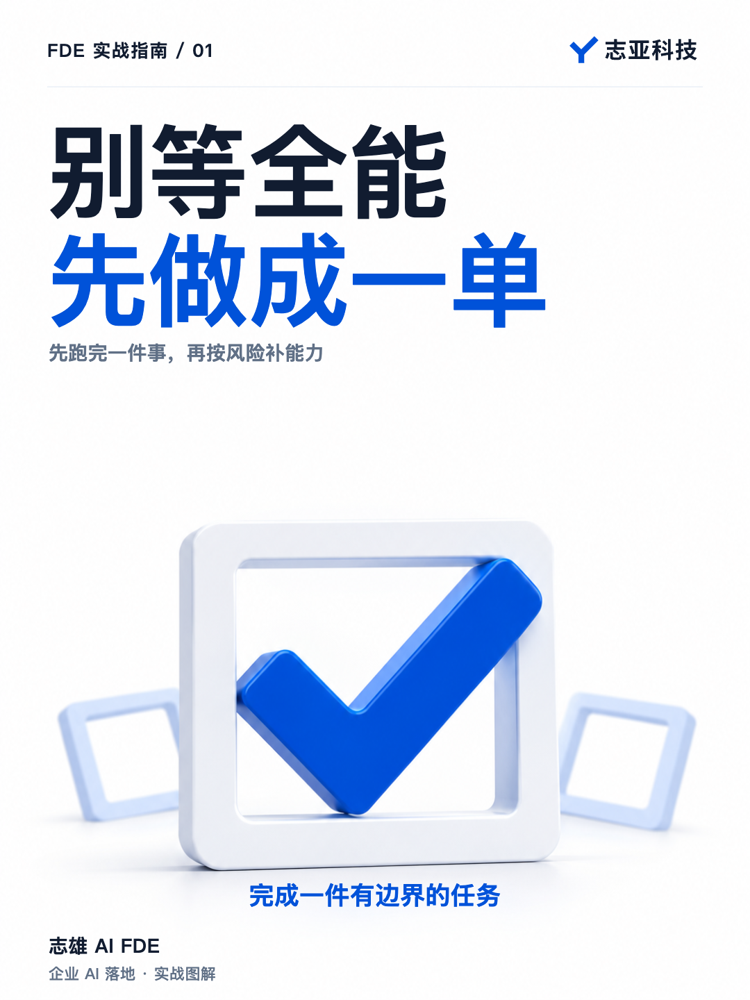
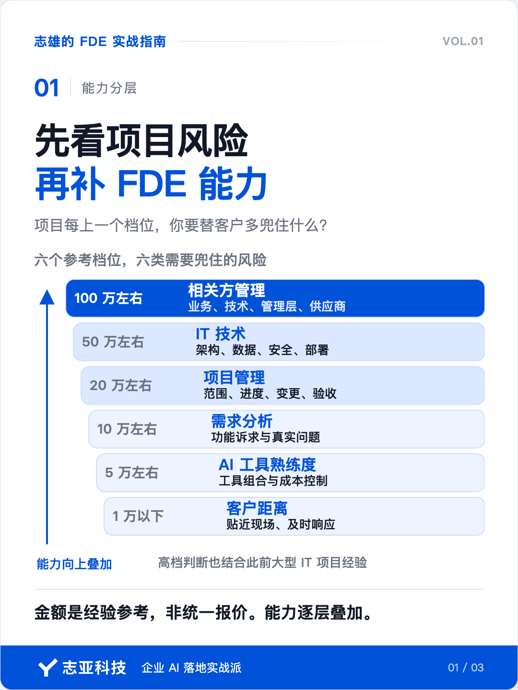
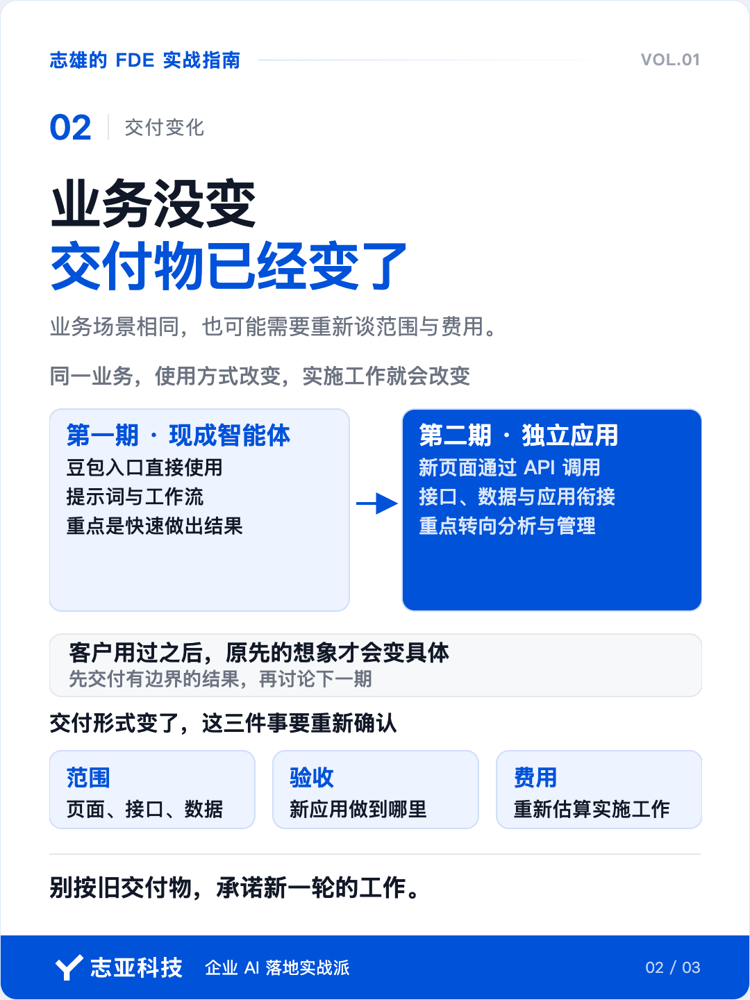
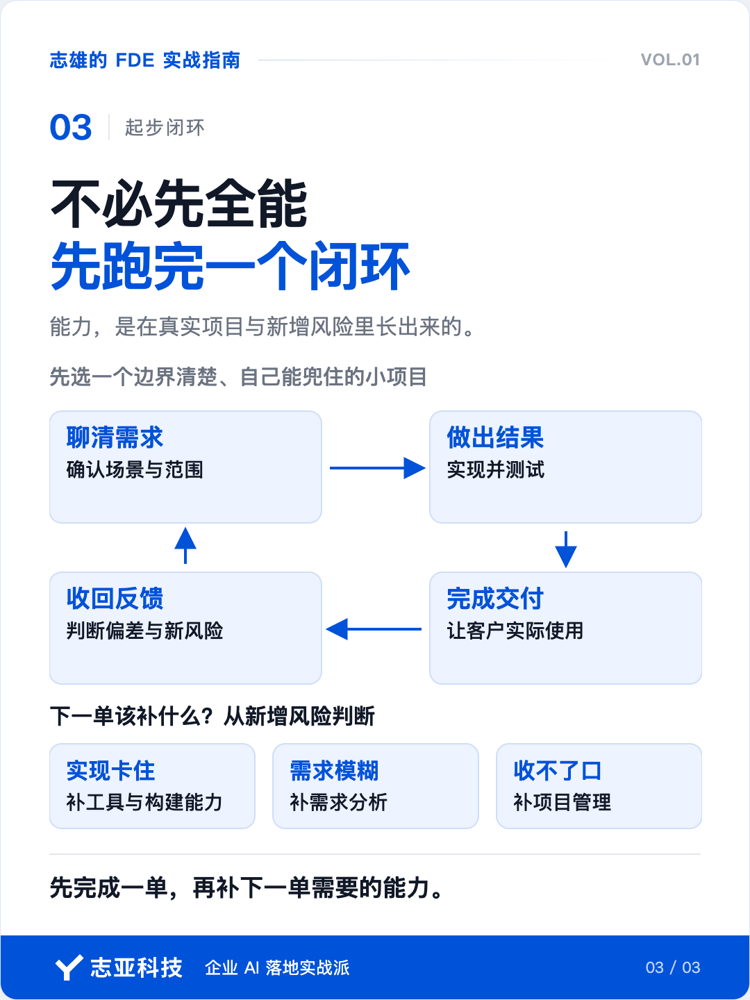

# 做 FDE，要先成为全能工程师吗

**志雄 FDE 实战指南 · 志亚科技出品** 
作者：白志雄｜武汉市志亚科技有限公司

[返回阅读目录](../README.md) · [查看本篇图卡](#配套图文卡片)

一提 FDE，很多人想到的，是一个几乎什么都会的工程师。

要懂业务，要写代码，还得进客户现场，把 AI 项目交付掉。

如果你以前只做开发、产品或项目管理其中一环，听完很容易觉得自己还差得远。

但谁又能一开始就「什么都会」呢。

以我为例，转岗做项目经理负责的第一个项目，不过才 1 人月，慢慢做到数人月，数十人月。

现在创业也是，从头来过，最开始接智能体交付的单子便宜的才 200，再到几千，几万。

所以，我对 FDE 的定义和能力分层，都是一单一单干出来的。

### 1、为什么怕不够

你要是在软件公司做过项目，就知道一个项目从来不是靠一个人把所有环节干完。

产品经理谈需求，开发写代码，项目经理管进度，实施把系统带进客户环境。

你把自己负责的那段做好，已经很专业了。

自己出来接 FDE 项目，这些事会一起摆到面前，担心能力不够很正常。

前面说到，我最早接的智能体单子，一单才几百块。

但同时，需求也简单，和客户把一个场景聊明白，做出来、测试没问题，就能交付。

这样的小单，让我从零跑通了项目闭环。

那时候，最管用的是离客户近、回应快。

### 2、项目会变形

后来有一单内部培训智能体，更让我看清项目是怎么变难的。

来找我的是合作方，终端客户的想法要经他转过来。

客户最初说想用小程序或 H5，聊到后面，又决定先让员工在豆包里用。

我按确认的范围交付了两个智能体，一个做 MBTI 测试，一个做销售话术学习和演练。

结果一试，客户发现自己要的是独立应用。

于是项目进入第二期，原来的工作流要通过 API 接到新页面。

你看，业务场景没变，交付物已经变了。

第一期重点是用好现成工具，快速做出结果。

第二期得重新谈清页面、接口、数据和验收，费用也要重估。

客户一开始没说准，我能理解。

没用过之前，他只能按熟悉的产品去想象。

先交付一个有边界的结果，他用过之后，真正的需求才浮出来。

这时 FDE 要补的，就从工具熟练度转向需求分析和项目管理。

### 3、我的六档判断

如果你现在问我，FDE 该先练哪种能力，我会先问你准备接什么样的项目。

我把两次从小项目往上做的经历，整理成六个参考档位。

**1 万元以下，看客户距离。** 贴近现场，听懂问题，及时回应，把小结果做出来。

**5 万元左右，看 AI 工具熟练度。** 会选工具、会组合，也能控制成本。

**10 万元左右，看需求分析。** 分清客户说的功能和真正要解决的事。

**20 万元左右，看项目管理。** 控住范围、进度、变更和验收，让项目收得住口。

**50 万元左右，看 IT 技术。** 架构、数据、安全和部署，要撑得起长期运行。

**100 万元左右，看相关方管理。** 让业务、技术、管理层和供应商朝同一个目标走。

百元到十万元级，是我创业后亲自走过的交付路径。

二十万元及以上的判断，更多结合了此前做大型 IT 项目的经验。

这些金额不是硬门槛，也不是统一报价。

真正值得看的，是项目每上一个档位，你要替客户多兜住哪一类风险。

能力会叠加，不会换了一档就把前面的丢掉。

### 4、说到最后

你现在想做 FDE，我建议先找一个边界清楚、自己能兜住的小项目。

聊清需求，做出结果，完成交付，收回反馈，先走完一个闭环。

接更大的项目时，再问自己，新出现的风险是什么。

要补工具、需求分析，还是项目管理，你就从这里判断。

我两次从小项目往上走，靠的都是这样一单一单把能力长出来。

## 配套图文卡片

### 先看项目风险，再补 FDE 能力

### 业务没变，交付物已经变了

### 不必先全能，先跑完一个闭环

---

志亚科技出品。个人非商业学习和使用免费，商业使用须事先取得书面授权。

[使用许可](../LICENSE) · [作者与联系](../README.md#作者与联系) · [返回阅读目录](../README.md)
