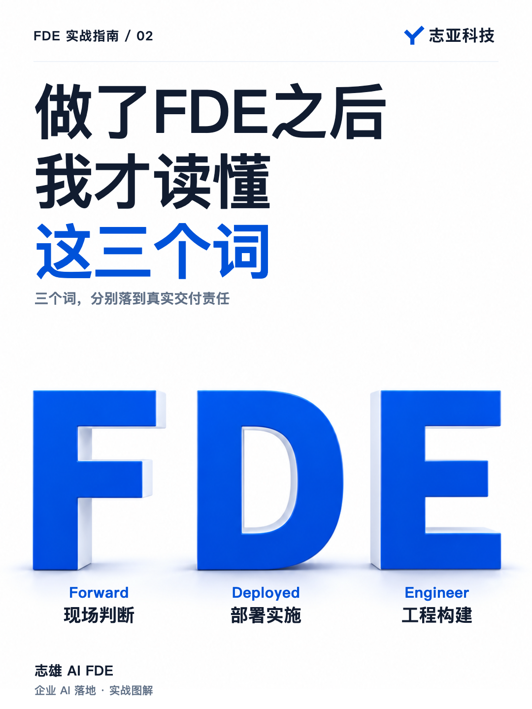
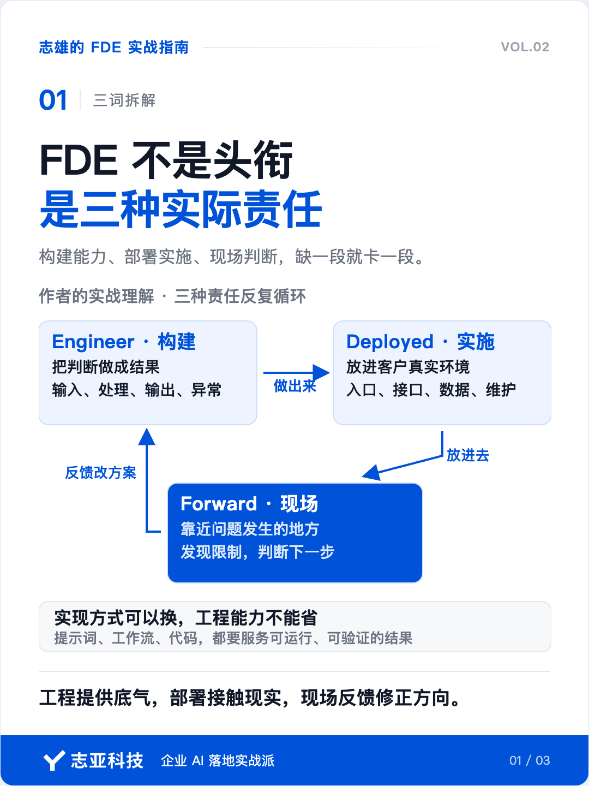
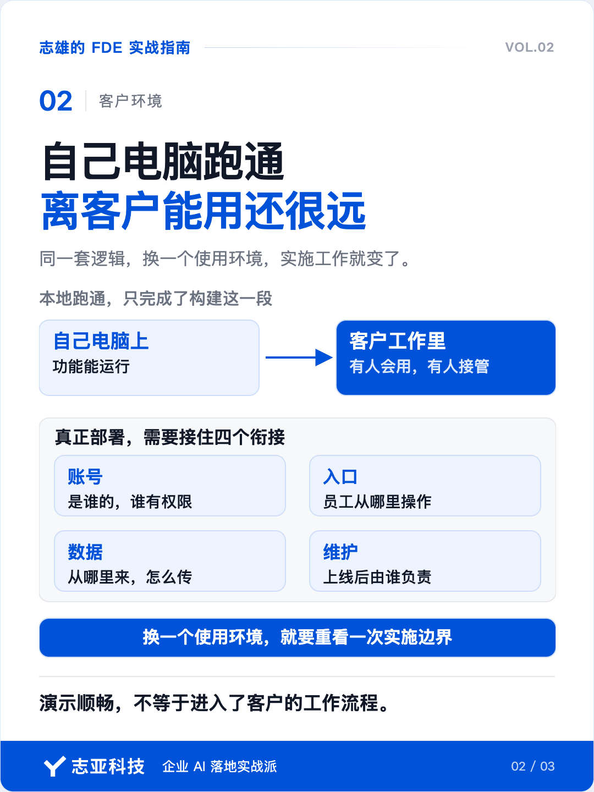
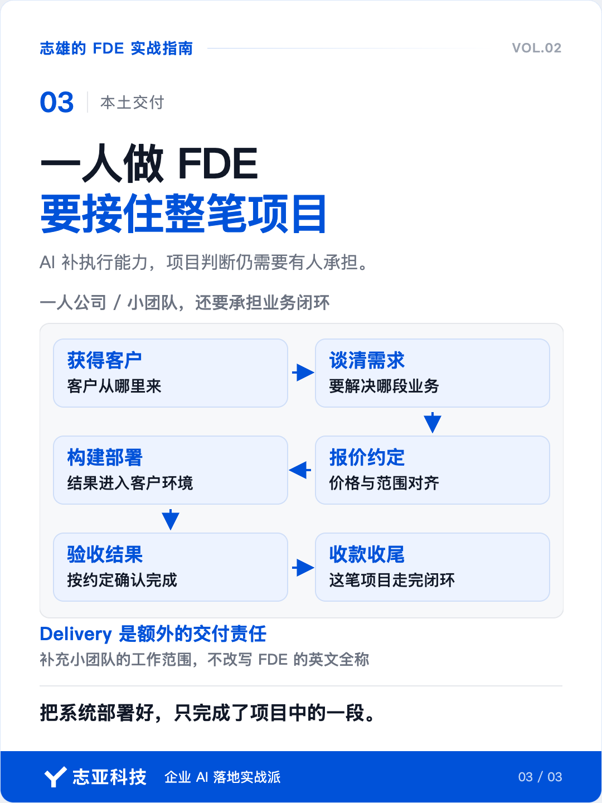

# 做了FDE之后，我才读懂这三个单词

**志雄 FDE 实战指南 · 志亚科技出品** 
作者：白志雄｜武汉市志亚科技有限公司

[返回阅读目录](../README.md) · [查看本篇图卡](#配套图文卡片)

FDE，前沿部署工程师。

懂业务，也懂技术，到客户一线把 AI 落地。

关于 FDE，你大概已经看过不少这样的介绍。

这句话不难理解。但背下来之后，你能说清自己到客户那里，到底要负责什么吗？

从知道一个岗位叫什么，到知道自己该怎么做，中间还差了一层。

我想借以前辩论时用的一个方法，把这一层讲清楚。

辩论赛通常由双方一辩开场，要做一件事，叫**「开宗明义」**。不是上来就摆论据，而是先说清楚，今天双方讨论的到底是什么。

同一个词，你在什么场景下理解，我在什么背景下使用，得先对齐。

否则，两个人说的根本不是一回事，后面的道理讲得再好，也接不上。

定义在这里，是给后面的论证定一个共同的起点。

今天我们讲 FDE，也应该沿用这个思路。不然很可能出现大家说的都有道理，但站在错位的场景中就是正确的废话。

我的场景很明确，就是一个人或一个小团队，给中国的中小企业做 AI 项目。

这是我创业后，从几百元的智能体交付，一路做到万元级项目所经历的事情。

放在这个场景里，「懂业务、懂技术」就需要继续往下解释。

业务要理解到哪一步？技术要做到什么程度？做出来之后，怎么才能让客户真正用起来？

这些问题，光背一个岗位定义，回答不了。

但把项目里实际做的事情，放回 Forward Deployed Engineer 这三个词里，你会发现，它们恰好能帮我们把能力和责任分清楚。

专业度也就从这里开始建立。你不只知道这个词，还能结合事实，讲清楚自己为什么这样理解。

所以，这三个词，我们得拆开看。

### 1、先看工程师

为什么从它开始，因为这是地基。不管如何分类，加多少前缀，最终的落脚点都在 Engineer。

提到工程师，我们很容易想到写代码。可我做智能体交付时，有的功能靠提示词，有的靠工作流，有的必须写代码。

实现方式可以换，工程能力不能省。

我和客户聊销售培训智能体时，对方想加入「先学习，再测试」的功能。听起来只是在对话里加两个环节，但只要继续往下想，就会碰到学习进度的问题。

学员中途离开，下次从哪里继续？系统怎么知道他学过什么？

这时，你就得把身份、状态、数据和交互拆清楚，再判断用什么方式实现。

**这就是 Engineer 的核心，是用系统性方法，把问题做成一个能运行、能验证的结果。**

会写代码是其中一种能力。能把输入、处理、输出和异常想清楚，才知道代码应该写在哪里。

所以原来做产品、做项目的人，也有自己的工程思维基础。你要补的是把判断变成结果的能力，不能停在文档和建议上。

### 2、再看部署

Deployed 这个词很有意思，字面上，被部署到一线的是工程师。

到了项目里，这个人又要把做好的方案，放进客户的真实环境。

这就比「我在自己电脑上跑通了」多了一层要求。

还是销售培训那个项目，给客户一个智能体对话入口，和接入他已有的小程序，就是两种不同的部署场景。

前者可以围绕智能体的使用方式设计。后者就要考虑页面怎么调用接口、数据怎么传、谁来负责集成。

同一套逻辑，换一个使用环境，实施工作就变了。

**所以 Deployed 对应的是围绕客户环境的定制开发和部署实施能力。**

这里的部署，包含让人真正用起来所需要的那些衔接。

账号是谁的，入口在哪里，数据从哪里来，后面怎么维护，都要有人接住。少了这些，演示时再顺，也可能进不了客户的工作流程。

### 3、前沿在哪

轮到 Forward，很多人会自然联想到技术前沿。

做 AI，当然要了解新东西。但从我做项目的经验看，这个词更重要的含义，是你站在哪里。

你是在等别人把需求整理好，还是已经走到了问题发生的地方？

如果只说「现场」，Field 也能表达这个意思。看 Forward，我更看重里面向前推进的姿态。

客户说想做一个智能体，你要往前了解，他到底拿它做什么。谈到学习进度，你还得继续判断，原来的方案能不能承载。

你靠近现场，才有机会在事情还没做错之前调整方向。

**在我的能力模型里，Forward 对应现场判断力，以及帮助客户看清方向的能力。**

这个判断也不能凭空来。你得做过、部署过，知道方案在哪里会受限制，给出的建议才有分量。

三个词到这里就接上了。

Engineer 把判断做出来，Deployed 把结果放进去，Forward 从真实使用里发现新情况，再回来修改方案。

它们会反复循环。工程能力提供底气，部署让你接触现实，现场反馈又帮助你判断下一步。

### 4、放回中国项目

FDE 是个舶来岗位名称，到了国内的项目，到了中小企业项目，还要再往前想一层。

背靠技术平台做交付，身后可能有销售、研发和支持团队。自己出来做一人公司，这些事情总得找到人负责，很多时候就是自己。

客户从哪里来，需求怎么谈，价格怎么报，做完怎么验收收款，都在同一个项目里。

所以我会用 Delivery，也就是交付，来理解小团队多出来的那部分责任。

这没有改变 FDE 的英文全称，而是在说明我们实际承担的工作。把系统部署好，只完成了其中一段；我还要把这笔项目从需求接到交付。

AI 帮我们补了很多执行能力，但它没有替我们接走这些判断。

**我做的 FDE，就是用工程能力把方案做出来，在客户环境里把它落下去，再根据现场反馈，持续把事情往约定的结果推进。**

这套解释能同时回答，我要会什么，我在做什么，以及我为什么要做这些。

### 5、说到最后

现在再看「前沿部署工程师」，它就不只是一个听起来新鲜的头衔了。

三个词分别落在构建能力、实施动作和现场判断上，又被同一个项目连起来。

我愿意花时间把定义拆清楚，就因为它会影响后面的每一个动作。工程能力缺在哪里，部署为什么卡住，方向什么时候该调整，你得有自己的判断依据。

专业感也从这里长出来。

别人听过一个名词，你能把它解释到实际工作里。别人继续追问，你还能说清为什么这么做，什么情况下要换一种做法。

这才是作为一个实践者，重新解释 FDE 的价值。

## 配套图文卡片

### FDE 不是头衔，是三种实际责任

### 自己电脑跑通，离客户能用还很远

### 一人做 FDE，要接住整笔项目

---

志亚科技出品。个人非商业学习和使用免费，商业使用须事先取得书面授权。

[使用许可](../LICENSE) · [作者与联系](../README.md#作者与联系) · [返回阅读目录](../README.md)
