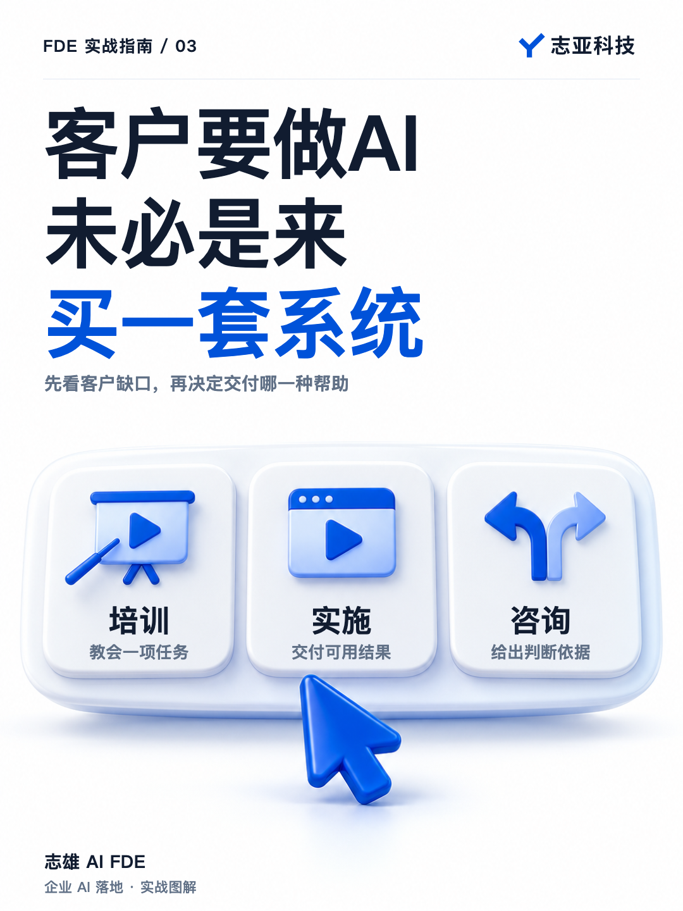
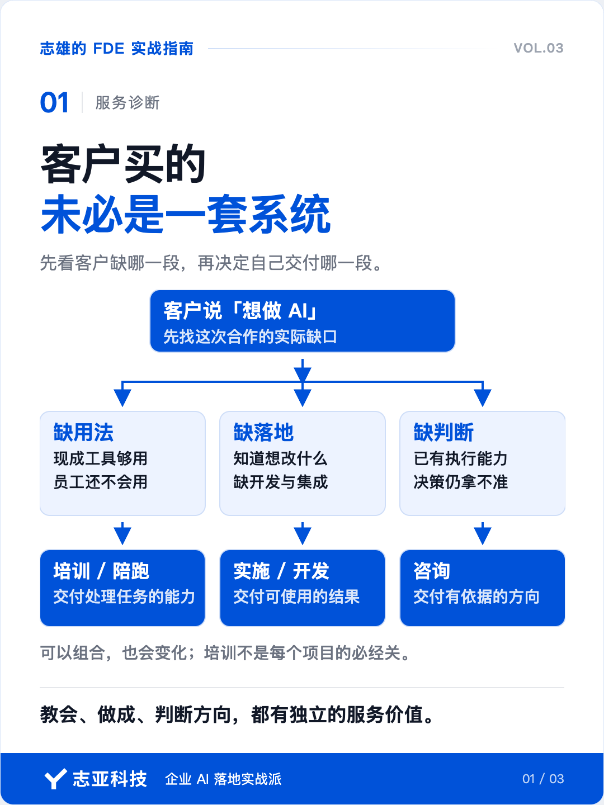
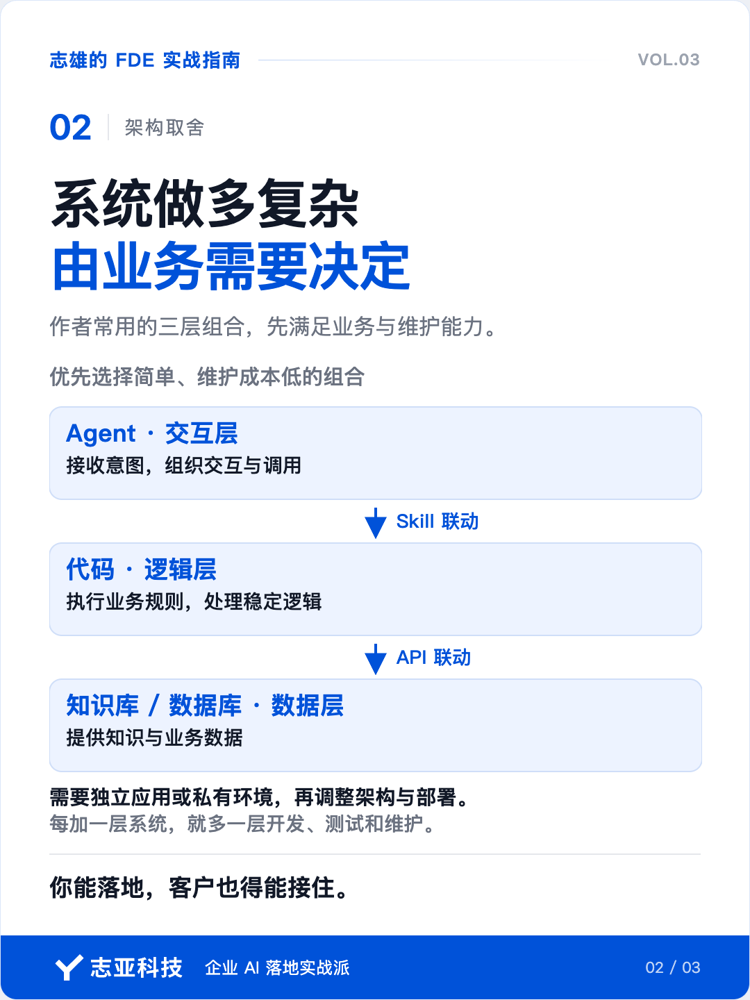
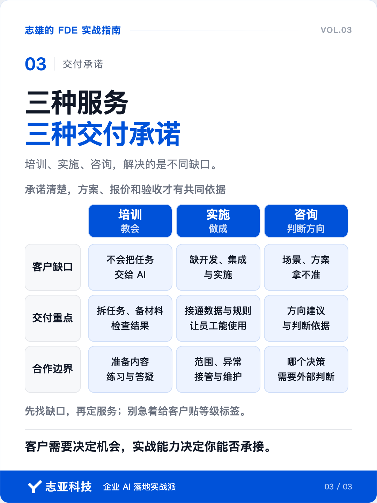

# 客户找你做 AI，未必是来买系统的

**志雄 FDE 实战指南 · 志亚科技出品** 
作者：白志雄｜武汉市志亚科技有限公司

[返回阅读目录](../README.md) · [查看本篇图卡](#配套图文卡片)

刚开始做 FDE 时，我很难理解，为什么有人愿意为培训和咨询付钱。

聊一个小时，收几百块，客户到底买到了什么？

因为技术出身，总觉得要交付一个实实在在、能用起来的工具或软件，这笔钱才挣得踏实。

但真正开始做交付，现实很快告诉了我原因。

因为不少客户其实是不够了解 AI 的，要让他认同方案的价值，就得先讲 AI 能做什么、不能做什么，以及这些能力跟他的工作有什么关系。

早期我很热衷于讲这些。总觉得认知对齐了，后面的项目才好推进。

讲着讲着才发现，项目还没开始，时间已经花出去不少。

**成交了，前期售前投入太多；没成交，这些时间全部成了沉没成本。一个人根本耗不起。**

于是，我认识到了培训和咨询作为单独付费服务的作用。

客户愿不愿意花钱补齐认知、请人帮忙判断，也能让我看见他有没有认真投入这件事。后续再谈实施，就多了一层合作基础。

更重要的是，这个过程让我认清一件事，客户需要的帮助，未必都得做成软件。

**少花时间摸索，把一个任务学会，为一项决策找到依据，这些本身就值得付费。**

所以说即便企业都在说想做 AI，但最后付钱买的东西，可能完全不同。

有的需要你教员工把现成工具用起来，有的需要你围绕业务做一套应用，还有的自己就有技术团队，需要你帮他判断方向。

都叫 AI 落地，在不同阶段，交付的却是三种不同服务。

这件事如果一开始没分清，很容易出现一种错位。你准备聊开发，客户还没弄明白 AI 能做什么；你准备讲工具，对方已经在等你给架构建议。

**因此做 FDE，得先看客户缺的是哪一段，再决定自己交付哪一段。**

### 1、先看客户缺什么

场景界定 · 服务分层

如果背靠成熟平台或产品做 FDE，现场的重要工作，是判断这些能力怎样进入客户的业务，再完成必要的适配和部署。

其次还要想清楚，这次究竟需不需要开发，现成工具够不够，应该以什么形式交付。

这些问题，都会直接影响方案的起点。

我往往优先考虑简单、维护成本低的组合。几乎是一招鲜吃遍天。

- Agent 交互层
- 代码 逻辑处理层
- 知识库、数据库 数据层

这套组合里，Agent 按 Skill 调用代码，代码通过 API 连接知识库或数据库。交互、业务规则和数据各有位置，调整其中一层时，就知道需要检查哪些连接。

以 WorkBuddy 配合多维表格为例，在连接器支持所需操作、权限也已开通的前提下，可以让 Agent 按 Skill 调用增删查改。明确的业务规则交给代码，重复任务安排自动化，数据展示先用表格里的看板。

如果客户确实需要独立应用，再考虑把多维表格换成数据库，单独开发管理页面和后台。Agent 也可以评估 Hermes 等部署方案，但换平台要重新核对接口、权限和运行方式，不是换个名字就能接上。

有私有环境要求，还要检查模型调用和数据流向。Agent 部署在自己的服务器上，不等于所有数据都留在内部。

**能把业务解决到什么程度，才决定系统要做多复杂。**

对小团队来说，每加一层系统，就多一层需要开发、测试和维护的东西。因此一定要考虑到客户预算和后续使用能力，确保你能落地，客户也得能接住。

### 2、缺用法，就教会他

Engineer · 培训陪伴

一类客户的工作，用现成工具已经能解决，但员工还不知道怎样把任务交给 AI，也不知道怎么判断结果能不能用。

这时，培训和陪跑就有直接价值。

讲清楚一个任务该怎么拆、材料怎么提供、结果怎么检查，再让员工拿自己的工作跑一遍。交付的是他们处理这类任务的能力。

这一层体现的是 Engineer 的工程能力。工程思维可以用在应用层，教人系统地解决问题，同样需要你把方法想清楚。

**但培训在企业服务里还有一个作用，把双方的认知拉到能够谈需求的程度。**

当认知对齐已经超出正常售前沟通，需要专门准备内容、带着练习和持续答疑，就应该明确这项服务的目标、范围和费用。客户付出的时间和费用，也让双方更容易判断是否适合继续合作。

培训不是每个项目都必须经过的一关。客户已经会用，就往下一步走。

### 3、缺落地，就做实施

Deployed · 实施交付

另一类客户已经知道自己想改哪段流程，也能提供现有的做法和材料，但缺人把方案做出来、接进工作中。

这时，服务重心就到了 Deployed。

需要处理的事情会变得具体。数据从哪里来，业务规则怎样执行，员工在哪里操作，异常怎么处理，做完由谁接管。

标准工具能完成的部分直接使用，不够的地方再做定制。重点是把整条业务链路接通。

**这一层卖的是可使用的结果，不能以「功能演示过了」作为终点。**

对原来做开发、产品或项目经理的人，这也是已有经验能发挥作用的地方。

开发经验帮助你判断实现和稳定性，产品经验帮助你还原场景和流程，项目经验帮助你管理范围、进度、风险和验收。AI 可以帮你补相邻环节的执行，专业判断仍然要由你来做。

以我为例，其实做项目经理时积累的范围、进度、风险和验收经验，直接无缝接入当下的 FDE 交付过程。只是借助 AI 补上构建能力，就更容易把一个范围清楚的项目独立做完。

### 4、缺判断，就给方向

Forward · 方向咨询

还有一类客户，自己也能动手开发。他找外部的人，是因为有些决定拿不准。

哪些场景值得先做？现有方案有没有绕远路？哪些环节适合用模型，哪些应该由确定性的代码处理？

这时，再教一遍工具，或者急着承包开发，都没有回应他当前最需要的帮助。

这类服务的重心落在 Forward。交付的是有依据的方向判断，让客户知道下一步为什么这样走。

**咨询的分量，来自你对实施的理解与成果经验，交付的是一种确定性和最佳实践。**

做过实际交付，才知道一个建议背后需要多少数据准备、会碰到哪些限制、上线后由谁维护。否则方案写得再完整，也可能只是把实施难题留给别人。

咨询能力可以沿着这条路径积累。先能教清楚、做出来，在反复交付里形成判断，再用这些判断帮助客户选择方向。

客户的需要可以让你发现机会，已有的实战能力决定你能不能承接这个机会。

### 5、说到最后

核心收口 · 三种承诺

培训、实施、咨询，描述的是客户当下需要的帮助。一个客户也可能同时需要其中两种，或者随着项目推进发生变化。

所以别急着给企业贴上初级、高级的标签。而是先把这次合作要解决的缺口找出来。

判断这次该提供什么服务，我们可以看三个问题。

现成工具够不够用，客户会不会用？如果不够，缺哪段开发和集成？如果他们已经有执行能力，究竟是哪一个决定需要外部判断？

**教会、做成、判断方向，是三种不同的承诺。承诺清楚了，方案、报价和验收才有共同的依据。**

你在乙方，就据此决定提供什么服务；你在甲方，就据此判断应该购买什么能力，以及自己还要组织谁来配合。

而一个人做 FDE，就可以从其中一个边界清楚的小服务开始。先让客户在真实工作里得到结果，再随着能力和信任扩大交付范围。

## 配套图文卡片

### 客户买的，未必是一套系统

### 系统做多复杂，由业务需要决定

### 三种服务，三种交付承诺

---

志亚科技出品。个人非商业学习和使用免费，商业使用须事先取得书面授权。

[使用许可](../LICENSE) · [作者与联系](../README.md#作者与联系) · [返回阅读目录](../README.md)
