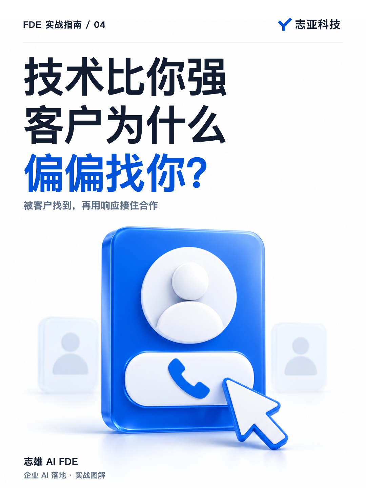
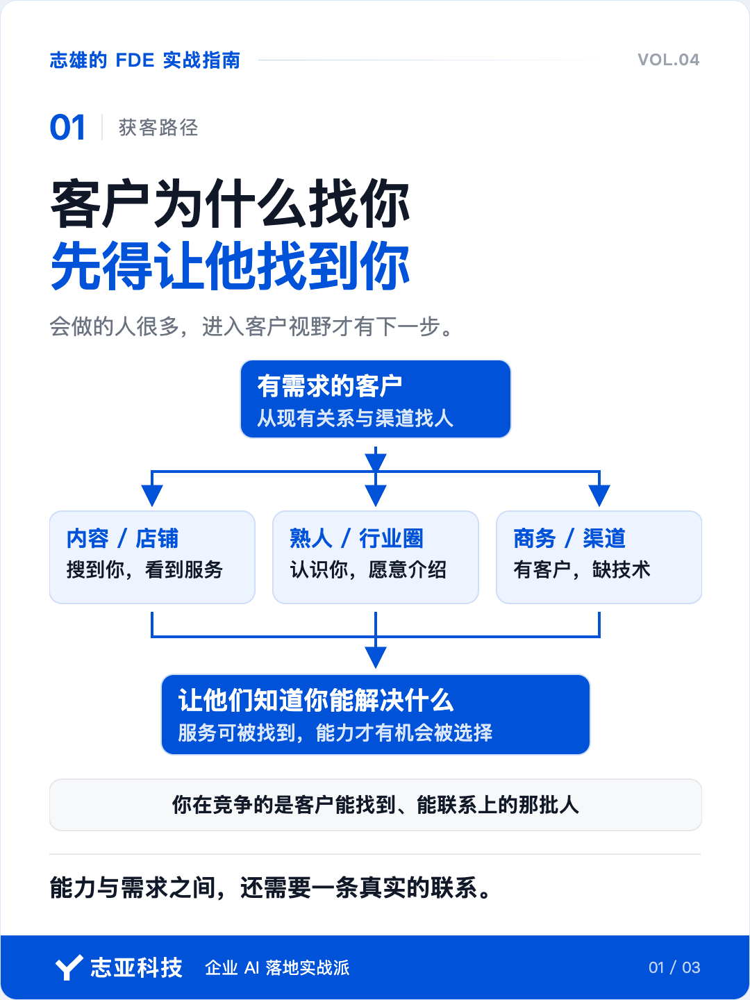
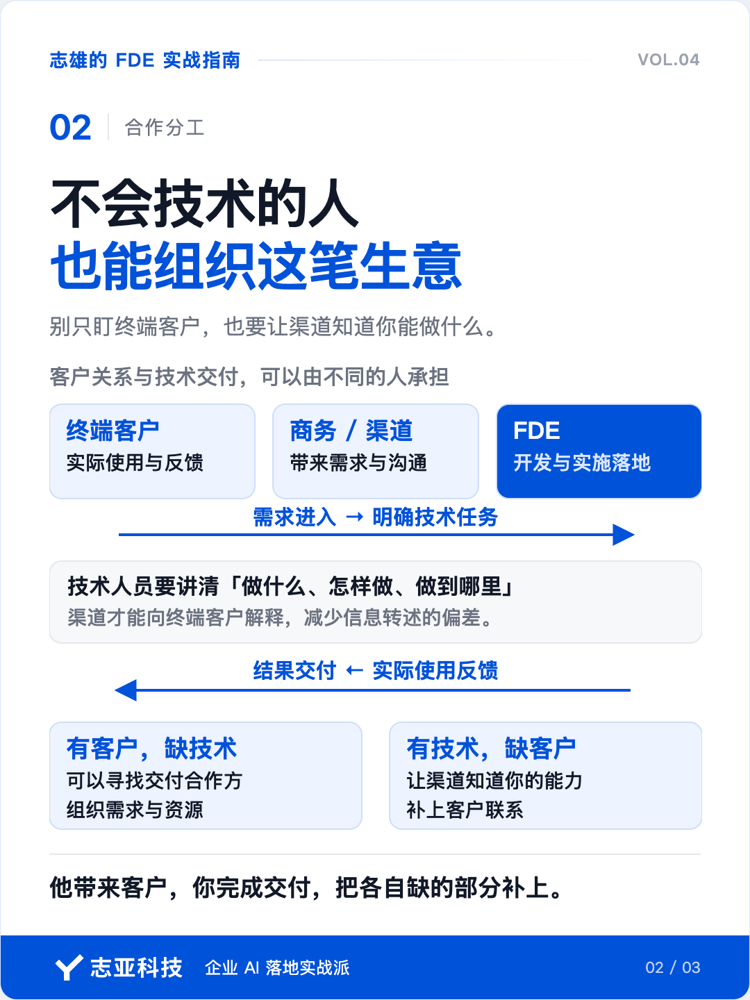
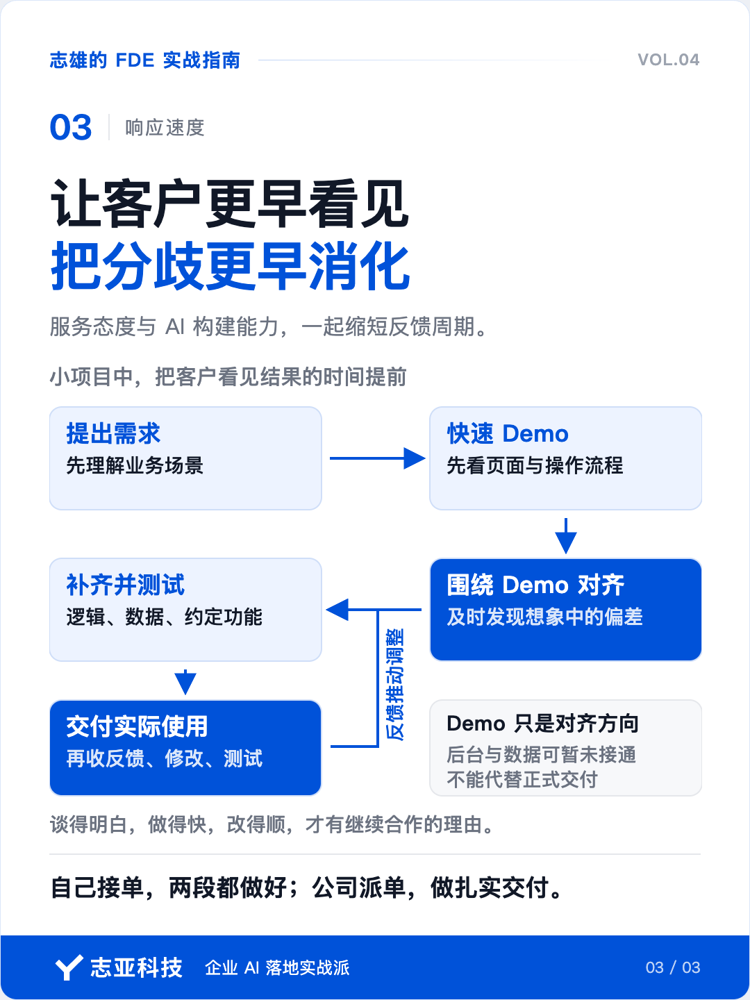

# 技术比你强的人很多，客户为什么找你做 AI？

**志雄 FDE 实战指南 · 志亚科技出品** 
作者：白志雄｜武汉市志亚科技有限公司

[返回阅读目录](../README.md) · [查看本篇图卡](#配套图文卡片)

还是前两篇文章提到的那个案例，我最开始以为对接人就是最终客户。

需求调研阶段，对方反复问，要做几个工作流，每个工作流分别负责什么，问得特别细。

我心想，这个客户还挺好学哈。

直到有一天聊出来一句，「因为我们要跟客户解释这件事」，我才恍然大悟，原来背后还有一层。

所以你看，不会技术，也一样能靠渠道、客户关系去承接订单。

这就得意识到，我们的客户可以是那些和终端客户有联系、但缺少技术能力的人。他们接到需求，再来找我们完成开发、实施落地，这也是一种合作方式。

身边那些做渠道、做商务、做平台的人，其实都可以成为这样的客户。

**能做这样项目的人很多，但终端客户先找到的是他们，这个距离就具备商业价值。**

### 1、不会做也能接单

早期做百元级智能体交付，我主要通过闲鱼和小红书获客。

有人知道我在做智能体开发，就联系我，让我加入他们的接单组织。

那时才发现，原来还有一批人专门做线上流量。他们只负责开店，甚至平台前几页的不同店铺，背后都通向同一个接单平台。

客户从不同的店铺进来，需求汇总到一起，再交给我们这些独立开发者去做。

我当时挺震惊。有人一点技术都不会，靠做流量、承接资源，这个生意照样能做。

我们在研究怎么把智能体做出来，他们在研究怎么让有需求的人找到自己。

**谁能接触到客户，谁就有机会组织这笔生意。**开发是其中很重要的一环，获客同样有人在专门做。

这也解释了为什么一个技术人员明明能做，却一直没有订单。你的能力和客户的需求之间，还缺少一条联系。

### 2、你得让人找到

现在看这个标题，答案就没那么复杂了。

客户为什么找你做 AI？因为他通过自己现有的关系和渠道，找到了你。

他可能搜到了你的店铺，看到了你的内容，也可能是认识的人把你介绍给他。至于技术比你强的人，他未必知道，更未必联系得上。

**你在和谁竞争，取决于这个客户能找到谁。**

很多人一准备接单，就去看行业里最厉害的人。看到头部主播、头部品牌已经有那么大的知名度，就觉得自己没机会了。

但知名度再高，也覆盖不了每一个具体客户。用户群体足够大，总有人还在问身边的朋友，这件事有没有人能做。

你能走近这群人，机会就还在。

所以，刚开始做 FDE，得让周围的人知道，你已经在提供什么服务，能解决什么问题。朋友圈、行业群、线下交流，都可以产生这样的联系。

也别只盯着终端客户。认识客户、会做商务的人，同样可能需要你。他负责把需求带进来，你负责技术交付，两个人就能把各自缺的那一段补上。

**对独立开发者来说，让渠道知道你能做什么，和让终端客户知道你能做什么，同样重要。**

### 3、找到以后怎么办

上面讲的是找客户。有的 FDE 可能会说，我就在公司上班，客户是公司谈好的，我负责后面的交付。

那没问题，前面这一步就省掉了。

但同公司、同平台，技术比你强的人也不少。客户凭什么认可你，后面有事还愿意找你？

**这个时候，靠的是响应速度。服务态度和 AI 构建能力，要一起发挥作用。**

我们熟悉的一种软件实施流程，是先调研需求，再做产品设计。需求和设计确认之后，开发工程师开始编码、自测，再交给客户做 UAT，也就是用户验收测试。

麻烦在于，有些问题在看文档、看设计的时候，根本发现不了。客户觉得自己看懂了，等系统真正用起来，才发现跟想象中不一样。

这时再改，开发已经做完了，工期也快到头了。谁理解错了，算修改还是加需求，成本由谁承担，很容易就在这里扯起来。

有了 AI，做这类小项目，就应该把客户看到结果的时间提前。

**客户提需求，尽快把 Demo 做出来，让他直接看。**

把原来单独画设计、反复确认文档的环节，合并到围绕 Demo 的沟通里。页面什么样，流程怎么走，操作之后得到什么，客户一看就能给出更具体的反馈。

Demo 阶段，后台逻辑和数据可以先不全部接通。先把想法变成看得见的东西，双方才能更早发现，哪些地方想岔了，客户真正需要的又是什么。

方向确认后，再补齐逻辑和数据，把应用开发出来、测好、交付。AI 的构建能力，也应该体现在这段开发周期的缩短上。

后面出现调整，同样可以借助 AI 快速修改，再做测试，让客户尽快看到调整后的结果。原来最怕等到项目末尾才暴露的问题，就有机会在前面一轮轮消化掉。

客户能直接感受到的，是三件事。

**谈需求、看原型，效率高。**不用一直靠脑补，想法很快就能拿到眼前讨论。

**开发时间短、交付周期短。**确认之后，能尽快把约定的功能做出来，让他用上。

**改问题不磨叽，响应及时。**收到反馈后，愿意处理，也有能力迅速修改、测试，再给他看结果。

这才是技术加态度共同带来的响应速度。你愿意积极处理，AI 帮你加快构建，客户才能在整个实施过程中持续感受到高效。

### 4、说到最后

所以我一直说，万元以内的小项目，核心竞争力是和客户的距离。

这件事有两个先后相连的部分。

一是客户能找到你。你可以自己做内容、做渠道，也可以和已经拥有客户关系的人合作。会做的人很多，先进入客户的视野，才有机会谈下一步。

二是找到之后，你能让客户更快看到结果。需求用 Demo 来对齐，开发借助 AI 提速，反馈及时处理，再通过测试验证修改。

自己接单，前后两段都得做好。公司已经把客户交给你，就把后面这段交付体验做扎实。

**客户能找到你，是合作的开始。跟你谈得明白、做得快、改得顺，才有了继续找你的理由。**

## 配套图文卡片

### 客户为什么找你，先得让他找到你

### 不会技术的人，也能组织这笔生意

### 让客户更早看见，把分歧更早消化

---

志亚科技出品。个人非商业学习和使用免费，商业使用须事先取得书面授权。

[使用许可](../LICENSE) · [作者与联系](../README.md#作者与联系) · [返回阅读目录](../README.md)
