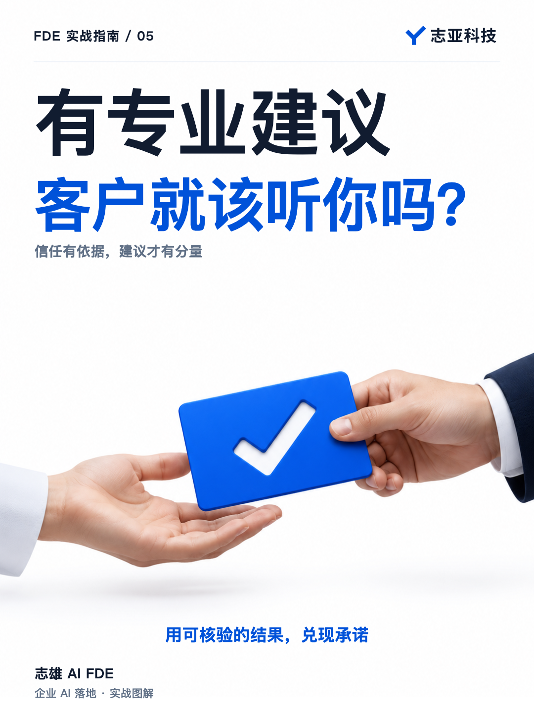
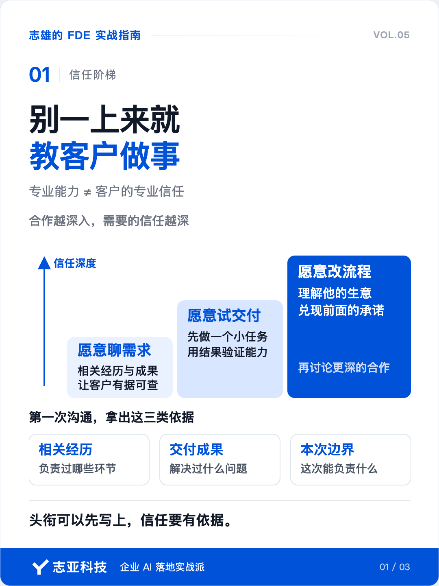
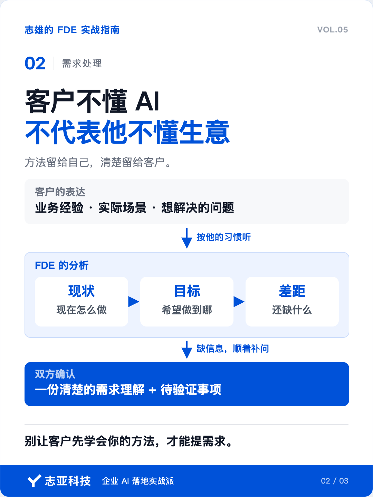
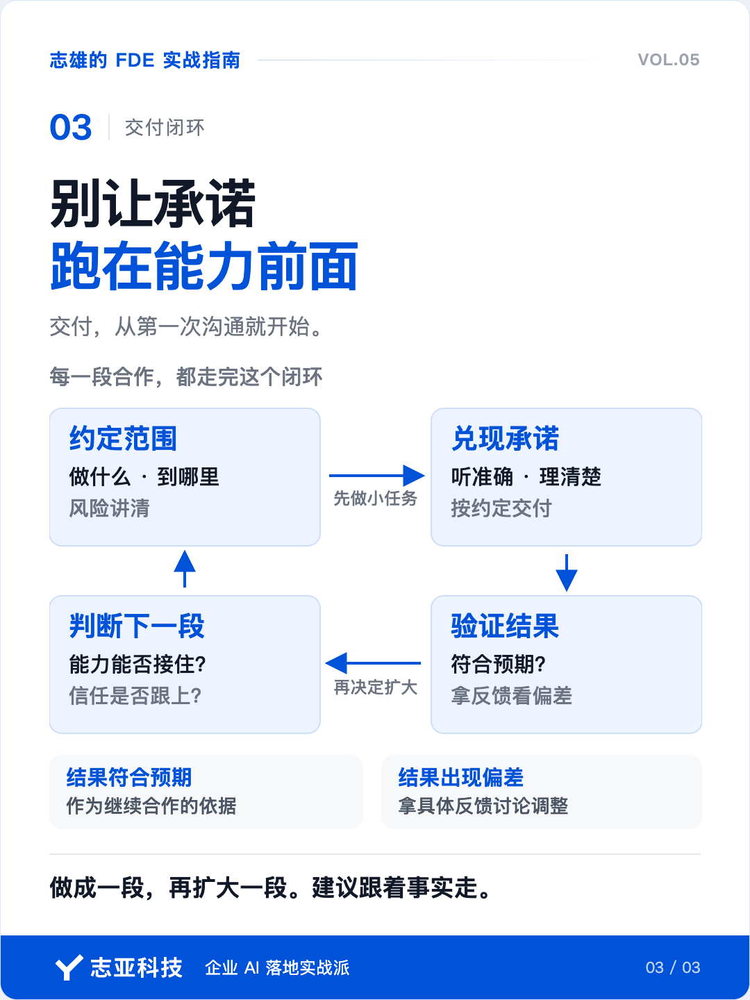

# 做 FDE，别一上来就教客户做事

**志雄 FDE 实战指南 · 志亚科技出品** 
作者：白志雄｜武汉市志亚科技有限公司

[返回阅读目录](../README.md) · [查看本篇图卡](#配套图文卡片)

经常能刷到一些讲 FDE 的帖子，说你是专家，不能只给客户做交付，还要把专业知识和优秀方法教给他，帮他发现业务里的问题。

听起来没毛病。能做到这些，相当有水平。

但这里漏了一个前提。就是你觉得自己专业，怎么让客户也这么觉得呢？

特别是第一次合作，东西还没做出来，对方还没见识过你的能力，你就开始告诉他，需求应该怎么提，流程应该怎么改。

这些建议可能都对，可客户为什么要听你的？

**有专业能力，和获得客户的专业信任，是两码事。**

但信任也不是等项目做完才开始建立。从客户了解你的经历，到第一次聊需求，再到拿到最终成果，他一直在判断，这个人到底靠不靠谱。

### 1、先有认可

在动漫火影忍者里，鸣人希望当上火影的原因是从小不被村里人接纳，他认为只有当上火影之后，才能被大家认可和喜欢。

但鼬是这么提醒他的，**不是当上火影的人才会得到大家认可，而是得到大家认可的人才能当上火影。**

做 FDE，也很容易把这个顺序弄反。

听到别人说这个岗位要引导客户、重塑流程，就以为换上这个头衔，自己自然有了指导客户的资格。

但客户对你的信任，不会随着岗位名称一起送过来。

人家愿意让你开发一个功能，和愿意让你改变他的工作方式，需要的信任程度不一样。前者可以先看交付，后者还要判断，你是不是真的理解他的生意。

**头衔可以先写上，客户愿意信你多少，还得有依据。**

### 2、拿出相信你的依据

第一次合作，别只介绍自己会什么。把跟这次项目有关的证书、工作经历和交付成果拿出来，让客户有依据判断。

做过类似业务，就讲清当时解决了什么问题。做过完整项目，就说明自己负责过哪些环节。有相关证书，也可以作为专业训练的背书。

**不是把履历全部摆出来，而是回答客户心里的疑问，这件事为什么可以交给你。**

还没有独立的 FDE 项目案例，也不用把自己包装成资深专家。过去做开发、产品、项目管理时积累的经验，同样可以成为起点。

讲清已经做过什么、这次能够负责什么，比堆几个头衔更有说服力。

这些背书值得主动积累和整理。它们不能保证这次一定做好，但能帮你争取一个让客户进一步了解你的机会。后面的合作，要接得住这份相信。

### 3、方法用在哪里

我在 2025 年开展项目时，也走过这个弯路，满脑子都是要把系统、科学的方法落实到位。

客户来聊需求，总想按一套既有框架套。先讲现在的场景，也就是 As-is，再讲希望达到的状态，也就是 To-be，然后按这个顺序把需求梳理清楚。

这样做对不对？对。这些都是有效的方法。

但客户会不适应。他原本是来找人把事情做出来的，聊着聊着，还得先学会按照我的方式表达。

特别是直接和老板谈小项目，别把他不熟悉 AI，当成他不懂自己的业务。他能把生意做到今天，自然有自己的经验和判断。

你熟悉 AI 和 IT，可以补上他缺的那部分，但没必要因此从头教他怎么做事。

**方法论应该帮助我们理解客户。让客户先学会配合方法论，反而可能增加合作的门槛。**

更合适的做法，是让客户按自己的习惯讲，你从中梳理现状、目标和差距。哪里还缺信息，就顺着他的话补问，再把整理的结果交给他确认。

**把方法用在自己的分析里，把清楚的结果交给客户。**

### 4、沟通也是交付

拿到沟通机会，就开始兑现前面建立的信任，别等系统做完才算交付。

调研时，把客户的意思听准确。聊完以后，把零散信息整理清楚。答应提供的资料，按约定给到。

已经确认的事情记下来，缺少依据的判断别急着承诺。暂时不能确定的地方，就说明还需要验证什么。

这些不是为了显得服务态度好，而是在让对方判断，事情交给你之后，还需不需要反复盯着、反复解释。

**每一次调研、每一次信息往来、每一份文件，都在让客户体验你的交付。**

这不等于售前要免费做完整方案。范围可以小，但已经答应的事情要做好。

客户不必知道你用了多少方法。他需要感受到，这件事经过你处理，确实更清楚、更容易往前走了。

### 5、让结果夯实信任

客户愿意尝试合作，就先把一个范围清楚的任务做好。

先接纳他已经说出来的想法，不急着推翻。方案还不够理想，但风险已经讲清、范围可控，客户也愿意为这次尝试付费，就可以先做一小段。

把这次做什么、做到哪里约定清楚，让双方都有机会检验，需求理解得对不对，合作是否顺畅。

客户没有做过这样的项目，有些问题靠解释，确实很难让他理解。拿到东西、自己试过之后，原来脑海里的想象才会变得具体。

结果符合预期，就有了继续合作的依据。出现偏差，就拿着具体反馈讨论调整，别继续争论谁的想法更专业。

**让客户看见你的能力，也让建议落在双方都看得见的事实上。**

一开始就大包大揽，把业务诊断、流程改造和整套系统都接下来，你对客户的了解还没跟上，承诺已经放出去了。

所以别急着扩大承诺。每做成一段，再判断下一段该做什么、自己能不能接住。

**建议要跟着事实走，合作范围要跟着交付能力和信任一起扩大。**

### 6、说到最后

下一次接触客户，不妨先检查三件事。

有没有拿出与这次合作有关的经历和成果，让对方知道为什么可以找你？

沟通和材料有没有帮他把事情理清楚，而不是让他先学会配合你的方法？

准备承接的任务，能不能在约定范围内做出结果，把前面的承诺兑现？

**这些事情都在为信任服务，而信任就是交付的核心基础。**

有了信任，客户才更愿意讲出实际情况、配合推进，也更愿意认真考虑你的建议。你把事情做好，又会让下一次合作有更扎实的基础。

不是做完项目才有资格提建议，而是建议要有依据，也要看双方的信任走到了哪一步。

别急着证明自己能教客户多少东西。让他在每一次接触里都能确认，把事情交给你，是靠谱的。

## 配套图文卡片

### 别一上来就，教客户做事

### 客户不懂 AI，不代表他不懂生意

### 别让承诺，跑在能力前面

---

志亚科技出品。个人非商业学习和使用免费，商业使用须事先取得书面授权。

[使用许可](../LICENSE) · [作者与联系](../README.md#作者与联系) · [返回阅读目录](../README.md)
