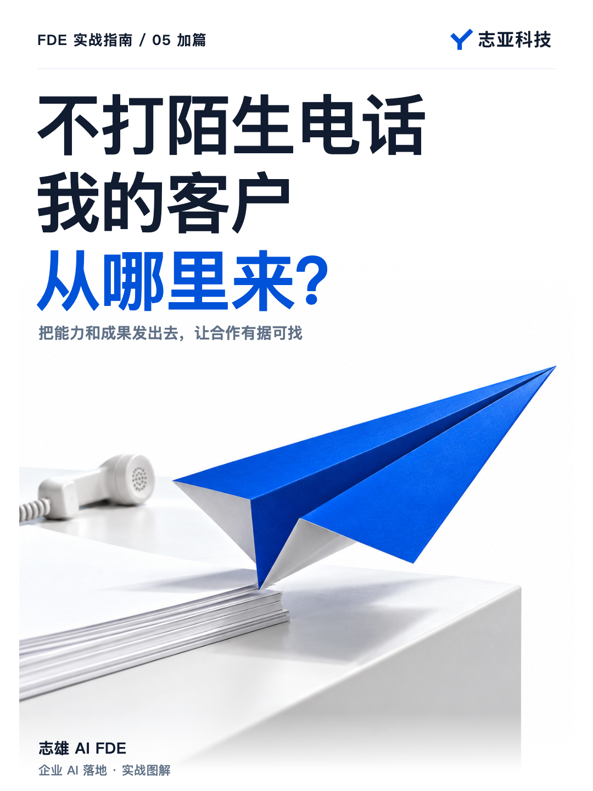
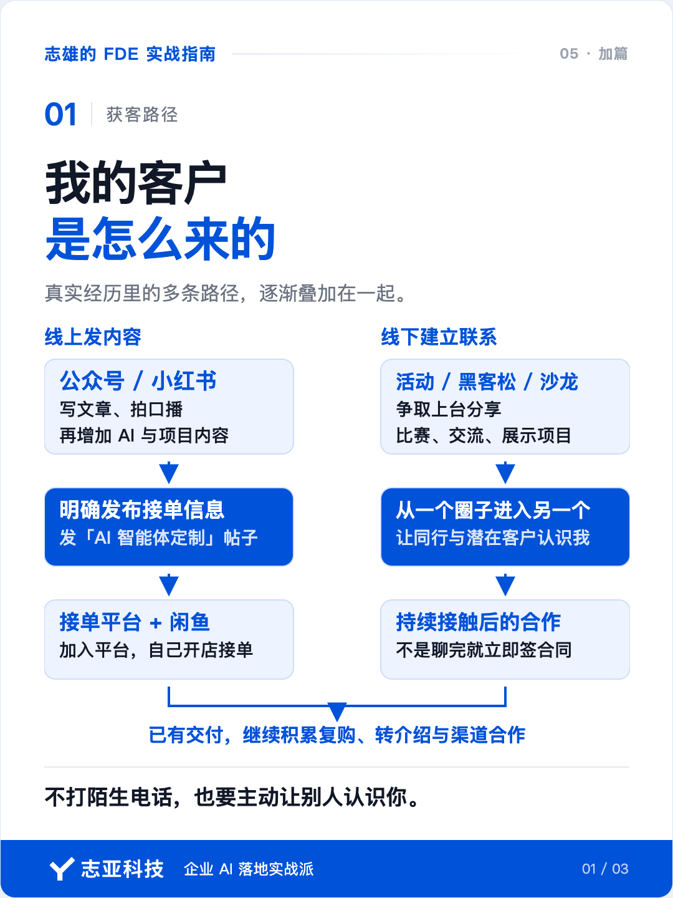
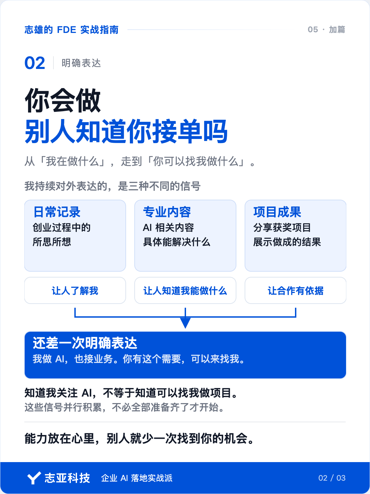
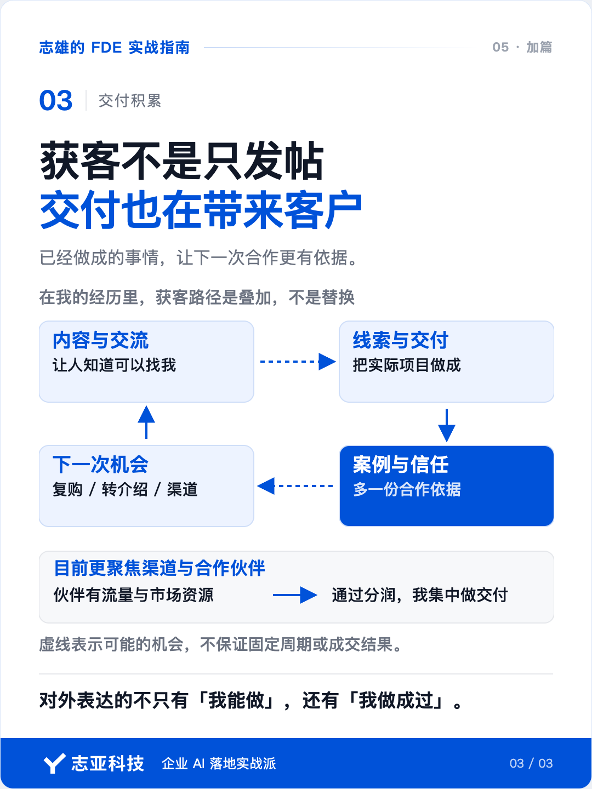

# 一个人做 FDE，我的客户是怎么来的

**志雄 FDE 实战指南 · 志亚科技出品** 
作者：白志雄｜武汉市志亚科技有限公司

[返回阅读目录](../README.md) · [查看本篇图卡](#配套图文卡片)

创业前最后一段销售经历，获客的方式很直接。

公司给一批潜在客户的电话，或者自己去找，然后一个个打过去。把自己和公司的业务介绍出去，换一个合作的机会。

这条路能做，但不是我喜欢的方式。出来做 FDE 之后，也不想继续这么干。

可不打电话，客户从哪里来？

后来走出来的路，是先让别人知道我在做什么，再让有需要的人找到我。

**不是坐着等客户，而是持续把自己能做的事情放到外面去。**

这篇不讲获客理论，就讲这些客户到底是怎么来的。

### 1、先让人知道你在干嘛

最初，我更新公众号和小红书，写文章，也拍口播视频。

内容并不全跟 AI 有关，更多是创业过程中的所思所想。那时流量低，没什么明显的正反馈。

回头看，这些内容至少留下了一段别人可以翻看的记录。你能看到这是一个真实的人，正在做事，也不是昨天才冒出来说自己懂 AI。

后来才逐步增加 AI 相关的内容，再分享获奖项目。

这些内容回答的，其实是不同的问题。

**日常记录让人了解你，专业内容让人知道你能做什么，项目成果让人看见你凭什么能做。**

不过，这不是我一开始就设计好的三个阶段，更不是全部准备齐了，订单才会来。

真正推动我往前走的，是一次意外的流量。

### 2、一篇帖子的转折

2025 年年底，我尝试了 Gemini 的学生会员优惠，申请过程很顺，就把自己的操作写成教程发了出去。

没想到，这篇教程带来了一波关注。

之前一直在发，没什么动静。突然有人看了，那种流量涌来的刺激，确实让人更愿意继续做下去。

也就是这次，我更笃定自媒体值得做，还迈出了一步之前一直想做、却没做的事。

**直接告诉别人，我做 AI，也接业务。**

于是，小红书上多了一篇帖子，内容很简单，就是「AI 智能体定制」。

那篇帖子现在还在，后来有了大几千的阅读，也带来了线索和订单。

为什么这篇能被看到？当时我猜，前面的持续更新可能起了作用，让平台把这个账号识别成持续创作的账号。但这只是推测，不能拿它当平台的分发规则。

能确认的是，前面发了不少内容，到了这一次，终于把「我在做什么」说成了「你有这个需要，可以来找我」。

**让别人知道你关注 AI，和让别人知道你能接 AI 项目，中间还差一次明确表达。**

这只是一个小小的启动，后面发生的事，才让我看到另一条路。

### 3、订单背后还有人

有人刷到帖子，私信问我有没有兴趣加入他们的接单平台，我就去了。

进去才发现，原来还有一批人专门做线上流量。

他们在小红书、闲鱼上发帖、开店。按当时接触到的情况，你翻了好几页，看到的不同店铺，背后可能还是同一批人在承接。

他们不负责开发，而是把线索聚起来，再交给我们这些独立开发者或小团队去做。

这让我挺意外。原来不懂技术，也能靠流量和资源组织起一门生意。

**终端客户不是唯一的客户。那些能找到客户、却缺人交付的人，同样可以跟我们合作。**

在这些接单群里，前后大概谈了一百多个需求，最终成交的可能有三十个。这是当时的粗略回忆，不是每来一个咨询都能变成订单。

也是在这个过程中，我了解到闲鱼这个渠道，自己开了店，又成交了一些项目。

早期的小项目，就是这样一点点接起来的。

对有长期需求的客户，合作结束后也会继续保持联系。后来，一部分客户又回来找我做事，也有人介绍了新的客户。

获客开始不再只靠下一篇帖子。已经做过的交付，也在带来下一次合作。

### 4、线下别只当观众

线上接单的同时，我也一直参加线下的 AI 活动、黑客松和沙龙。

去现场，不只是听别人讲。只要有机会，就尽量上台分享，让别人知道自己正在做什么。

参加比赛、争取名次，分享做出来的项目；看到可能合作的人，也会主动联系、交流。

这跟我不喜欢打陌生电话，并不矛盾。不想沿用一种销售方式，不代表不愿意主动建立联系。

**在线下，光到场还不够，得让别人有机会认识你。**

慢慢地，从一个圈子被带进另一个圈子，认识的人越来越多，本地同行和潜在客户也开始注意到我。

这些接触不是当天聊完就能变成合同。但经过一段时间，线下积累的联系，也开始带来实际合作。

线上发内容，线下做分享，看起来是两件事，做的却是同一件事。让更多人知道，你能做什么，以及为什么可以找你做。

### 5、现在走到哪了

目前的业务量，支撑我一个人做，已经没有太大问题。

但要继续往前，不能所有环节永远都只靠自己。所以现在接触更多的，是渠道与合作伙伴。

他们有流量、有市场资源，能理解我的产品和服务，就一起合作。由他们去卖，通过分润把合作接起来，我把精力集中在交付上。

再往后，如果业务量足够，再考虑扩充交付团队。这是下一步的打算，不是已经完成的结果。

回头看，从自己发内容，到接单平台，再到客户复购、转介绍和渠道合作，并不是换了一条路，前面的事就不做了。

它们是在逐渐叠加。

**发出去的内容带来线索，做成的项目成为案例，案例又给下一次合作增加了依据。**

我们能够对外表达的，不再只有「我可以做」，还有「这个事情，我已经做成过」。

这才让持续向外发信号，慢慢有了正循环。

### 6、说到最后

这条路走了多久？按我的经历，大概一年。

但这一年，不是选好方向以后一直等客户。里面有下决心，有尝试，也有发现不合适之后再调整。

不能把它理解成发够一年内容，客户自然会来。有人会快一些，也有人需要更久。

看过这段经历，能少绕一些弯路，但替不了自己去做，也替不了实际交付。

如果你已经决定做 FDE，别只在心里决定。

**让别人知道你在做什么，明确告诉他们可以找你做什么，再用做成的事情继续证明。**

前期可能很久都没什么回应。但不把信号发出去，别人连找你的机会都没有。

## 配套图文卡片

### 我的客户，是怎么来的

### 你会做，别人知道你接单吗

### 获客不是只发帖，交付也在带来客户

---

志亚科技出品。个人非商业学习和使用免费，商业使用须事先取得书面授权。

[使用许可](../LICENSE) · [作者与联系](../README.md#作者与联系) · [返回阅读目录](../README.md)
