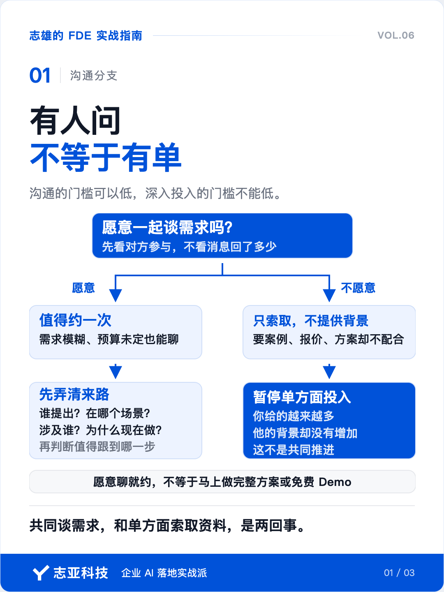
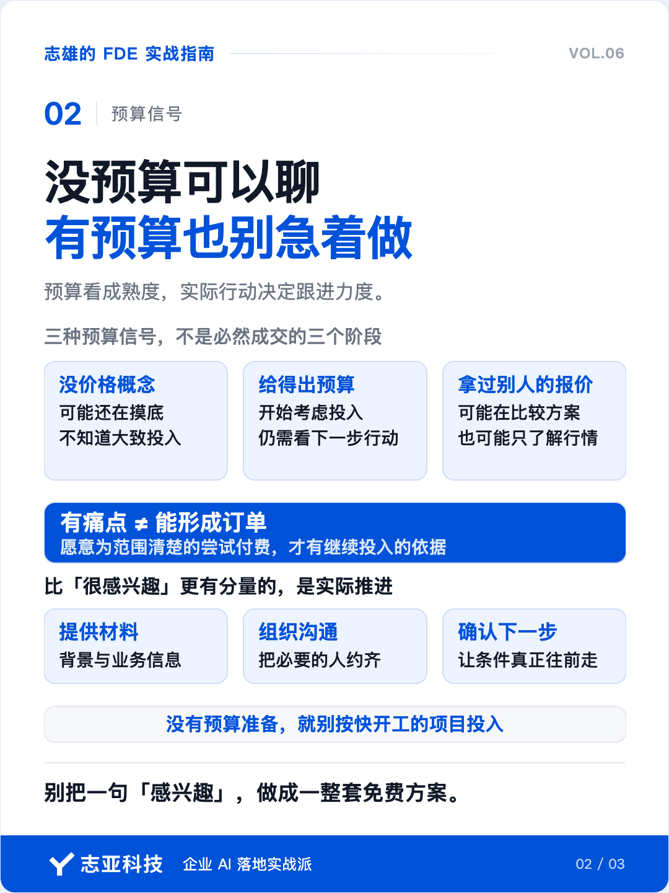
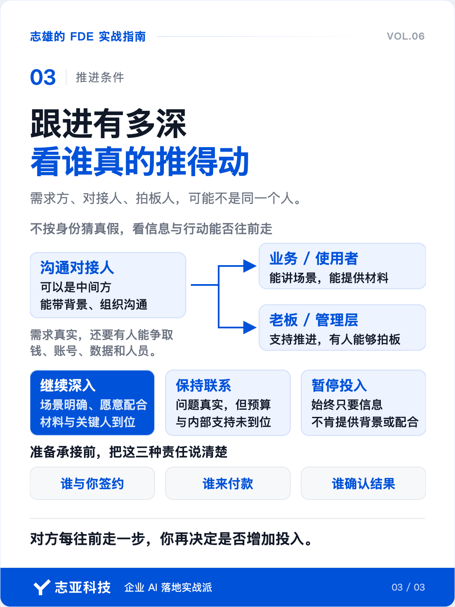

# 一个人做 FDE，我怎么判断客户值得跟进？

**志雄 FDE 实战指南 · 志亚科技出品** 
作者：白志雄｜武汉市志亚科技有限公司

[返回阅读目录](../README.md) · [查看本篇图卡](#配套图文卡片)

有人来问 AI 项目，你不想错过。可对方说得越多，你投入得越深，聊到后来才发现，预算没有，谁拍板也没定。

前面那些时间，已经花出去了。

但反过来，一听没预算就不聊，也可能把机会挡在门外。客户还没做过，连大概多少钱都不知道，来找人问，本来就是正常的事。

所以接需求，不能只问接不接，还得问一句，值得跟到哪一步？

**沟通的门槛可以低，深入投入的门槛不能低。**

### 1、愿意聊，就约

我对第一次沟通的判断很直接。只要对方愿意一起谈需求，就值得约一次。

需求模糊可以聊，预算没想好也可以聊。双方都愿意花时间，至少有机会把事情说清楚。不能要求客户先把项目想明白了，再来找你。

但有一种情况，要停下来。

只向你要案例、要报价、要方案，却不愿意提供背景，也不参与需求沟通。你给得越来越多，对方的信息却一点没增加。

**共同谈需求，和单方面索取资料，不是一回事。**

不要靠回了多少条消息判断机会，也别靠自己讲得多起劲判断客户有多认真。看对方有没有参与，才知道这是不是两个人在往前推。

### 2、先问来路

约上之后，先别忙着解释能做什么。弄清这件事是怎么冒出来的。

谁提出的？在哪个业务场景里？涉及多少人？为什么现在想做？

这些问题不是为了考客户。我们需要分清，眼前有一个正在发生的问题，还是对方只是在了解 AI 有没有合作可能。

前者即便表达不清，也有继续了解的对象。后者可以交流，但不必马上投入完整方案，更不用急着免费做 Demo。

中间方也不能一概排除。

他未必使用最终的系统，但可能能找到需求方、带回业务信息、组织下一次沟通。这种联系本来就有价值。

先看他能不能推动事情。到了准备承接项目时，再把谁与你签约、谁付款、谁确认结果说清楚。

**别用身份猜真假，用对方能提供的信息和行动判断。**

### 3、预算看成熟度

我常说，有预算，假的需求也是真需求；没有预算，真的需求也是假需求。

这里说的是能不能形成生意，不是业务里有没有痛点。

客户的方案未必理想，但他愿意为范围清楚的尝试付费，可以先做，再通过结果调整。痛点再真实，如果始终没有付费打算，就不能把它当成订单去投入交付。

所以，预算不只是报价的参照，也能帮你判断跟进的力度。

完全没有价格概念，往往还在摸底。给得出大致预算，至少开始考虑投入。拿过其他人的报价，可能已经在比较方案，也可能只是继续了解行情。

别把这些信号当成成交保证，还要看他接下来愿意做什么。

愿意提供材料、组织沟通、确认下一步，比反复说很感兴趣更有分量。

**没预算，不等于不理；没预算准备，就别按快开工的项目投入。**

### 4、看谁推得动

需求来自一线人员，不代表项目就能启动。

问题可能非常真实，但钱、账号、数据和人员都要往上争取。你原本准备做实施，聊着聊着却变成替对方说服老板，这里面多出来的成本，要看见。

做中国中小企业的项目，我会特别重视老板或管理层的支持。

不一定每句话都跟老板谈，但继续深入之前，要弄清背后有没有能拍板的人，这次沟通能不能走到他那里。

场景已经明确，对方也愿意安排业务人员、提供必要材料，就继续深入。问题真实，但预算和内部支持还没着落，保持联系，等条件往前走。始终只要信息、不肯配合，就暂停投入。

这不是故意设门槛。没有这些条件，你连需求都只能靠猜，写出来的方案也很难落地。

### 5、说到最后

一条线索来了，先给回应。愿意共同谈，就争取把来路、预算阶段和推进的人弄清楚。

然后决定下一步，是继续了解、投入方案，还是先保持联系。

别一开始就把对方当成已经成交的客户，也别因为他没准备好，就判定这件事永远没有机会。

**你要管理的不是客户的热情，而是自己的投入。**

对一人公司尤其如此。时间投在哪条线索上，就没法同时投到另一条上。让对方每一步的实际推进，成为你增加投入的依据。

## 配套图文卡片

### 有人问，不等于有单

### 没预算可以聊，有预算也别急着做

### 跟进有多深，看谁真的推得动

---

志亚科技出品。个人非商业学习和使用免费，商业使用须事先取得书面授权。

[使用许可](../LICENSE) · [作者与联系](../README.md#作者与联系) · [返回阅读目录](../README.md)
