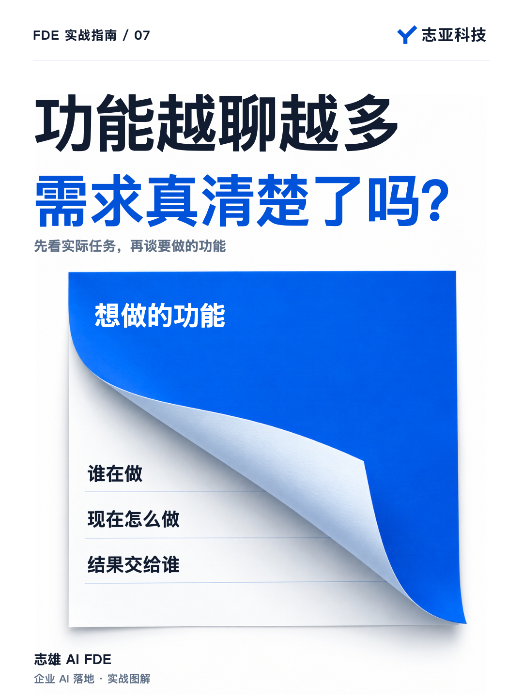
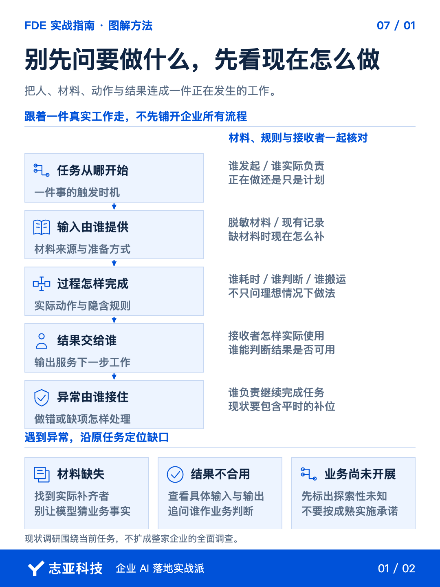
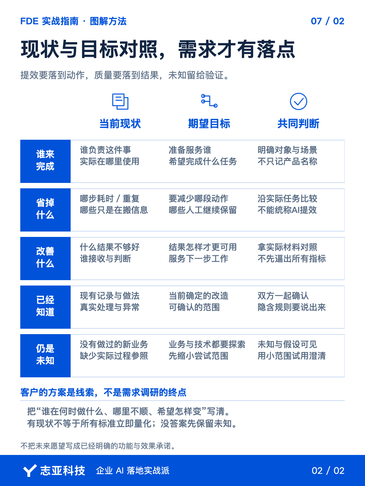

# 谈需求，重要的不是想做什么，而是正在怎么做

**志雄 FDE 实战指南 · 志亚科技出品** 
作者：白志雄｜武汉市志亚科技有限公司

[返回阅读目录](../README.md) · [查看本篇图卡](#配套图文卡片)

客户聊 AI需求，很容易直接就上来描述他预期的样子。

比如想自动处理，想一键生成，想让员工少做重复工作。这些目标都能理解，可聊着聊着，话题很容易就变成选平台、做几个功能、多久上线。

预期越说越具体，但当下是怎么做却还没讲清。

这时最值得补上的，不是另一个功能，而是一个问题。

**这件事，你们现在是怎么做的？**

不是泼冷水。我们要把客户的想象，接到一段真实发生的工作上。

### 1、先把想法听完

客户带着想法来，并没有错。

他会用见过的产品、听过的能力，构思自己的解决办法。说要做智能体，至少说明他已经在尝试表达需求。

你不必马上纠正，也别要求他放下想法，重新按你的模板讲一遍。

先听完，再沿着这个想法往回问。谁会用？这件事现在由谁负责？他今天怎样完成？

**客户说的方案，是了解需求的线索，不是需求调研的终点。**

如果只围绕工具继续聊，很容易把能不能实现，当成值不值得这样实现。前者是技术问题，后者还得回到业务里判断。

### 2、跟着一件事走

了解现状，不是把企业所有流程都调研一遍。

先跟着当前要解决的一件事走。它从哪里开始，谁拿到什么材料，经过哪些处理，结果最后交给谁。

遇到不清楚的地方，继续问实际做法。材料缺了怎么办，谁来判断结果可用，做错以后由谁接着处理。

客户不必一次讲得完整。你的工作就是从这些描述里，把任务还原出来。

能结合一份脱敏的实际材料、一段现有记录去看，就比只听目标更容易找到差异。不要只问理想情况下怎么做，也要知道平时是怎么把事情做完的。

**现状最有价值的地方，是它把人、材料、动作和结果连在一起。**

谁最耗时间，谁必须作判断，谁只是搬运信息，放进同一段工作里，才有机会分清。

### 3、对照才有需求

As-is 是现在怎么做，To-be 是希望怎么做。这两个词不用教给客户，但分析时要把两边摆在一起。

他说想提高效率，就回到现有动作里找，究竟想省掉哪一步。说想提高质量，就弄清现在什么结果不够好，谁能判断改进有没有发生。

有时要改变的是重复整理，有时是查找信息，有时只是让结果更容易被后面的人使用。不能用一句 AI 提效把它们全部盖过去。

把这一轮沟通整理成双方都能确认的描述。谁在什么情况下做什么，目前哪里不顺，希望变成什么样。

这比提前列一长串功能，更容易让客户看出你有没有理解他。

但有了现状，也不代表所有效果标准都能立刻量化。对尚未确认的效果，可以通过小范围试用继续澄清，不必逼客户现在就给出所有答案。

**现状提供判断的参照，不是要求客户提前写好全部验收标准。**

### 4、警惕没有现状

还有一种需求，事情现在没开展，未来准备开展，而且希望一开始就全交给 AI。

这和改进已有工作，是两种不同的难度。

客户没跑过这段业务，可能不知道哪些环节必不可少。你也没有实际过程可以参照，做出来以后，双方很容易继续凭想象判断好坏。

这里同时要探索业务怎么成立，以及技术怎么实现。

不是绝对不能做，而是不能把这样的探索，当成已经很明确的实施项目。

我挑小场景做 POC，也就是可行性验证时，会优先选客户正在做、做过的事情。因为他见过真实情况，拿到结果以后，更容易指出哪里对、哪里不对。

如果确实是在探索新业务，就先缩小尝试范围，把还不知道的地方摆出来。别轻易承诺一轮开发就能把未来都想明白。

**最危险的不是暂时没答案，而是双方都以为答案已经有了。**

### 5、说到最后

需求调研不是把客户的话抄成文档，而是减少双方各自以为对方已经知道的部分。

客户熟悉业务，却未必把隐含规则讲出来。你熟悉技术，也可能默认客户理解了限制。这些没对齐的地方，都会给后面的交付留下风险。

所以，听完未来，再回到今天。

找出正在发生的任务，把现状和目标放在一起。已经知道的共同确认，还没弄清的继续验证。

**把盲区变成共识，比把愿望写成功能更重要。**

知道今天哪里需要改变，才知道这次 AI 项目究竟该做什么。

## 配套图文卡片

### 别先问要做什么，先看现在怎么做

### 现状与目标对照，需求才有落点

---

志亚科技出品。个人非商业学习和使用免费，商业使用须事先取得书面授权。

[使用许可](../LICENSE) · [作者与联系](../README.md#作者与联系) · [返回阅读目录](../README.md)
