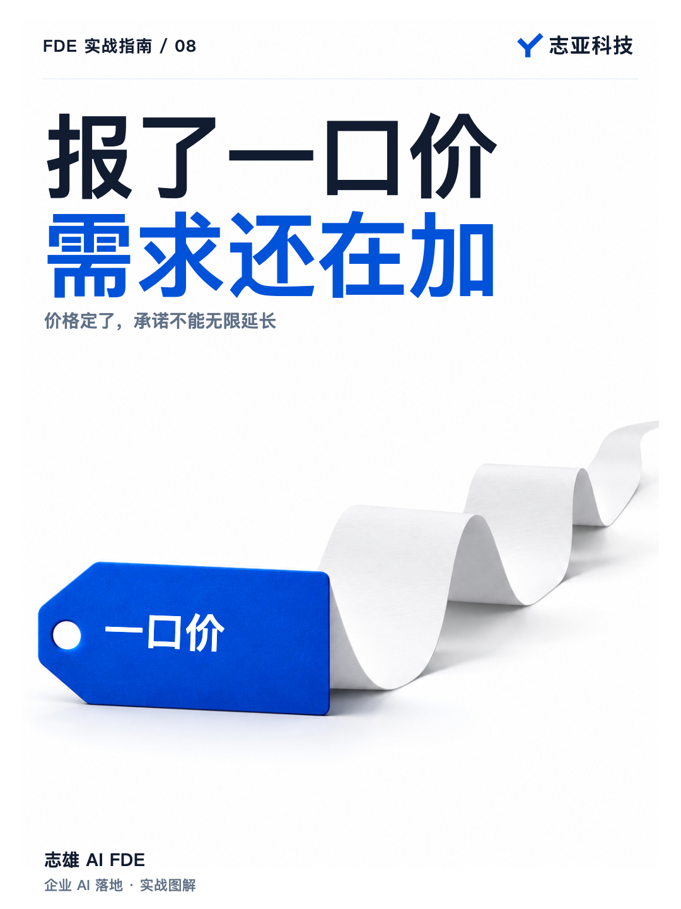
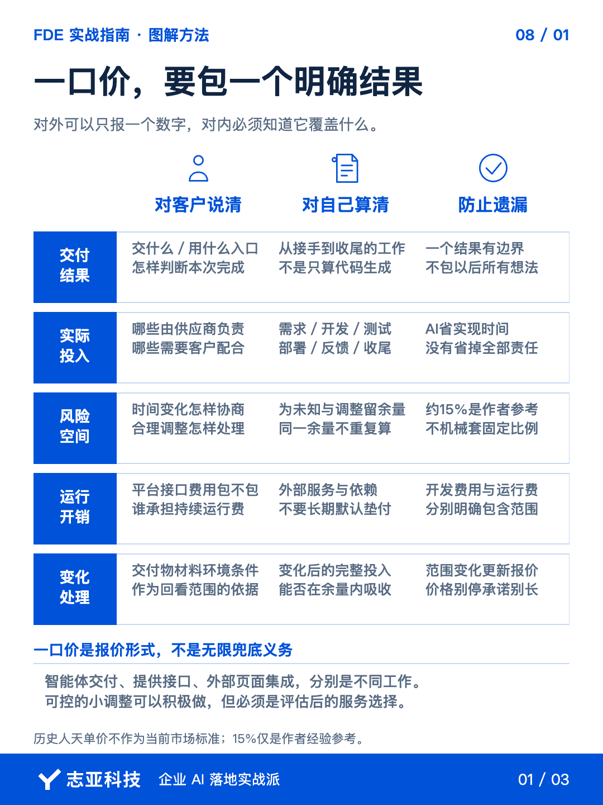
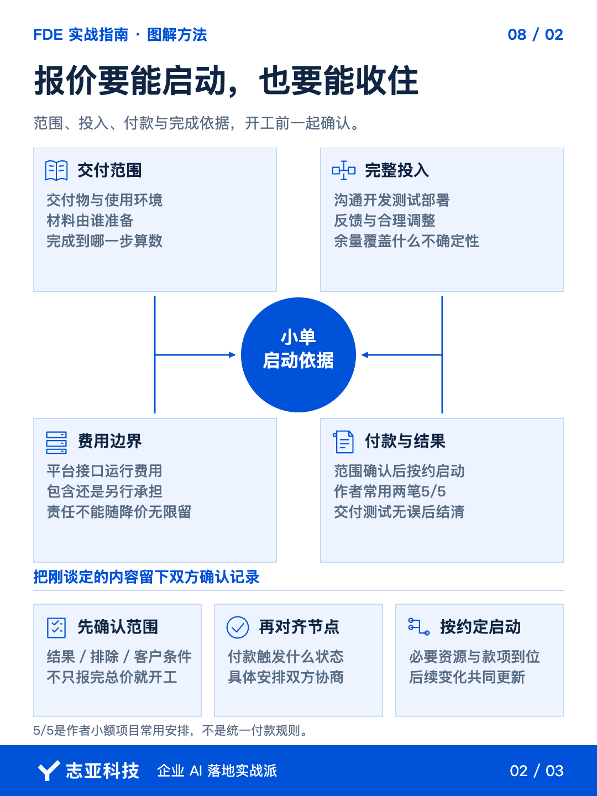
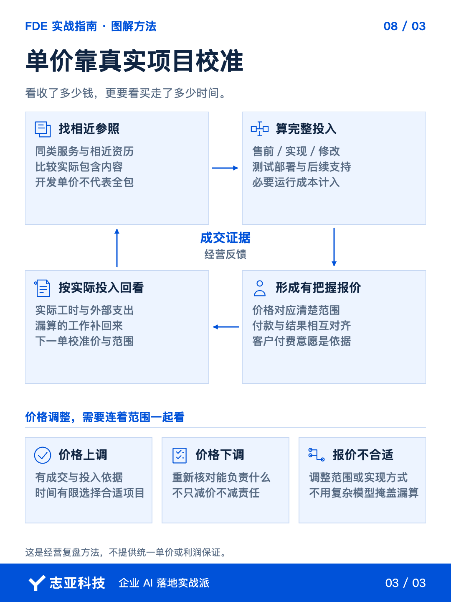

# 一口价，别包成无限价

**志雄 FDE 实战指南 · 志亚科技出品** 
作者：白志雄｜武汉市志亚科技有限公司

[返回阅读目录](../README.md) · [查看本篇图卡](#配套图文卡片)

以前在公司做企业信息化项目的时候，供应商报价有一套统一的规则。

即工作量算法，单位是人天，中级实施工程师一天 2500 ，项目经理一天大约 3200 到 3500 。评估一个项目需要花多少人一共多少天，乘以单价，合同费用也就出来了。

出来创业做智能体交付，最初我也沿用这套方法。但因为有 AI 的加持，特别是后续的 skill 开发几乎不再依赖手动，所以效率极大提升，工作量评估我都有点犯难了。

于是对于需求简单、边界清楚的千元级小单，我就就直接报一口价。

但一口价只是对客户的报法，不是自己可以不算账了。

**客户买的是一个结果，你花掉的却不只是开发时间。**

这里插一句：为什么我觉得以及我会选择一个人做 FDE 的原因，其实也源于此，就是单兵作战能力的极大的提升+沟通成本最小构成了这个模式应运而生的舒适环境。

感兴趣的朋友可以去看一本书，叫《人月神话》，你就懂我说的意思了。

### 1、先算完整投入

AI 编程让很多功能做得更快，这对小团队是极大的利好。但不要因此只盯着生成代码花了多久。

需求要沟通，结果要测试，部署要处理，客户反馈也得有人接。功能写完，不代表这单的时间已经花完。

报价前，把从接手到收尾的工作过一遍。哪些你负责，哪些由客户提供，哪些还不确定，都影响实际投入。

我的做法是在预计工作量里留出风险余量，用来处理合理调整和没有预料到的问题。不是每次机械加一个固定比例（大概 15%，项目越大比例越高），也不能把同一份余量重复计算。

当然，这部分浮动余量可以不让客户付费，但要让客户允许你在交付周期上延长。

总得来说，**对外可以只报一个数字，对内得知道这个数字准备覆盖哪些工作。**

另外第三方平台、接口或运行产生的费用，也要说明包含在报价里，还是由客户另外承担。否则开发的钱谈清了，运行的钱又成了新的争议。

### 2、单价从哪里来

刚开始独立接单，不知道一天该值多少钱，很正常。

起步时，可以找同类服务、相近资历的公开报价作参照。关键是看里面包什么，不能拿单纯开发的价格，去承诺从需求到维护的全套服务。

至于怎么找同类服务，很简单，假装你是客户就可以问出来。

再结合自己能承担的成本，给出有把握完成的报价，通过实际成交慢慢校准。

后续有客户愿意用更高的价格购买你的时间，说明有了调整价格的依据。忙不过来时，要考虑把有限时间留给更合适的项目。

没有单子的时候，也可以调整价格，但要一起看范围。不能只把价格往下压，责任却一点没减。

**价格可以浮动，对自己投入的判断不能丢。**

同时要记住，价值是靠客户定义的，准确说是有付费意愿的客户定义的，而不是你。

### 3、一口价包哪一段

适合一口价的小单，不只是金额小，还得有一个说得清的交付结果。

交付一个智能体，和把它接进客户的外部页面，不是同一份工作。提供接口，也不等于已经完成前端集成。

这不是计较，而是你要知道哪些部分自己做，哪些需要别人配合。

报价里把交付物、客户提供的材料、使用环境和完成条件讲清楚。按这几项回头看，才知道对方新提的要求，还是不是原来那一单。

如果交流中范围已经变了，就一起更新报价。别让价格停在最初，承诺却随着聊天越长越大。

这一点也不用做得很僵。成本可控的小调整可以积极响应，但那是你评估后的服务选择，不是报过一口价就得无限兜底。

**一口价要对应一个结果，不能对应客户以后所有的想法。**

### 4、报价要能启动

谈好了多少钱，还要谈什么时候付款、对应什么结果。

我做小额一口价项目，常用两笔，范围确认后先付一半启动，交付并测试无误后再付另一半。具体安排还是双方协商。

这样，客户先表达真实的投入意愿，剩余款项也有明确对应的交付结果。

别聊完一个总价就着急开工。把刚才谈定的范围和付款节点留下双方确认的记录，按约定的启动条件推进。

更大的项目，可以采取其他报价方式。能够合理估算收益时，也可以讨论价值报价。但当前这一步，先把一个边界清楚的小单算明白，不用急着套用复杂模型。

### 5、说到最后

第一次报价，不必证明自己能卖多贵。要先回答，这个价格下，能不能把约定的事情做好，做完之后值不值得。

内部算完整投入，外部说清交付范围，再把付款和完成条件对齐。

项目结束以后，还得拿实际工时回来核对。报价低了，下一次调整；范围漏了，下一次补清楚。单价就是在这些真实项目里逐步找到的。

**别只看这单收了多少钱，还要看它买走了你多少时间。**

一口价可以让成交更简单，但不能让自己的经营账变糊涂。

## 配套图文卡片

### 一口价，要包一个明确结果

### 报价要能启动，也要能收住

### 单价靠真实项目校准

---

志亚科技出品。个人非商业学习和使用免费，商业使用须事先取得书面授权。

[使用许可](../LICENSE) · [作者与联系](../README.md#作者与联系) · [返回阅读目录](../README.md)
