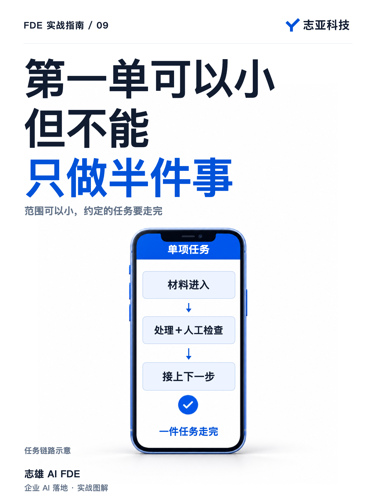
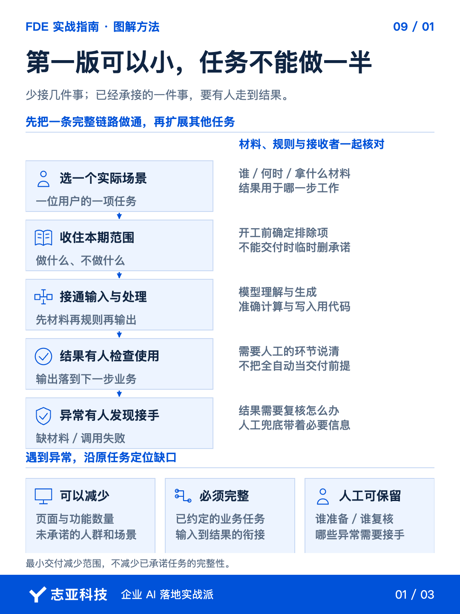
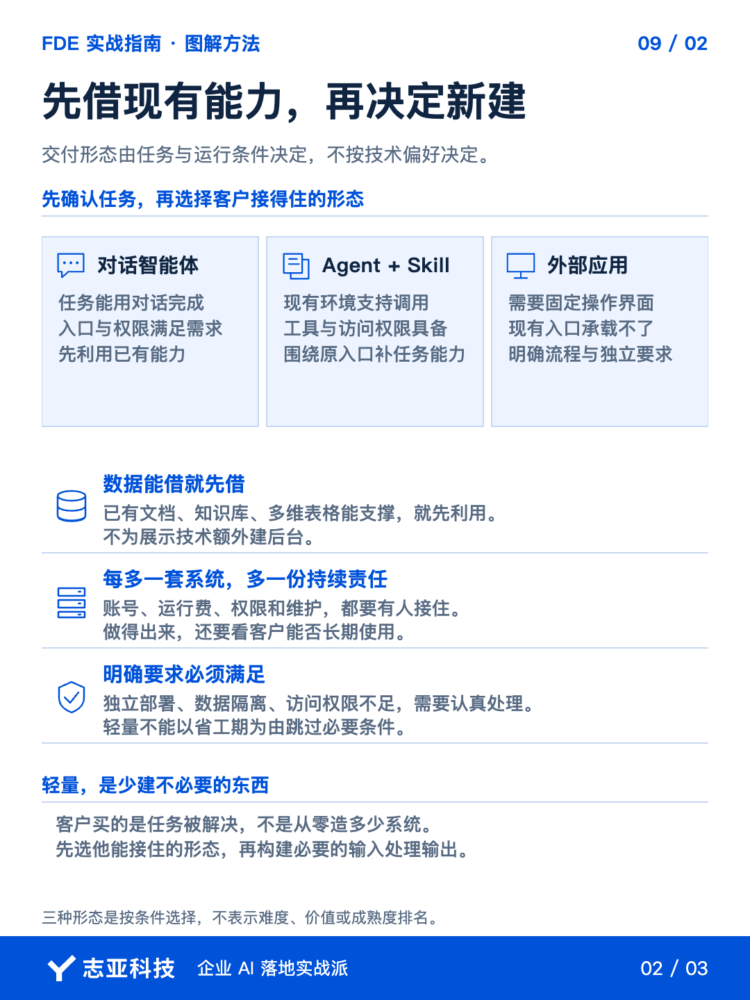
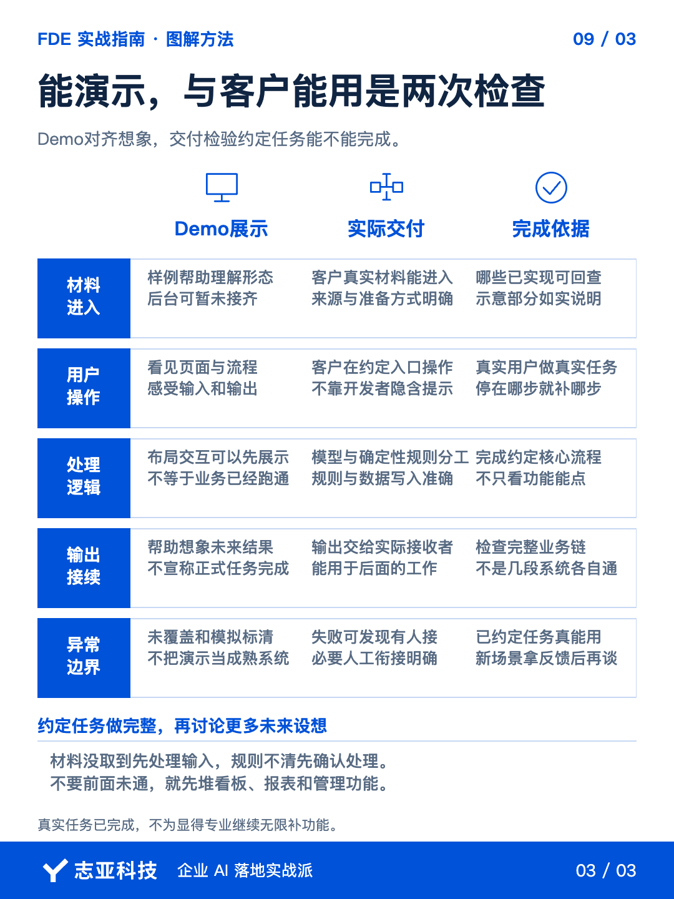

# 第一次做 AI 交付，哪些能省，哪些不能省？

**志雄 FDE 实战指南 · 志亚科技出品** 
作者：白志雄｜武汉市志亚科技有限公司

[返回阅读目录](../README.md) · [查看本篇图卡](#配套图文卡片)

最早从零开始做智能体交付时，我接的单子只有几百块。

钱不多，项目边界也很小。不是把一套大系统打折卖，而是只承接其中一件能做完的事。

后来从几千做到几万，交付的范围逐步扩大。这时再回头看，早期那些小单子，并不需要等到会做一整套系统才开始。

但小单也有一个不能省的东西。

**答应客户的那件事，得让他真的能用。**

几个页面做好了，几个工作流跑过了，不代表客户的工作已经完成。

第一次独立做 FDE，真正要想清楚的不是功能能做多少，而是这一单究竟要把哪件事做成。

### 1、先选一件完整的事

客户谈需求，往往会说想要一个智能体、一套系统，或者一个自动化流程。

这些是他想拿到的东西，还不是我们要完成的工作。

把范围往下拆，先说清楚，谁在什么场景里，用什么材料，完成什么任务，最后拿什么结果去做下一步。

**第一版要小，就少接几件事。不要把同一件事只做一半。**

页面可以少，功能可以少，暂时不覆盖的人群和场景也可以多。前提是，这次约定的任务能够走完。

这里还有一个区别，任务走完，不等于所有动作都自动化。

客户整理材料，系统处理，员工检查结果，再继续原来的工作。只要这些衔接事先说清楚，人工参与的链路，同样可以完成一次交付。

真正的问题，是系统只做了一段，剩下的工作没人知道该怎么接。

所以确定第一版时，除了列“做什么”，也要说清“不做什么”和“哪些继续由人做”。

已经承接的功能不能做不完再删。范围是在开工前收住的，不是交付时临时改口。

### 2、能借用，就不新建

确定任务以后，再选交付形态。

如果通过对话就能完成，先考虑智能体。客户已经有支持 Skill 的 Agent 环境，也具备需要的权限，就可以围绕现有入口补能力。

需要固定页面、明确操作流程，或者现有入口承载不了，再考虑外部应用。

**客户买的是任务被解决，不是你从零造了多少东西。**

数据也一样。已有文档、知识库或多维表格能够支撑，就先利用现有条件。不因为想展示技术，额外造一套后台。

中小企业的小项目，尤其要算后续的账。

多一个系统，就多一份账号、费用、权限和维护责任。你做得出来，客户未必有条件长期接住。

当然，客户明确要求独立部署、数据隔离，或者现有权限不够，不能为了省开发时间把这些条件跳过去。

**轻量的意思是删掉不必要的建设，不是省掉必要的责任。**

### 3、先把一条链打通

选好形态，就围绕一件事把输入、处理和输出连起来。

谁提供材料，系统按什么规则处理，结果送到哪里，谁检查和使用。先把这条路走通，再扩展其他功能。

给 AI 编程的任务，也应该按这条链描述。只说“帮我做一个业务助手”，它可以生成很多东西，却未必是在完成客户的工作。

需要理解和生成的部分交给模型。必须准确执行的计算、状态和数据写入，用确定性的逻辑处理。不要把所有事情都塞进一段提示词。

构建顺序也要收住。

材料还没取到，就先处理输入。规则还没说清，就先明确处理方式。不要前面没通，后面又堆上看板、报表和管理功能。

**先接通一件事，比同时铺开十个功能，更容易知道项目卡在哪里。**

正常路径跑通以后，补上必要的异常处理。

材料缺了，调用失败了，结果需要复核了，系统至少要让人知道。暂时不能自动恢复，可以交给人，但不能让失败悄悄过去。

人工兜底不是丢人。出了问题没人知道、没人接手，才会把一个小项目拖成大麻烦。

### 4、能看，不等于能用

Demo 可以先展示页面、布局和交互，用样例让客户感受未来的形态。

它的作用是把脑海里的设想放到眼前，不要求一开始就把后台和真实数据全部接好。但展示时，要讲清哪些已经实现，哪些还只是示意。

实际交付则要换一个检查角度。

**别只看自己能不能演示，要看客户能不能完成约定的任务。**

真实材料能否进入？客户在约定入口能否操作？输出能否接到他的下一步工作？出错时能否发现并处理？

如果只有你知道材料怎么填、哪里不能点，客户还不能使用，说明这件事还没交完整。

反过来，如果约定任务已经完成，不必为了显得专业，继续把所有未来设想都补上。

先让客户用这一小段。新的场景和更大的范围，拿到反馈以后再谈。

### 5、说到最后

第一次做 FDE，不用一上来就证明自己能建平台、能做全自动化。

先挑一件有现实依据的任务，收住范围，选客户接得住的形态，把输入、处理、输出和人工衔接做完整。

**最小交付的单位，是一件能完成的工作，不是一个页面、一个工作流，也不是一个智能体。**

这个单位选对了，智能体也好，Skill 也好，外部应用也好，都只是实现方式。

早期小单真正值得积累的，就是这种能力。知道这一单承诺什么，用最少的必要建设，把承诺兑现。

先做成一件事，再接下一件事。项目可以小，交付不能断。

## 配套图文卡片

### 第一版可以小，任务不能做一半

### 先借现有能力，再决定新建

### 能演示，与客户能用是两次检查

---

志亚科技出品。个人非商业学习和使用免费，商业使用须事先取得书面授权。

[使用许可](../LICENSE) · [作者与联系](../README.md#作者与联系) · [返回阅读目录](../README.md)
