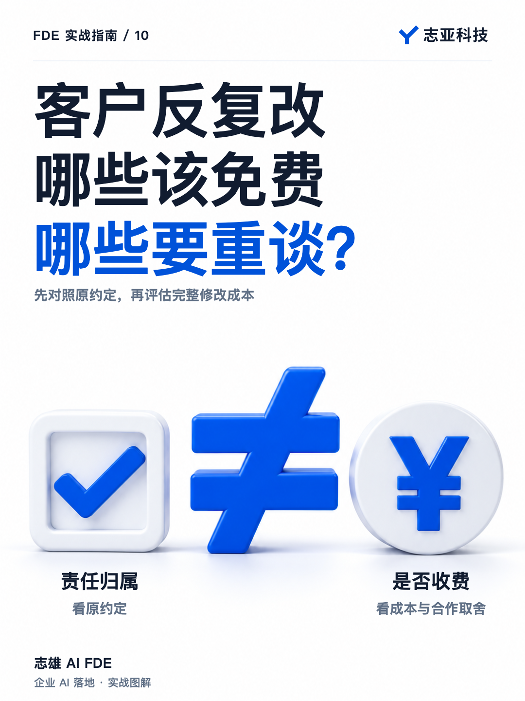
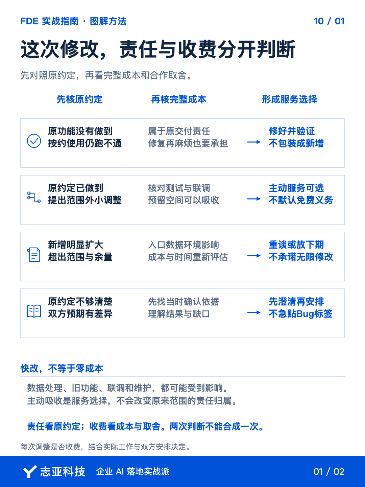
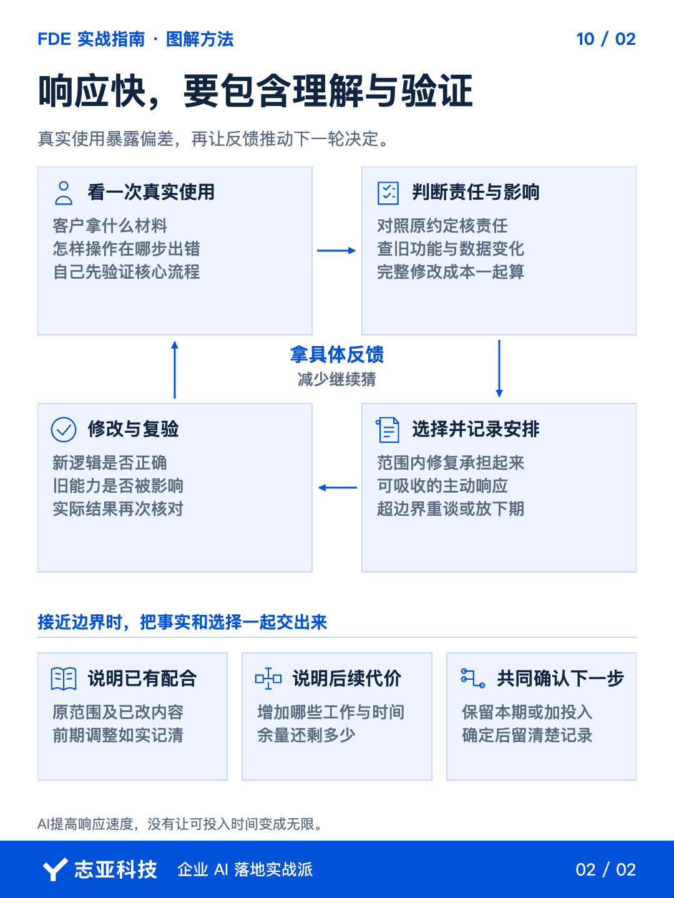

# 客户反复改需求，哪些该免费，哪些要重谈？

**志雄 FDE 实战指南 · 志亚科技出品** 
作者：白志雄｜武汉市志亚科技有限公司

[返回阅读目录](../README.md) · [查看本篇图卡](#配套图文卡片)

客户提出修改，我通常会积极响应。

借助 AI 编程，很多调整可以更快完成。但客户今天加一点、明天换一种逻辑，最初答应的项目，也可能在几轮修改后变成另一件事。

这时只盯着代码难不难改，会漏掉两个判断。

**该不该由你负责，看原约定。要不要额外收费，看工作量和合作取舍。**

这两件事分清，才能既把服务做好，也不把自己拖进无限修改。

### 1、先看他怎么用

客户说不对，别马上猜他想要什么，也别急着让 AI 重写。

先看他拿什么材料、怎么操作、在哪一步得到不合适的结果。你演示时跑通了，不代表真实使用时所有条件都相同。

自己熟悉系统，可能会自然避开不支持的输入，知道先做哪一步。客户不知道这些，反而能让问题露出来。

这也是尽早让客户试用的价值。等所有功能都做完才看到偏差，前面很多投入就难以收回。

但试用不是把没测过的东西直接丢给客户。自己先验证约定的核心流程，再请使用者用真实任务检验。

拿到具体反馈，下一步才不是猜。

### 2、先分清两件事

处理修改，我会先对照原来答应了什么。

约定的功能没实现，或按约定使用仍然跑不通，这是原本的工作没做好。该修就修，不能把修复包装成新增功能重新卖一次。

原约定已经做到，客户又提出新的要求，那就是另一回事。

但新要求，也不等于每一项都必须另外收费。一个小调整，成本在预留空间里，可以主动帮他完成。

**属于谁的责任，和这次收不收费，是两个判断。**

前一个看原约定，后一个看实际成本和合作取舍。

否则，很容易走向两个极端。不是把该修的问题全算成变更，就是把范围外的要求全当成免费义务。

如果原来的约定本来就模糊，也别急着给反馈贴上 Bug 或新增的标签。先把双方当时各自理解的结果说清楚，再谈怎样补齐。

### 3、快改不等于零成本

AI 能缩短实现时间，但给它发完指令，事情还没结束。

新逻辑对不对，旧功能有没有受影响，数据处理有没有变化，都需要检查。涉及多个环节，还要重新联调。

所以看一次修改，不能只看代码改了几行。换了入口、数据源或部署环境，后面的测试和维护也可能跟着增加。

我在报价和时间评估里，会预留一部分时间处理风险和合理调整。有这个空间，响应客户就不必每次都紧绷着。

但余量会被消耗。改过几轮以后，要回头看剩下多少，而不是永远凭一句应该很快就答应。

**AI让你更容易响应客户，没有让你的时间变成无限。**

### 4、该重谈就讲清

接近可承受的边界，就把事实摆出来，不要等到心里已经很不满才开口。

原来按照什么范围报价，已经配合调整了哪些，接下来还会增加什么工作。

你可以很直接地讲，前面几次调整已经一起做了，再往下改，原来的成本和时间就兜不住，需要重新确认。

这不是突然变脸。你已经响应过，也提供了继续调整需要付出的代价。

随后一起决定，是保留当前范围，把新想法放到下一期；还是增加预算和时间，继续做。

确定以后留一份清楚的记录。否则这一轮觉得谈妥了，下一轮又会回到各自的理解。

你在甲方也一样。要分清是供应商原来没做到，还是内部想法变了。前者推动修复，后者需要重新协调资源，不能都叫对方再优化一下。

### 5、说到最后

客户试过以后改变想法，并不一定是坏事。他可能正是看到结果，才把原来模糊的期待说清楚。

先把这种反馈听明白，再判断责任和成本。

原来没做到，修好。额外的小调整，能吸收就积极响应。已经明显超出原范围和承受空间，就重新谈。

**合同保护底线，服务体现在你怎样把事情往前推。**

两者不冲突。既不要拿合同挡住每次正常反馈，也不要靠无限让步证明自己服务好。

真正的响应快，是尽快弄清问题、作出决定、完成修改和验证，而不只是打字回复一句没问题。

## 配套图文卡片

### 这次修改，责任与收费分开判断

### 响应快，要包含理解与验证

---

志亚科技出品。个人非商业学习和使用免费，商业使用须事先取得书面授权。

[使用许可](../LICENSE) · [作者与联系](../README.md#作者与联系) · [返回阅读目录](../README.md)
