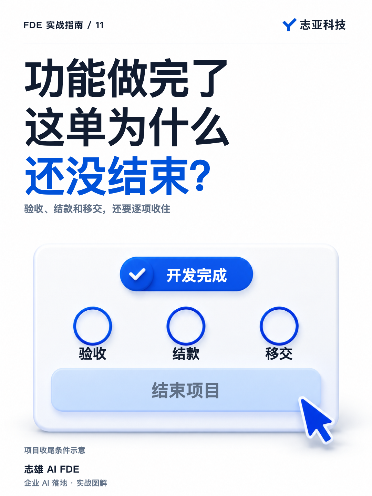
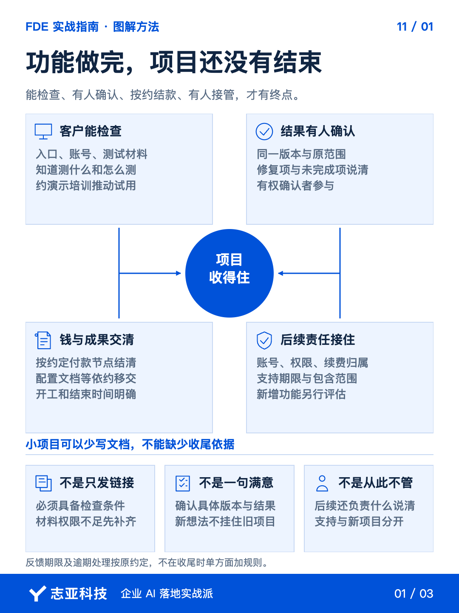
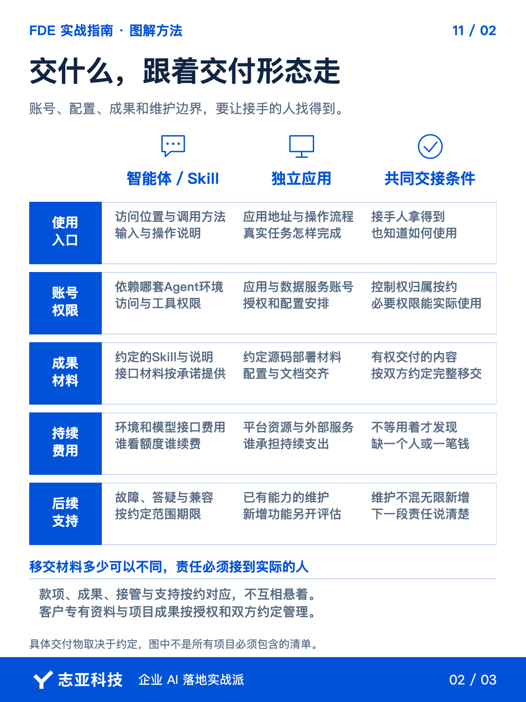
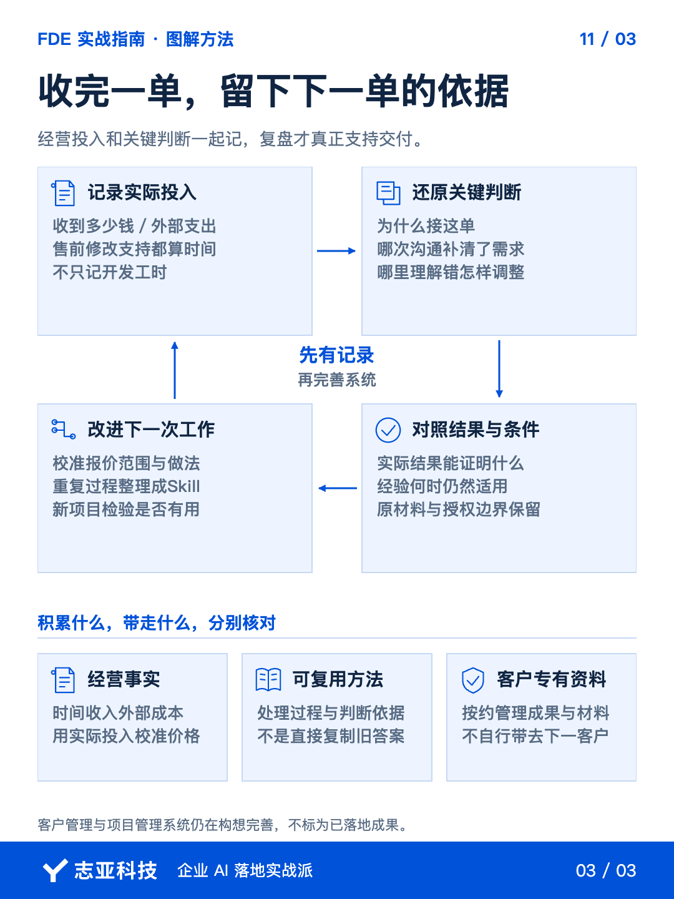

# AI项目做完了，怎么把尾款和责任一起收好？

**志雄 FDE 实战指南 · 志亚科技出品** 
作者：白志雄｜武汉市志亚科技有限公司

[返回阅读目录](../README.md) · [查看本篇图卡](#配套图文卡片)

小项目把功能做好，链接发出，这单是不是就结束了？

尾款还没结、结果还没确认、账号和维护还没交代，就还没有结束。

在项目管理的过程组概念里，验收、回款和移交，本来就是一个项目需要推进的阶段。它不会因为订单金额小而消失。

**开发完成，是功能做出来。项目完成，还要确认结果、交清责任、按约结算。**

小项目可以少写文档，但不能缺少收尾依据。

### 1、让客户能确认

发一句做好了，您有空看看，不足以让验收真正开始。

客户要有可访问的入口、必要的账号、测试材料和方法，也要知道这次应该检查哪些结果。

这些可以很轻，但必须能支撑实际测试。缺了材料或权限，就不能只按自己发出链接的时间，认为对方已经具备验收条件。

反馈时间也应该提前约定。什么时候开始测试，多久反馈，发现问题怎样处理，都在合作时说清楚，不到尾款卡住才想起来。

而根据我的最佳实践，我的建议是文档要写，培训也要做。最好约上客户时间，集中演示和讲解，推动客户开始进入到验收阶段。

至于逾期没有反馈怎么办，按双方实际约定处理，不在收尾时单方面增加规则。

也就是说**你要交出的不只是功能，还要有让对方能够确认功能的条件。**

### 2、把完成说清楚

客户满意当然重要，但一句做的挺好的，未必已经把项目完成这件事确认下来。

对照原范围，哪些已经做到，哪些反馈已经解决，还有什么没完成，逐项把结论说清楚。

约定的功能跑不通，就继续修。后来想到的新功能，另行讨论，别让原项目永远等着下一批想法。

这里不是要重新讲一遍变更管理，而是要守住一个收尾条件，双方确认的是同一个版本、同一组结果。

如果你在甲方推进，也要知道由谁确认。提出需求的人、实际使用的人和批准项目的人，可能并不是同一个。

该谁确认，就让谁参与。不能因为演示时大家都点头，就默认后面不会再有人提出不同理解。

### 3、钱和责任都交清

做小额一口价项目，常用启动和交付测试后两笔付款。走到收尾，就按约定的节点结款，别一直停在再看看，项目的关键就在于有明确的启动和结束时间。

交接也按约定安排。

交付一个智能体、一个 Skill 或独立应用，需要给出的东西不同。使用入口、账号权限、必要配置和操作说明，让接手的人拿得到，也知道怎么用。

约定了源码、接口或部署材料，就交齐。依赖谁的账号、谁承担续费，也一起说明，别让客户用着用着才发现还缺一个人或一笔钱。

后续支持同样要有边界。

故障修复、答疑和兼容性维护，按约定的支持范围和期限提供。新增功能另外评估、另开项目，不混在维护里无限往后延。

**结束项目，不是从此不管，而是把后面还管什么讲清楚。**

### 4、把这一单算明白

钱收完、东西交清，还值得多做一件事，把这单的实际投入留下来。

收到多少钱，外部服务花了多少，自己前后用了多少时间。别只记开发工时，售前、修改和支持也要算进去。

这样才知道报价合不合适。下一单该涨价、缩范围，还是换一种做法，不必每次都靠感觉。

项目里形成的判断也值得留。

当时为什么接，哪次沟通让需求更清楚，哪里理解错了，最后怎么调整。结果和判断放在一起，下次才能知道过去的经验适不适用。

小项目一般都是skill /web 工作台/数据接口 这类开发工作，全程几乎都可以使用 Agent 完成，那么最好把这个过程都在 Agent 中进行，这样它就记录下了一切，方便复盘。

需求分析等重复交付过程，也可以继续整理成 Skill。客户管理和项目管理系统还在构想、完善，不用等它们全部建好才开始记录。

**先留下这次为什么这样做，再考虑把记录放进多漂亮的系统。**

客户专有资料和项目成果，则按双方约定管理。复用自己的经验，不等于把客户的材料带去下一单。

### 5、说到最后

小项目走完一圈，不只是从需求走到代码，而是从一个约定走到双方都认可的结果。

客户能检查，结果有人确认，款项按约结清，东西有人接管，后续支持有边界，这单才真正有了终点。

再把工时、成本和关键判断留下来，下一次就不必从头猜。

**完成一单，要少一件悬着的事，多一点下次能用的经验。**

如果交付越做越多，挂着的尾款、账号和无限答疑也越来越多，那就该回头检查，不是自己不够勤快，而是收尾这一步还没做完。

## 配套图文卡片

### 功能做完，项目还没有结束

### 交什么，跟着交付形态走

### 收完一单，留下下一单的依据

---

志亚科技出品。个人非商业学习和使用免费，商业使用须事先取得书面授权。

[使用许可](../LICENSE) · [作者与联系](../README.md#作者与联系) · [返回阅读目录](../README.md)
