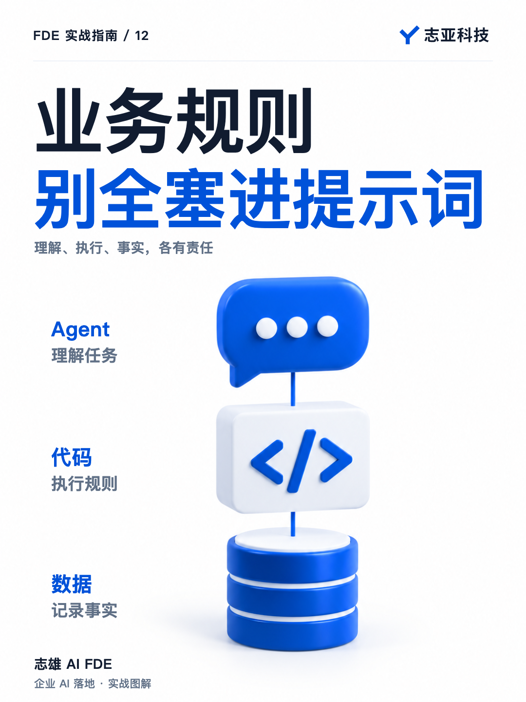
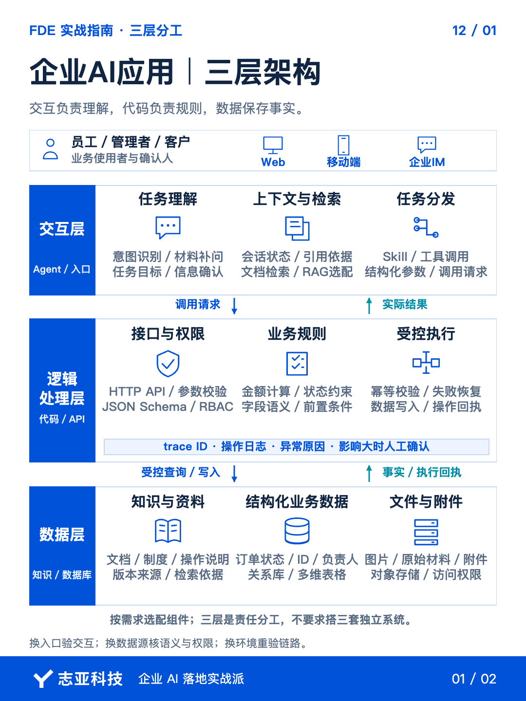
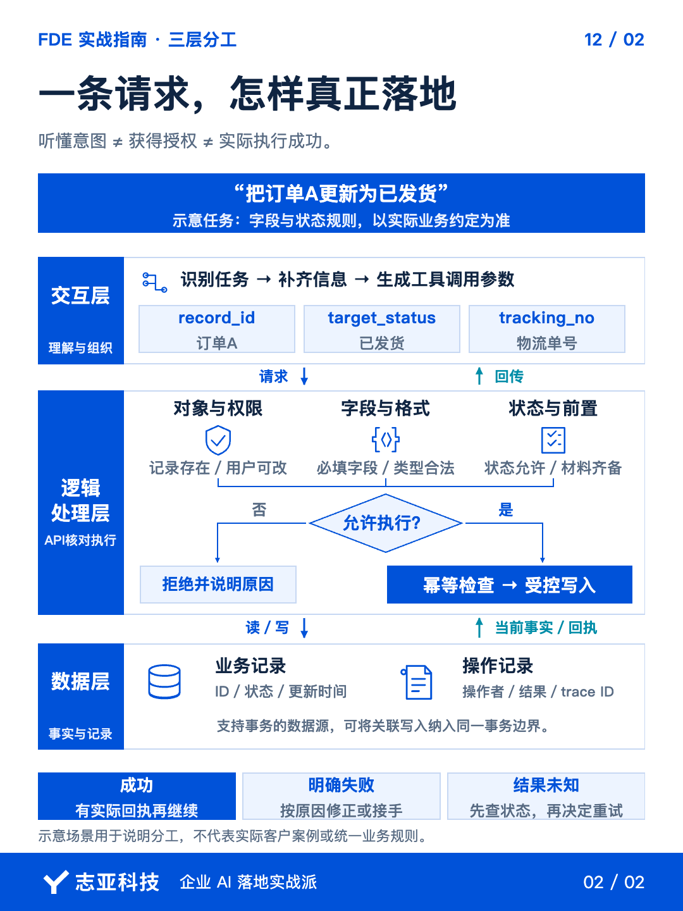

# 企业AI应用，别把业务规则全塞进提示词

**志雄 FDE 实战指南 · 志亚科技出品** 
作者：白志雄｜武汉市志亚科技有限公司

[返回阅读目录](../README.md) · [查看本篇图卡](#配套图文卡片)

做企业 AI 交付，我常用的组合是三层。

Agent 接交互，代码处理逻辑，知识库和数据库承接资料与业务数据。

分开它们，不是为了多造几套系统，而是为了出了问题能找到原因。

用户说错、数据取错、规则算错，和模型理解错，是不同的问题。全揉进提示词，演示时可能顺，真正使用时却难排查。

**理解和生成可以借助模型，关键规则要有明确的执行和检查方式。**

### 1、把入口交给它

Agent 适合接住自然语言里的任务。

用户想查什么、准备处理什么材料、下一步需要调用哪项能力，可以在这一层理解和分发。材料不够，就继续问，意图不清，就先确认。

但理解用户想做什么，不等于已经有权替他做。

要修改一条业务记录，还得检查记录是哪条、当前用户能不能改、准备写入什么值。不能因为聊天里说了可以，就把后面的校验跳过去。

**Agent 负责听懂，执行层还要负责核对。**

这个区别分开以后，入口就不用承担所有业务规则。换一个交互工具，也不必把核心规则重新写成另一套提示词。

### 2、规则靠 API 约束

企业里有些东西允许表达不同，有些东西不应该每次重新发挥。

整理一段描述，可以让模型协助。金额怎样计算、什么状态允许进入下一步、谁能修改数据，则应该按已经确认的规则执行。

这些部分，我优先放到确定性的代码中，以 web 应用后端为载体实现，然后通过 API 开放给 Agent。

不是代码天然不会错，而是规则可以被明确写出、测试和追踪。条件不成立就停止，不需要再猜一句话能不能让模型记住。

模型可以帮助提取信息，也可以提出操作建议。但真正写入、发送或改变业务状态的操作已定是交给代码实现的后端逻辑。

影响大的操作，还可以保留人工确认。

**你要交付的是按业务规则办事，不是让模型每次都尽量表现好。**

### 3、事实放在数据层

知识库和数据库，也不是两个随便替换的名字。

文档、制度、操作说明，适合组织成可检索的知识资料。订单状态、任务记录、负责人、更新时间，则需要清楚的结构和持续维护。

模型能把答案说得完整，不代表那就是客户当前的事实。

该查资料时就查资料，该读业务记录时就读记录。资料有不同版本，要知道以哪份为准；记录更新了，后续处理也要拿到对应状态。

这一步的重点，不是先选一个看起来先进的数据库，而是确认信息由谁维护、从哪里获取、什么时候更新。

轻量场景可以从多维表格开始。客户已有的数据源能够满足权限、容量和运行要求，就不必为了架构漂亮，先搬一遍数据。

但不能因为表格方便，就忽略了谁能访问、谁会修改，以及修改以后会影响什么。

### 4、换工具不换责任

在我的常用组合里，Agent 可以配合 Skill 调用处理能力，代码再通过 API 或连接器访问数据。

这是落地的一种组织方式，不是所有项目都必须搭齐三套独立系统。

简单任务，现有平台可能已经包住其中几层。重复处理可以放到自动化流程，表格看板能满足查看需求，就不一定要另做管理页面。

客户确实需要独立部署、不同权限或更复杂的数据管理，再调整对应的组件。

不过，可替换不等于零成本替换。换入口要检查交互，换数据源要处理字段和权限，换环境还要重新测试。

真正值得保留的是责任边界。知道哪一层做什么，才知道这次换工具会动到哪里。

**架构的价值不是以后随便换，而是变化来了，不必把所有东西一起推倒。**

### 5、说到最后

做中小企业 AI 项目，不要从今天流行哪个 Agent 开始选方案。

先看哪些工作需要理解和生成，哪些规则必须稳定执行，哪些事实需要查证和记录。再选客户承担得起、也接得住的组合。

Agent、代码、数据，分别回答三件事。

用户想做什么，系统允许怎样做，业务里实际发生了什么。

把它们分清，并不会让项目失去 AI 的价值。恰恰相反，模型可以在适合的地方发挥，关键规则也不必跟着每一次生成结果波动。

**AI 负责的不是越多越好，整个方案能稳定完成的事情越多，才越有价值。**

## 配套图文卡片

### 企业AI应用｜三层架构

### 一条请求，怎样真正落地

---

志亚科技出品。个人非商业学习和使用免费，商业使用须事先取得书面授权。

[使用许可](../LICENSE) · [作者与联系](../README.md#作者与联系) · [返回阅读目录](../README.md)
