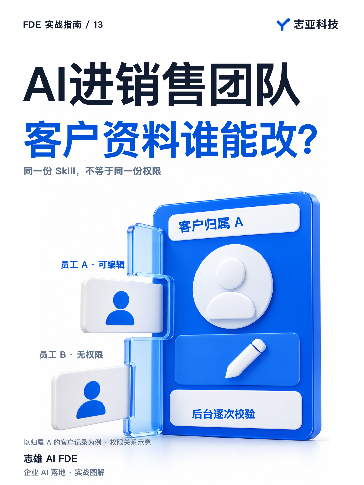
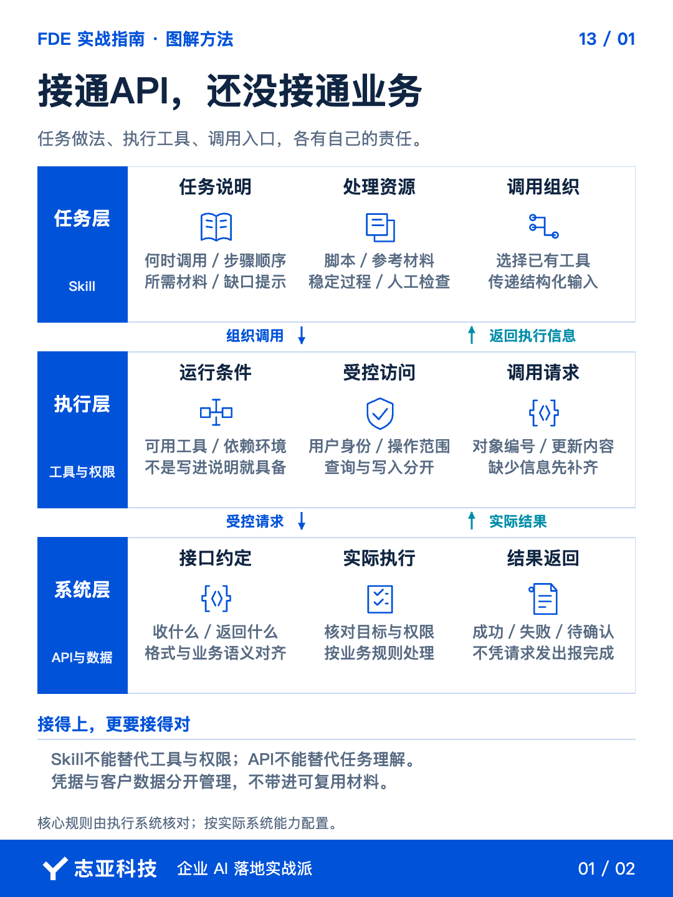
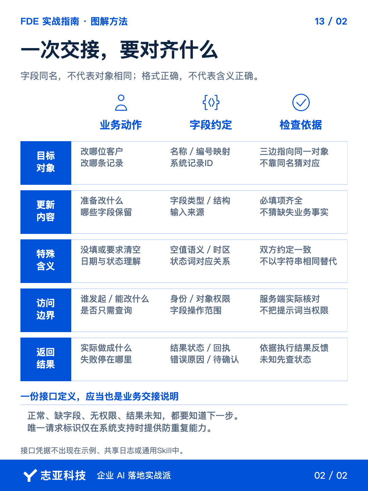

# AI与CRM对接中的身份校验与权限管理

**志雄 FDE 实战指南 · 志亚科技出品** 
作者：白志雄｜武汉市志亚科技有限公司

[返回阅读目录](../README.md) · [查看本篇图卡](#配套图文卡片)

跟客户聊完一场会，还得把沟通内容重新整理进 CRM。

能不能把录音交给 AI，让它来做这段整理和录入？

在我做过的 AICRM 系统里，员工可以用自己的 Agent，比如 Codex，接上读取会议材料的 Skill，提取关键信息，再调用 CRM 的接口，新建或更新客户资料。

一个人用，工作链路就这样接起来了。

但如果要把它交给整个销售团队，是不是把同一份 Skill 发给每个人，就可以了？

**功能可以共用，客户资料却不能让所有人随便改。**

A 负责的客户，B 能不能更新？他们的上级经理，又应该看到哪些资料？

到了这里，要解决的已经不是 AI 会不会调用接口，而是后台能不能分清，谁有权操作哪条数据。

### 1、先看单人怎么用

单人使用时，最容易先关注两件事。

会议信息提取准不准？CRM 里有没有确实新建或更新对应的客户资料？

在这件事里，Skill 告诉 Agent 怎么处理任务，API 则提供操作 CRM 的入口。

不用先给员工重新开发一套聊天界面，就能从他趁手的 Agent 发起操作。

但这只解释了任务怎样完成，还没有回答多人使用时，数据应该怎样划分。

不是单人使用就不需要身份校验，而是此时还没有展开员工之间、员工和经理之间的权限关系。

**从一个人能用，到一群人能用，不能只复制操作入口。**

### 2、多人多了什么

放到销售团队里，要求就具体了。

A 只能新建和管理自己负责的客户。B 也一样，不能因为用了同一个 Skill，就顺手管理 A 的客户。

他们的上级经理，则需要同时查看和管理两个人负责的客户。

大家做的都是新建、查询、更新，操作名称没有变，允许操作的数据范围却不同。

这时，如果后台只判断请求里有没有客户名称、要修改什么内容，就还缺了一步。

**知道一位客户叫什么，和有权修改这位客户的资料，不是一回事。**

员工可能知道别人的客户，也可能在会议材料里提到这个名字。Agent 能理解他说的是谁，不代表系统就应该替他执行。

所以，不能把客户信息识别准确，当成权限已经判断准确。

### 3、把关放在后台

我的做法，是在 CRM 后台增加权限校验，也就是在最终操作客户数据的代码里把关。

每一次通过 API 操作数据，都要先回答两个问题。

来的是谁？他能不能做这次操作？

前一个是核实身份，后一个是检查权限。确认他是 A，还不够，还得确认这条客户记录是不是在 A 可以管理的范围内。

具体实现时，身份要来自系统能够验证的登录状态或访问凭据，不能靠他在对话里说一句自己是经理。

后台再结合客户的负责人、用户角色和管理关系，决定是否放行。经理能管理的是被授权的团队范围，不是系统里的所有客户。

新建也不能漏掉这一步。客户资料归到谁名下，要按后台规则确定，不能任由 Agent 填一个负责人就算数。

**Agent 负责理解要做什么，CRM 后台负责决定能不能做。**

这也是为什么，权限规则不能只写进 Skill。

Skill 可以提醒 Agent 哪些操作不允许，但真正执行的入口还得检查。即使 Agent 发出了不该发的请求，后台也要挡住。

换一个 Agent、修改任务说明，都不能改变 CRM 已经约定的权限边界。

### 4、拒绝也要闭环

如果 A 指定了一位 B 负责的客户，要求更新资料，后台查到他没有权限，就应该停止操作。

即使客户名称和相关信息全部说对，也不能放行。

然后把拒绝结果返回给 Agent，让它明确告诉用户，这次更新没有完成，需要按公司的授权流程处理。

不能后台已经拒绝，对话里却回复修改成功。也不能把拒绝当成接口故障，换一种说法继续尝试。

而且这个检查不能只管更新，不管查询。若先把无权访问的客户资料读出来，再拒绝修改，数据已经暴露了。

因此，验证这条链路时，别只测能否成功更新一条资料。

要分别看，A 能否管理自己的客户，B 能否管理自己的客户，经理能否管理被授权团队的客户。

还要反过来检查，A 操作 B 的客户时，后台是否拦住，数据有没有被修改，Agent 是否准确反馈没有完成。

**允许的事情做得成，不允许的事情做不成，才是这条业务链路应该交付的结果。**

### 5、说到最后

AICRM 这个场景里，单人和多人用的是同一类能力，读取材料、提取信息、调用接口。

但使用者增加以后，客户归属、管理关系和操作权限，就必须进入系统的执行规则。

这些问题，不是换一个更聪明的模型就能解决的。

做企业 AI 集成，不能只问接口有没有调通。还要把具体业务放进去，追问每一次操作，到底是谁在做，替谁做，有没有资格做。

这才是从连接工具，走到交付业务的那一步。

AI 可以替员工少操作几次，但不能替企业省掉必要的管理边界。

## 配套图文卡片

### 接通API，还没接通业务

### 一次交接，要对齐什么

---

志亚科技出品。个人非商业学习和使用免费，商业使用须事先取得书面授权。

[使用许可](../LICENSE) · [作者与联系](../README.md#作者与联系) · [返回阅读目录](../README.md)
