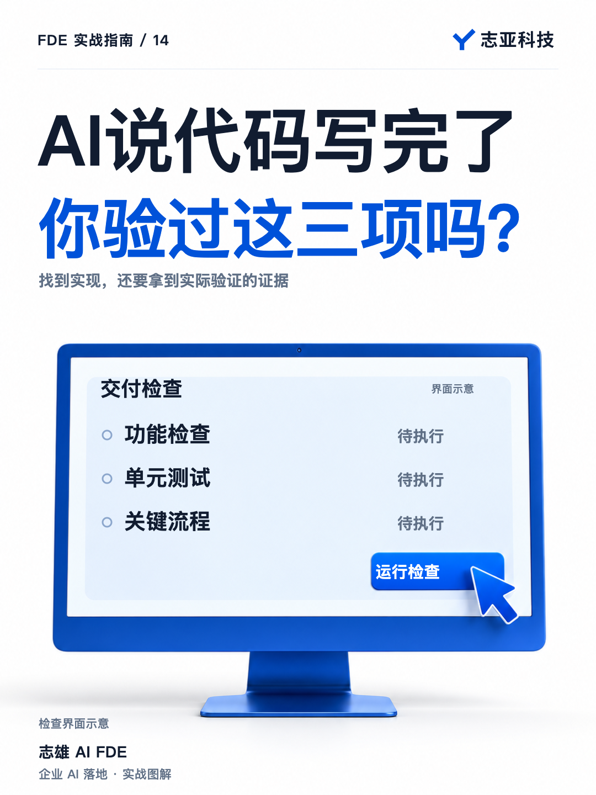
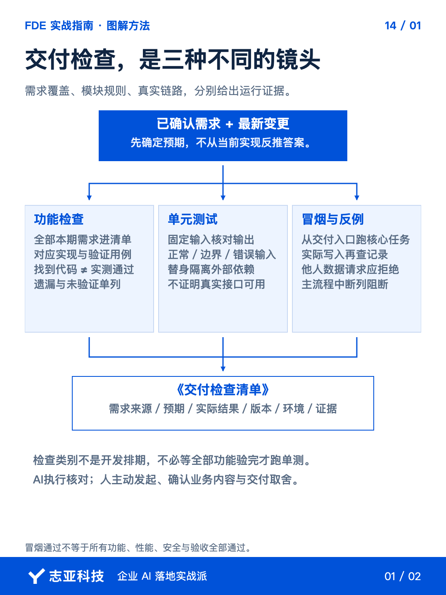
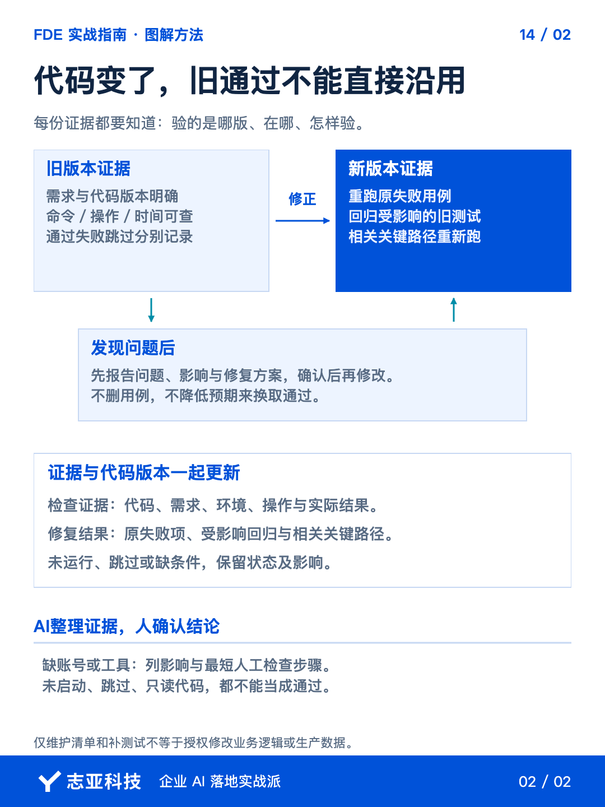

# AI说代码写完了，你还要检查什么？

**志雄 FDE 实战指南 · 志亚科技出品**<br>
作者：白志雄｜武汉市志亚科技有限公司

[返回阅读目录](../README.md) · [查看本篇图卡](#配套图文卡片)



上一篇我们讲完了架构。那么一旦架构确定，**不管是 Skill 还是 Web 应用，开发都可以交给 AI**。这属于 Vibe Coding 的范畴，这里就不展开了。

需要特别展开的是，**文档、代码可以让 AI 写，但检查和测试得手动来**。

也就是你得主动发起检查、确认结果，**不能把 Agent 的完成回复直接当成验收**。具体的核对、测试编写和执行，仍然可以交给 AI。

这篇直接给一套做法，**先做功能检查，确认需求有没有遗漏；再做单元测试，检查独立模块；最后做冒烟测试，检查关键流程能不能跑通**。

### 1、功能有没有漏

第一步，**把已确认的需求文档直接引用到当前开发 Agent 的对话框**。文件、附件或它能访问的文档位置都可以，最新变更记录也一起提供。

让它读取原需求，逐条对应实现，写入《交付检查清单》。每项分开记录两件事，**是否找到实现，以及是否实际验证通过**。

**预期先从原需求和已确认样例中提取**，不能看代码现在怎样运行，就把它当成正确答案。没有规定的行为列为待确认，你只需确认关键规则或有歧义的样例。

例如员工本人允许、他人拒绝、授权经理允许，**先确定这些预期，再让 Agent 测试**。需求来源、实现位置和实际证据一起留下。

拿前篇 AICRM 的需求作为检查示例，会议材料提取、客户新建、客户更新、员工数据范围和经理管理范围，都应有对应项。**不能只列新建和更新，就把权限要求漏掉**。

这一步的标准是，本期需求全部进入清单，遗漏、偏差和未验证项单独列出。**找到代码只是覆盖核对，功能通过还需要实际结果**。

Agent 能执行的功能验证，让它执行。**只读代码、用例被跳过或测试没有启动，都不能算通过**。接口未接通、账号缺失时，说明影响哪些要求。

**你先看它输出的遗漏、问题和未验证摘要**。有需求理解偏差，指出对应项，让它重新核对，不用自己再抄一遍长文。

### 2、模块能不能用

需求没有漏，不代表每段逻辑都做对了。接下来让 Agent 做单元测试，**针对可以独立检验的函数或模块，给定输入，再核对预期输出**。

仍以 **AICRM 的处理逻辑**说明测试方法。

字段处理。提供一组固定测试数据，检查**必填信息缺失时是否报错，没要求更新的字段是否被保留**。
权限判定。给定用户、客户负责人和管理关系，**分别检查本人允许、他人拒绝、授权经理允许**。
更新逻辑。检查只修改指定内容时，**其他字段和目标记录是否保持正确**。

让 Agent 根据原需求写用例，再实际运行。**正常输入、边界条件和错误输入都要覆盖关键规则**，不用一个成功例子代表整个模块。

涉及数据库、接口或模型时，单元测试可以用替身隔离外部依赖。但替身通过，只证明当前模块在这些条件下的行为，**不证明真实接口已经可用**。

让 Agent 从需求及风险中列出关键必测用例，不能只挑容易通过的模块。**必测项实际执行并符合预期，才支持这一阶段通过**；失败、跳过和未覆盖项分别列出。

出现失败，先汇报问题、影响和修复建议。**经确认后修改，再重跑原失败用例和受影响的旧测试**。不要删用例或降低预期来换取通过。

### 3、流程能不能通

模块分别通过，还可能在衔接处出问题。再做一轮冒烟测试，**快速检查当前版本的关键业务路径**，有没有阻碍继续使用的大问题。

AICRM 可以选这样**一条核心流程**。

提交脱敏会议材料，提取客户信息，**新建一位测试客户，再更新一个指定字段，最后重新查询记录**。

让 Agent 在已授权的测试环境里执行，核对数据是否进入正确客户，目标字段是否更新，未改字段是否保留，以及**界面或对话反馈是否与实际结果一致**。

如果只是模拟返回成功，**真实写入没跑过，就不能把这条流程标为已通过**。Web 应用还要检查实际入口能否打开并完成核心操作；Skill 则从准备交付的 Agent 调用方式开始验证。

权限等关键规则还要补真实接口反例。用 A 的测试身份请求更新 B 的测试客户，**核对后台是否拒绝、B 的记录是否未变**。权限函数测试通过，不能证明接口确实调用了它。

这一阶段要求约定的关键路径和必要反例实际通过。**权限绕过、误改数据或主流程中断，列为阻断问题**，不给出可交付建议。

**冒烟通过不是所有功能、性能和安全都已经验完**。它回答的是，这个版本的核心能力能不能继续往下检查。

AI 能操作入口，就让它先跑。缺浏览器能力或必要账号时，**让它给出最短手测步骤**。

人工最后拿熟悉的材料走一次，**判断业务内容和操作体验**。问题交回 Agent 定位，确认修复方案后再改，随后复测和更新记录。

### 4、直接用这段指令

**引用需求文档后，把下面这段交给当前开发 Agent**。不要求你先读完所有代码，再决定怎么测。

```text
请依据我引用的已确认需求文档及最新变更记录，检查当前实现。
无法读取材料时先说明，不按记忆补写需求。

先标识本次代码版本及未提交改动、需求版本、测试环境。
预期从需求和已确认样例提取，不从当前实现反推。
没有规定或有歧义的行为列为待确认，只向我提出必要的关键判断。

按三个阶段维护《交付检查清单.md》。
各阶段是检查组织方式，不要求等待全部功能实测后才能跑单元测试。

第一阶段，功能检查
全部本期需求进入清单，关联实现与验证用例。
分开记录实现覆盖和实际验证，列出遗漏、偏差及未验证要求。
代码存在、没有报错或没有执行，均不能代替功能通过。

第二阶段，单元测试
根据需求与高风险规则列出关键必测项，补充并运行适用用例。
覆盖正常、边界和错误输入，标明外部替身。
统计通过、失败、跳过、未执行与未覆盖，不只报通过数。
不删用例、不降低预期、不把仅测容易部分说成阶段通过。

第三阶段，冒烟测试与关键反例
在已授权的测试环境，从交付入口验证关键实际路径。
核对目标记录、字段变化及执行反馈，模拟结果单独标注。
权限等关键规则还要检查真实接口的拒绝路径及数据未变。
权限绕过、误改数据或主流程中断，列为阻断问题。
冒烟通过不等于全部功能、安全和验收通过。

清单逐项记录
需求来源、预期来源、用例、检查方式、实际结果及状态。
证据关联代码版本、执行时间、环境、实际命令或操作步骤。
保留脱敏输出或日志位置，不只复述完成说明。
缺条件说明影响哪些检查、需要我提供什么。

先允许维护清单和补充测试，不自动修改业务代码。
发现问题先列问题、影响和修复方案，取得确认再修改。
修改后重跑原失败用例及受影响回归，复跑相关关键路径。
更新新版本证据，保留旧结果，不沿用旧通过结论。

先确认测试账号、接口与数据均在明确授权范围。
不得操作生产数据、真实发送、扣费或删除业务数据。
安装依赖、迁移及其他外部副作用先等待授权。
不得输出或保存敏感信息与完整凭据。

对话先给短摘要
需求覆盖情况、关键用例执行情况、阻断问题、未验证影响。
不得因全部被跳过或没有运行而报告通过。
非阻断问题说明影响及处理选择，由负责人决定。
需要我判断的，给最短手测步骤、观察标准和反馈方式。
不要自行宣布验收或上线。
```

**提示词组织的是检查过程，不保证发现全部缺陷**。风险较高的业务规则、数据安全或复杂部署，还需要相应专业复核。

### 5、说到最后

这三步分别回答三个问题，**需求有没有漏，模块有没有错，核心流程有没有断**。

文档引用给 Agent，**检查清单和测试结果让它整理**。你看摘要、补条件，再亲自确认业务内容和使用体验。

发现问题时，提供对应项、输入和实际现象，确认修复方案后让 Agent 复测并更新记录。修改代码后，**旧的通过结果不自动适用于新版本**。

**开发和测试都可以借助 AI，但这两个任务要明确分开安排**。代码生成结束以后，把检查真正跑起来，才知道下一步是继续修，还是准备交付。

## 配套图文卡片

### 交付检查，是三种不同的镜头



### 代码变了，旧通过不能直接沿用



---

志亚科技出品。个人非商业学习和使用免费，商业使用须事先取得书面授权。

[使用许可](../LICENSE) · [作者与联系](../README.md#作者与联系) · [返回阅读目录](../README.md)
