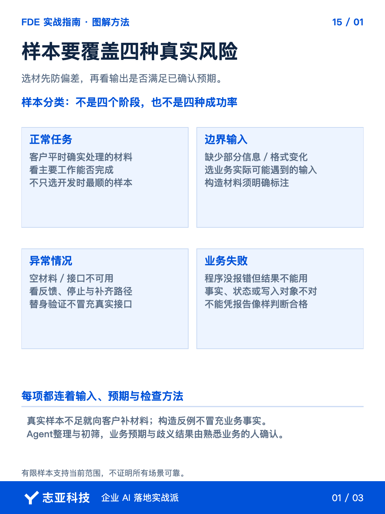
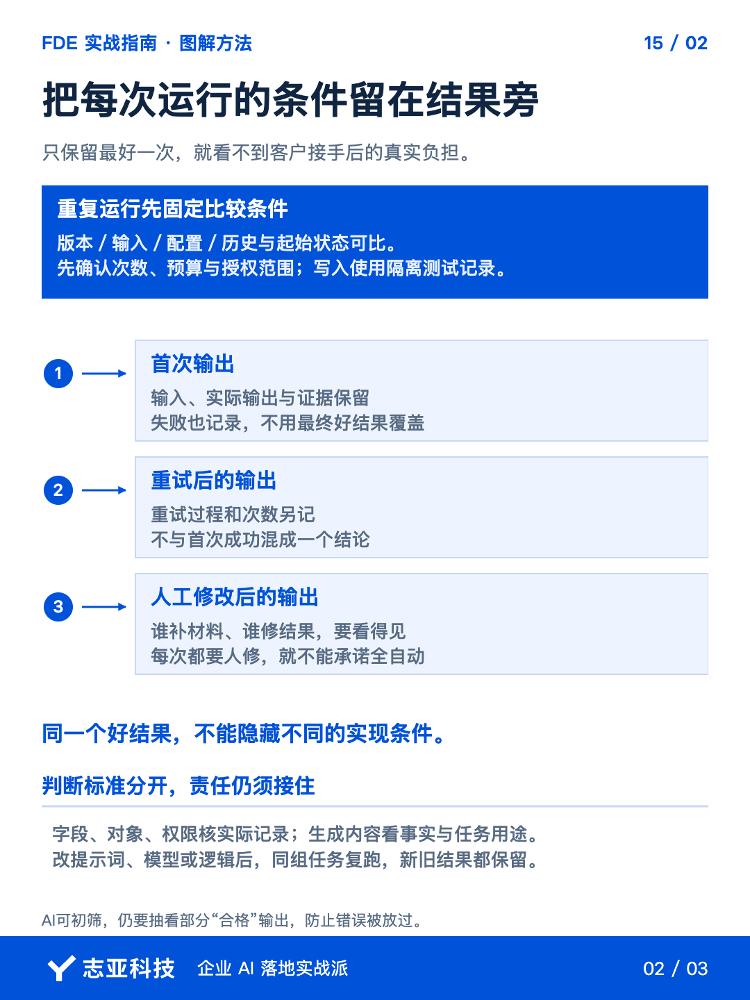
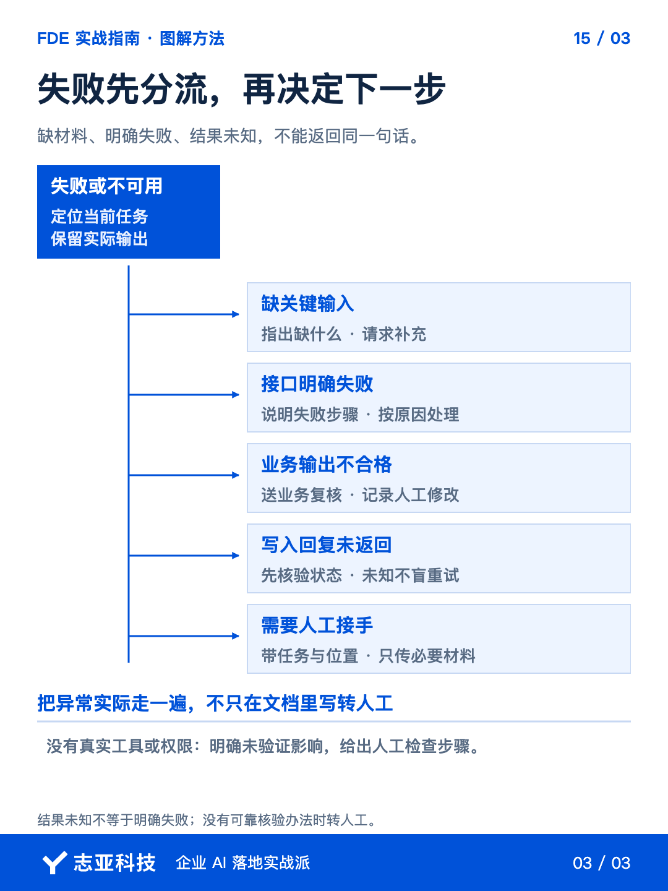

# AI演示跑通了，不代表客户每天都能用

**志雄 FDE 实战指南 · 志亚科技出品**<br>
作者：白志雄｜武汉市志亚科技有限公司

[返回阅读目录](../README.md) · [查看本篇图卡](#配套图文卡片)


自己测试时，结果不好，可以改一句提示词再试。客户换一份材料，未必知道该改哪里，也不可能一直等你在旁边调整。**开发者能把结果修好，和客户每天都能用好，是两件事。**

上一篇我们讲了功能检查、单元测试和冒烟测试。关键模块和流程跑通以后，还要往前走一步，**换材料、重复运行，看看业务结果是否合格，以及还需要多少人工。**

这一篇就带你组织一轮业务验证。材料整理、执行和留证交给 Agent，关键预期由你和业务人员确认。**最后留下能交付、需复核、仍未验证的范围，不能只挑最好的一次展示。**

### 1、先把材料交给它

把已确认需求、脱敏真实材料和上一轮问题交给当前开发 Agent，**让它按四类任务整理《业务验证清单》，避免只用调得最顺的材料证明效果。**

- **正常任务**，用客户平时处理的材料检查主要工作。
- **边界输入**，选业务会遇到的缺信息、格式变化等情况。
- **异常情况**，检查空材料、接口不可用时怎样反馈和停止。
- **业务失败**，程序没有报错，但生成或写入结果不符合要求。

每项补上输入、检查点和预期行为，人核对是否覆盖关键任务。真实材料不足就请客户补，**故意删字段或制造的异常单独标明，不能冒充真实业务样本。**

### 2、把合格说具体

有了材料，还得知道什么结果算对。**先按已确认需求写出预期，不要等系统生成以后，再找理由说它合理。**

以会议材料提取客户信息为例，没有预算就不能补造，还在讨论就不能写成已确认。**核对的是事实与状态，不是摘要像不像专业报告。**

下面是一条检查记录的示例，只说明怎么记，不代表已经跑过测试。

| 记录项 | 记录内容 |
|---|---|
| 输入与预期 | 材料未提供预算，输出应保留待确认，不能填入推测金额 |
| 首次结果 | 保留实际输出及原文位置，核对是否补造预算 |
| 重试与人工修改 | 另记每次调整了什么、谁处理、花了多少时间 |
| 最终判断 | 能直接用、需人工处理或未通过，并关联依据 |

**首次可用和修改后可用要分开，没运行的项目保留未执行。**

如果结果还要写入系统，就让 Agent 通过记录查询核对目标对象和字段。**内容读起来正确，不代表数据写到了正确的位置。**这类规则要有明确的通过或失败结果。

还记得第12篇的三层架构吗？Agent 交互层查有没有听错任务，代码逻辑层查规则和权限是否按约执行，知识库与数据库层查依据、版本和实际记录。**三层都看，才能分清该改提示词、修逻辑，还是补资料。**

生成内容不用逐字对答案。Agent 按事实、完整性、客户限制和用途初筛，**歧义和可疑结果交业务人员判断，并抽查部分初筛合格输出，防止错误被放过。**确认后把判断补回清单。

探索期 POC 尚未形成的标准，继续拿结果讨论，不硬编分数。**AI 的合格判断不能自动代替客户的业务判断。**

### 3、让它重复跑

预期确认以后，把清单交回当前 Agent，让它提出关键样本的运行次数和预计调用费用。**确认测试环境、数据范围和调用预算后，再开始执行。**

运行时，**先固定版本，保持输入、配置和起始状态可比。**需要历史对话就明确提供，不要一边改条件一边比较结果。

涉及写入时，**每次使用隔离测试记录，避免前一次操作污染下一次的条件。**

让 Agent 每次保留实际输入、输出和检查结果，并标注运行版本与条件。**首次失败、重试后成功、人工修改后才可用，要分别记录，不能只留下最后最好的一次。**

这时要重点看人工投入。同一项工作，如果每次都要你补材料、改结果，交付时就要保留这个环节。**不能把有人照看的运行，承诺成客户可以全自动使用。**

修改提示词、切换模型或调整逻辑后，让 Agent 用同一组任务再跑，保留新旧版本结果。**修好的问题要复测，原来能做的任务也要重新检查。**新发现的问题，加入下一轮清单。

### 4、再验失败怎么接

成功路径看完，再让 Agent 检查，**输入不全、接口失败、结果不能用时，系统实际会怎么处理。**只在说明文档里写了转人工，还不算做到了。

在授权测试环境中模拟缺关键材料，观察系统是否明确指出缺什么。**应该请求补充时，就不能继续猜着生成。**接口失败，也要能找到失败步骤，而不是对用户仍然回复已完成。

如果写入请求已经发出，却没有收到回复，要先确认执行状态。**让 Agent 检查是否已有查询或核验办法，不要为了重试而重复写入。**没有可靠办法，就保留结果未知并转人工处理。

该转人工的结果，要带上任务、已完成步骤、失败位置和必要材料。**人工接手应该能继续处理，而不是从头猜发生了什么。**涉及私密材料时，只传必要信息。

这些情况能由 Agent 在测试环境验证，就让它先跑；只能用替身模拟的，要注明未验证真实接口。**缺权限或工具时，列出最短人工检查步骤，不把没测过的部分报成通过。**

### 5、把检查交给它

前面的检查最终要回到交付决定。**先看直接可用、需人工处理、失败或未验证这三类结果，再点开有疑问的证据。**缺条件的部分说清影响，不能让一份整齐的报告代替决定。

引用需求、真实材料和已有记录后，可以把这段要求交给当前开发 Agent。

```text
基于已确认需求、脱敏真实材料和已有问题，整理业务验证清单。
覆盖正常、边界、异常和业务失败，标明真实样本、构造反例与缺失材料。
逐项给出输入、独立预期、检查方法和待确认项，不按当前输出反推答案。
先请我确认业务预期、运行次数、调用预算和授权测试范围。

确认后固定版本、配置与可比起始状态执行，保留输入输出及证据位置。
首次结果、重试、人工修改和接手分别记录，失败、跳过、未执行单列。
生成内容先初筛，歧义交人工判断，并抽查部分初筛合格输出。
涉及写入使用隔离测试记录并查询实际结果，模拟与真实接口验证分开。
检查缺材料、接口失败和转人工路径；写入结果未知先核验，不盲目重试。
不操作生产数据、不真实发送、不删除业务数据，不记录完整凭据。
缺工具或权限时，说明未验证影响并给最短人工检查步骤。
发现问题先报告，确认修复后复测失败项与相关旧任务，保留新旧结果。

最后汇总直接可用、需人工处理、失败或未验证的范围、依据及人工投入。
有限样本通过不代表所有场景可靠，不自行宣布验收或上线。
```

这段指令用于组织检查，**还需要按当前项目确认样本、接口条件和业务预期，不能当作已经实测的方案。**

### 6、说到最后

这一轮结束，**哪些任务能用、还要多少人工、哪些问题没解决，都应该有记录可查。**小项目不必先搭复杂评估平台，但不能把关键判断留在开发者脑子里。

后续每次改动，拿留下的材料再检查。**稳定是在实际结果和反复修正里逐步建立的。**把范围与限制交代清楚，下一篇再让客户真正接手。

## 配套图文卡片

### 样本要覆盖四种真实风险



### 把每次运行的条件留在结果旁



### 失败先分流，再决定下一步



---

志亚科技出品。个人非商业学习和使用免费，商业使用须事先取得书面授权。

[使用许可](../LICENSE) · [作者与联系](../README.md#作者与联系) · [返回阅读目录](../README.md)
