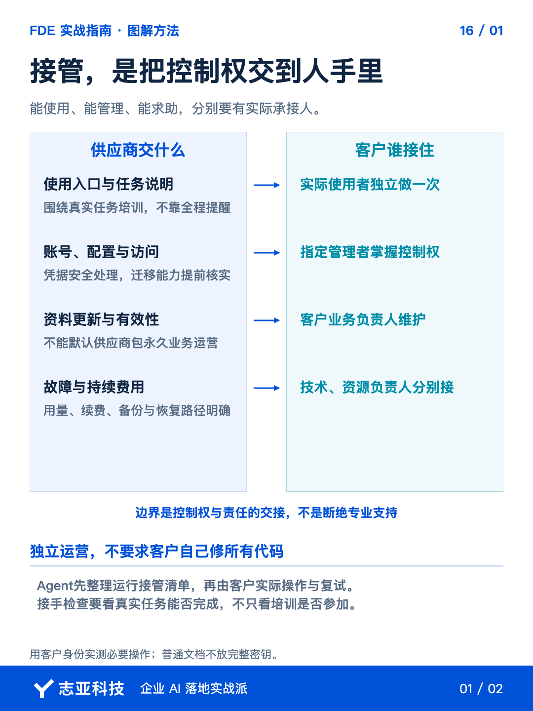
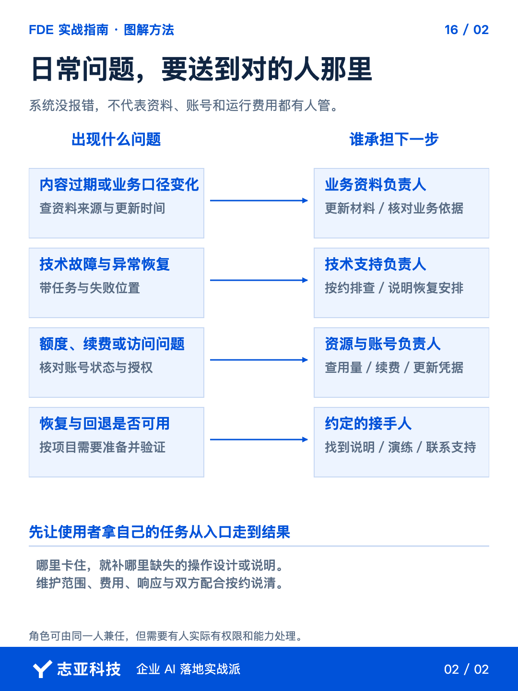

# AI系统交付后，怎样让客户自己用得起来？

**志雄 FDE 实战指南 · 志亚科技出品** 
作者：白志雄｜武汉市志亚科技有限公司

[返回阅读目录](../README.md) · [查看本篇图卡](#配套图文卡片)

系统已经交过去，客户却还在找你要账号、更新资料、处理报错。**东西交了，日常运行仍然挂在开发者身上。**

这时再发一份源码，或者再演示一遍，也未必能解决。**你能操作，证明不了客户离开你的提示也能操作。**

前两篇讲了代码检查和业务验证，这次换客户自己走一遍。**就查四件事，使用者能否完成任务、负责人是否掌握控制权、业务资料谁维护、异常谁接住。**查完，你应该能区分哪些还没交出去，哪些是双方同意保留的支持服务。

### 1、按任务整理交接

把本期需求、部署说明、已确认的功能和限制交给当前开发 Agent，让它整理《运行接管清单》。**不要先列几十份文档，先列客户每天要完成什么。**

每项写清使用入口、所需账号、输入材料、正常结果和失败后的处理位置。**清单里的动作，应当能在准备交付的版本里找到对应入口。**文档写着可以更新资料，实际却只有开发者能改，就标为未交接。

再把源码、配置说明、接口资料等交付物关联到这些任务。**先知道接手人要做什么，才知道哪些资料必须给到，哪些只是开发过程的参考。**

让 Agent 列出它读不到或无法确认的项目，人只补关键缺口。**不能因为文档生成得完整，就把账号控制权和实际操作能力也算成已经移交。**

### 2、让客户自己跑一次

安排实际使用者，用授权材料从日常入口完成一项代表性任务。说明可以查，**但不要由开发者代操作，再把自己的成功算成客户会用了。**

观察停在哪里。入口找不到，先调整入口或说明；材料不会准备，补输入要求；结果看不懂，明确怎样判断和处理。**把卡住的位置写回清单，交给 Agent 补说明或提出改进，再让使用者复试。**

这不是考客户，也不是要求人人懂技术。**检查的是交付能否支持一个不熟悉开发过程的人完成工作。**如果每一步都要在微信里问你，接管就还没有完成。

不必把所有按钮培训一遍。**围绕主要任务教会开始、完成和求助，再留下对应的操作说明。**特殊任务可以标明需要另行支持，不伪装成全部独立完成。

### 3、把控制权核清楚

让 Agent 根据部署配置列出依赖服务，但不要输出完整凭据。**逐项核对账号归属、管理人、付费人、权限范围和续费安排。**

入口账号、模型服务、数据源可能不属于同一方。用客户侧已授权的身份实际登录并检查必要操作，**不能拿你自己的管理员账号代替客户验证。**

按第12篇的三层架构再查一遍，会更容易发现漏项。Agent 交互层谁能使用和管理，代码逻辑层的配置与 API 由谁维护，知识库和数据库由谁更新、谁能恢复。**三层可以在一个平台里，也可以由同一人接管，但责任不能因为入口只有一个就省略。**

关键服务依赖开发者个人账号时，先核实能否按约迁移或重新配置。**核实不了，就把限制和替代安排说清，不承诺平台根本不支持的移交。**调整后重新跑关键路径，别只改完账号就离场。

密钥通过双方认可的安全方式交接，客户侧负责人接收后按需要轮换。**普通操作文档只说明配置位置和管理方式，不放完整密钥。**维护访问是否保留，另按任务授权。

### 4、业务维护有人接

技术管理员不一定知道业务资料何时过期。**请客户明确谁更新内容、谁批准规则调整、谁汇总内部问题，分别写到接管清单。**

用一项必要的日常维护验证安排，比如由负责人更新一份测试资料，再检查系统是否使用了正确版本。**验证的是维护路径有没有接上，不是让客户改业务代码。**

故障处理也要实际核对。让 Agent 给出当前版本的错误查看位置、暂停方式和恢复条件，**能在授权测试环境演练的先演练，不能演练的标明未验证和接手人。**

备份不能只列文件名。需要恢复能力的项目，按授权和约定在隔离环境检查可恢复性，**没有验证的恢复安排，不写成已经可靠。**不要拿生产数据冒险演示。

费用到期、调用额度不足、维护期结束，也要有下一步安排。**独立接管不是客户会修所有故障，而是遇到事情知道由谁处理，不必从头找开发者问。**

### 5、说到最后

离场前，再看客户刚才独立操作留下的记录。**完成任务靠的是已经交出的能力，还是你在旁边临时补位？**卡住的位置，应当在接管清单里找到处理结果或明确的后续安排。

缺什么就补什么，不用为小项目搭一套庞大的运维制度。**但凡仍需你临时提供密码、解释隐含规则或代做日常操作，就明确它属于未完成交接，还是双方同意保留的服务。**

接管范围和遗留事项由双方确认，后续支持再按约安排。**把客户教会、把责任接上，才不会让每一次新合作都被上一单的临时救场拖住。**

## 配套图文卡片

### 接管，是把控制权交到人手里

### 日常问题，要送到对的人那里

---

志亚科技出品。个人非商业学习和使用免费，商业使用须事先取得书面授权。

[使用许可](../LICENSE) · [作者与联系](../README.md#作者与联系) · [返回阅读目录](../README.md)
