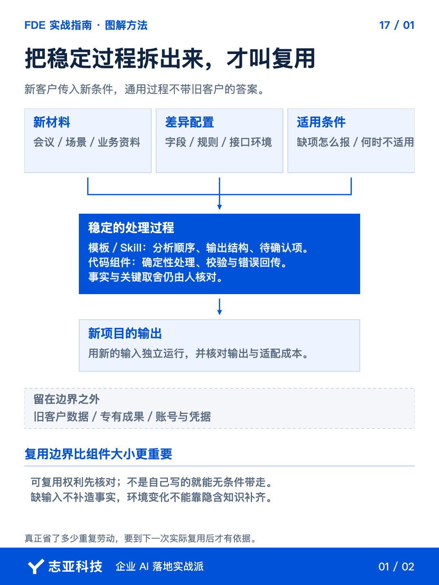
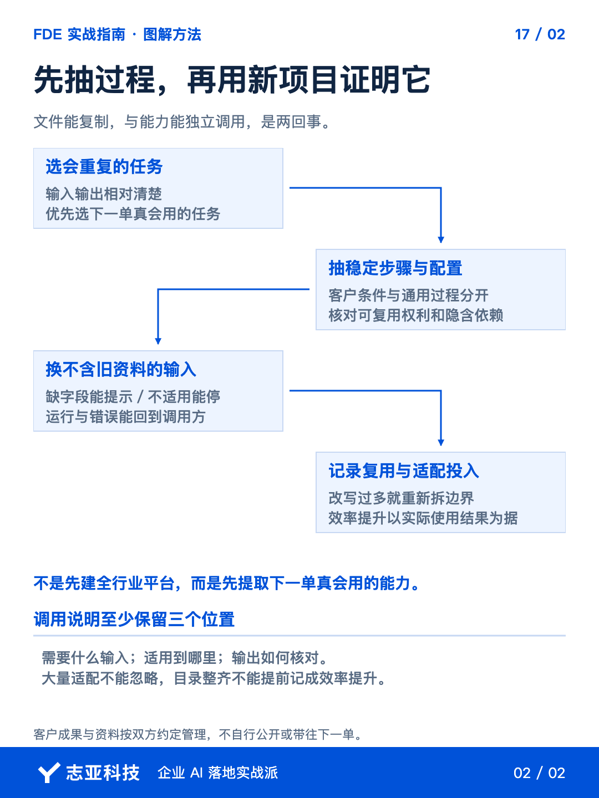

# 做完一个AI项目，怎样把重复工作做成可复用流程？

**志雄 FDE 实战指南 · 志亚科技出品**<br>
作者：白志雄｜武汉市志亚科技有限公司

[返回阅读目录](../README.md) · [查看本篇图卡](#配套图文卡片)


上一单交接完，下一位客户又发来会议材料，你仍要重新整理场景、追问缺口、生成需求文档。**项目文件存了不少，重复劳动却没有减少。**

问题在于，保存的是上次的答案，还没有提炼出生成答案的办法。**复用要带走处理过程，不能连上一位客户的事实一起带走。**

上一篇把客户接管的条件核清，这次给下一单的自己留点东西。**就拿需求整理这项重复工作，把输入、处理、检查和输出拆出来，再换材料验证。**先不急着建平台。

### 1、先找一项重复劳动

把项目目录和任务记录交给 Agent，在授权范围内整理候选项。**让它指出哪些任务已经重复，输入输出分别是什么，不要自动把所有文件包装成资产。**

需求整理、交付说明生成、相同格式的数据处理，都可能成为候选。你只需先选一件，**既确实重复，又已经有相对稳定的处理办法。**

比如需求文档每次都要写，但不同客户的结论不同。能沉淀的是识别场景、整理现状与目标、标出待确认项的过程，**不是把旧文档的客户名字替换掉。**

让 Agent 把固定步骤与客户变量分开列。名称、字段、规则、环境都写进可变项，**如果每一步都要重新作业务判断，就先缩小复用范围，不急着声称一键完成。**

### 2、让过程先独立出来

选定需求整理这项工作后，把已授权的样例及处理要求交给 Agent，**让它写出需要的材料、分析步骤、输出结构和检查依据。**

缺材料时应该问什么，原话、推断和待确认怎样区分，也写清楚。**输出完整不是目标，不能把客户没有说过的规则补成确定事实。**

这项能力的最小规格，可以先写成下面这样。这是提炼方法的示例，不是已经验证过的产品。

| 部分 | 需求整理的最小约定 |
|---|---|
| 输入 | 已授权的会议转写、现有业务资料、本期讨论范围 |
| 固定步骤 | 识别使用场景，保留来源，分开事实与推断，标出冲突和缺项 |
| 输出 | 可追溯的需求结构，加一页需要客户确认的问题 |
| 检查与停止 | 无来源的规则不进入确定范围；关键事实缺失时先补问 |

**新客户换的是材料和业务条件，不能把这张表里的检查责任也一起省掉。**

这段过程如果只是提示词，先作为可复制指令使用；需要多步处理时，再整理成你所用环境支持的 Skill 或脚本。**选形式看实际调用需要，不是名字越新越像资产。**

可以把下面这段交给 Agent，**要求它交出下次能调用的指令，而不只描述值得沉淀什么。**

```text
根据我引用的授权会议材料、已确认需求稿和修改记录，提炼需求整理过程。
产出一份可重复调用的指令，列输入、处理步骤、输出结构、检查与停止条件。
剥离旧客户名称、业务结论、账号、字段值和其他专有事实。
区分可复用步骤与每次都要确认的业务判断，不把一次做法写成通用规则。
缺必要材料、来源或确认依据时，列缺口，不补造事实。
用另一份脱敏材料试运行，核对来源、事实推断分层与待确认项，报告结果和限制。
只在授权范围处理材料，不覆盖原件、不外发，不把未运行说成验证通过。
```

**方法本身还不稳定，就先改方法，不急着给它加自动化外壳。**这段指令用于提炼候选过程，仍需下一步换材料检查。

### 3、按三层拆边界

回到前面讲过的三层架构，复用边界会更清楚。**Agent 交互层可以保留整理步骤与调用方式，代码逻辑层可以提取稳定的校验和处理，知识库与数据库层要接入当前客户自己的资料和业务记录。**

同样是需求整理，来源检查可以复用，客户的业务规则不能照搬。涉及代码时，让 Agent 找出接口地址、凭据、字段映射和环境依赖，提出拆分建议。**确认后再改，并换一套脱敏配置检查是否仍会读取旧地址或旧记录。**

还要核对复用权利。客户专有成果、原有组件与第三方依赖，按约定和许可分清，不确定的先不带走。**通用过程要连着输入要求、错误反馈和检查方法一起交付，不能只复制一段能跑的代码。**

### 4、换材料再试一次

让 Agent 换一份不含旧客户信息的材料，按同样步骤生成结果。**优先使用没有专门为它调过的新材料，检查复用的是方法，还是记住了旧答案。**

检查可以落到三处。新材料没说预算，待确认里是否留下缺口；来源是否指向这次转写，而非旧稿；客户规则是否仍带着上一单的内容。**这些检查没有过，就不能因为文件长得完整而放行。**

正常输入能跑以后，再用缺必要材料的输入检查。**它应该说明缺什么，而不是借用旧客户事实继续补答案。**

自己先看失败和待确认摘要，再抽查关键输出。**如果需要你重新解释大半流程，回头拆小任务，不把这份改写成本藏在效率收益里。**

确认可用后，留下简短调用说明，包含输入、适用条件、限制和检查方法。**让下一次的自己找得到、交得进材料、看得懂结果，就够开始复用。**

实际投入新项目，再记录省去了什么、适配增加了什么。**没有真实使用记录，就先写候选能力，不提前宣称节省了多少人天。**

### 5、说到最后

做完项目，不必强迫自己提炼一整套产品。**先把下一次确定会重复的一项劳动，整理成可以独立调用的小能力。**

把客户事实拿掉，把处理步骤留下，把适用条件和检查办法补上。**复用成立的证据，不是目录更整齐，而是换了材料仍能完成同一类任务。**

同一个过程，换一份材料仍然能用，才值得继续完善。**如果每单都要重新解释和大幅改写，就先缩小边界，不急着把它叫作可复用资产。**

这一组稳定方案的讨论，到这里留下了能执行的过程。下一篇转向需求判断，先看谁能拍板、谁能授权。**工具可以复用，新的业务取舍仍然需要重新确认。**

## 配套图文卡片

### 把稳定过程拆出来，才叫复用



### 先抽过程，再用新项目证明它



---

志亚科技出品。个人非商业学习和使用免费，商业使用须事先取得书面授权。

[使用许可](../LICENSE) · [作者与联系](../README.md#作者与联系) · [返回阅读目录](../README.md)
