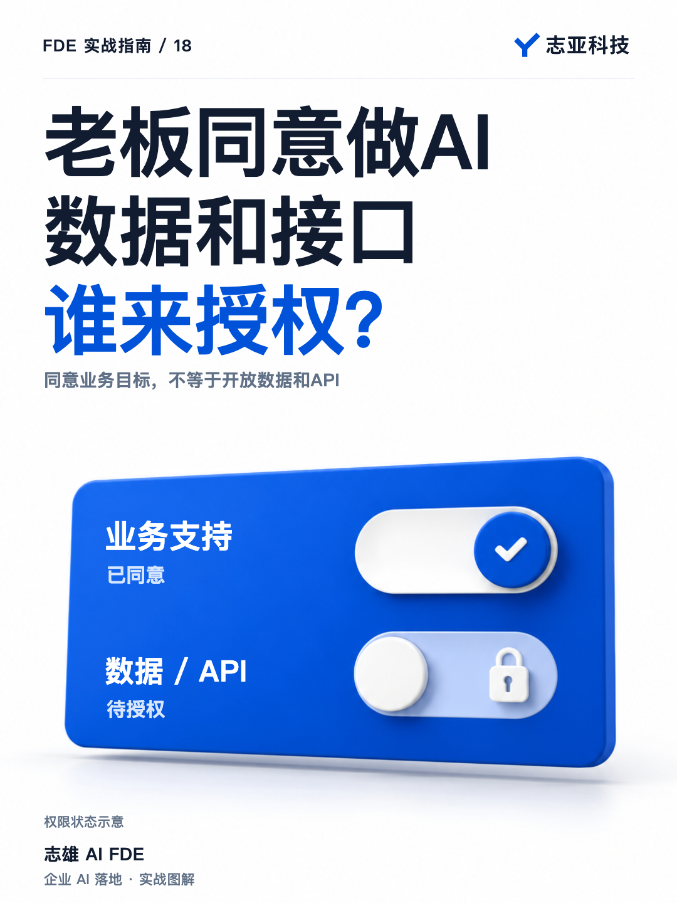
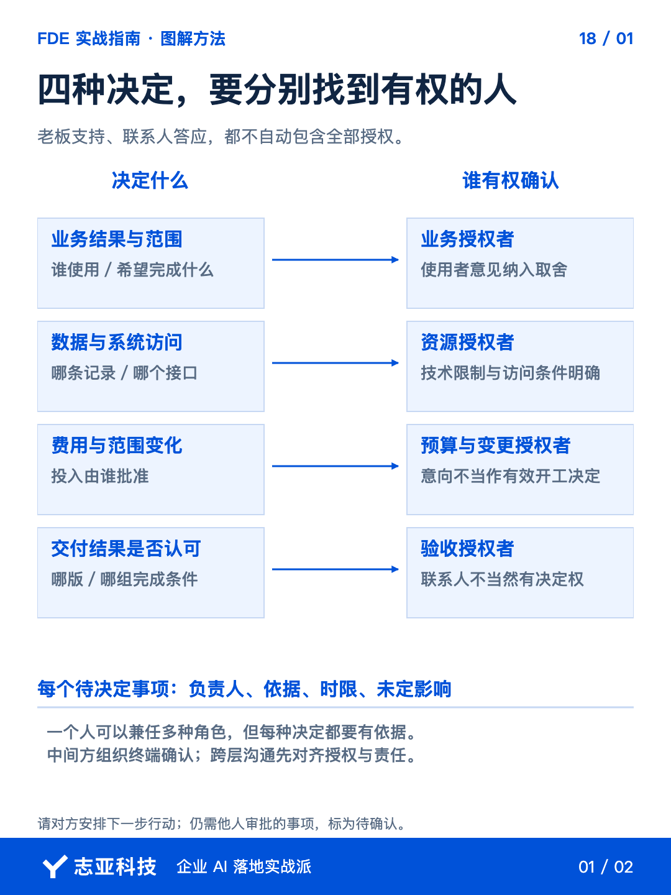
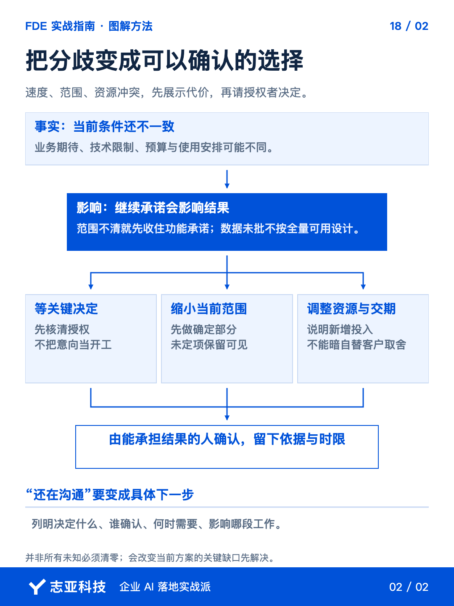

# 老板同意做AI，为什么还是拿不到数据和接口？

**志雄 FDE 实战指南 · 志亚科技出品** 
作者：白志雄｜武汉市志亚科技有限公司

[返回阅读目录](../README.md) · [查看本篇图卡](#配套图文卡片)

客户已经谈过预算，联系人也说老板同意，下一步很容易直接排开发。但资料还在等别人批准，业务规则又有人提出不同意见。**同意花钱的人，不一定能替所有人把实施条件定下来。**

这时继续谈更多功能，解决不了眼前的缺口。**先查清当前要作哪些决定，由谁确认，再判断哪些承诺可以落地。**

这里要查的不是谁的职务最高，而是谁能确认业务范围、开放数据和系统、批准投入变化、认可交付。**四种决定可以由一个人承担，但不能用一句老板同意了，替代每项条件真的到位。**这也是从做出稳定方案，进一步走向需求判断时要补的能力。

### 1、从待决定的事找人

把现有需求、授权范围内的沟通记录和方案交给 Agent，**让它整理《关键决定清单》，不要只生成一张组织架构图。**

清单围绕四类事情展开，业务结果与范围、数据和系统访问、费用变化、验收确认。**每项列出需要决定什么、已知由谁负责、来源在哪、还缺什么。**

同一个老板可以兼任几个角色，小项目不用硬凑几位负责人。**但业务上同意，不自动代表外部系统权限也已经开放。**

Agent 可以从记录提取人名和承诺，不能凭职务猜权限。**缺少依据的确认权标为待核实，交给直接客户补充，不让 AI 替组织任命负责人。**

### 2、用下一项行动核实

核实决定权，不必绕着头衔聊很久。**把下一步需要的行动提出，让联系人明确谁能安排、何时能完成。**

比如方案依赖接口访问，就请对方确认开放范围、授权人和可用时间。**联系人答应了，但还要另一团队审批，就仍是待确认条件，不能按接口已经可用承诺开发结果。**

以接口开放为例，确认记录可以只留一行。下面是记录结构，不代填真实项目的人名和日期。

| 待开放范围 | 谁能授权 | 何时可用 | 未到位的影响 |
|---|---|---|---|
| 明确到接口、数据范围及读写操作 | 记录有依据的授权人，尚不明确就待核实 | 区分承诺时间与实际开通时间 | 指出受阻的联调、验证或交付任务 |

三层架构在这里也用得上。**Agent 听懂了要做什么，不能代替代码层获得操作权限，更不能代替数据负责人批准资料用途。**批准业务目标、开放 API、允许访问数据，各自需要有效依据。

业务人员有想法，也可以继续收集。需要改变费用或范围时，**请对方把意见交到约定的确认出口，而不是直接把每个人的建议都加入任务表。**

这不是拒绝普通员工参与。**使用者提供事实，有权的人确定取舍，两种贡献都需要，只是不能相互代替。**

### 3、把分歧变成选择

不同角色有不同期待很正常。速度要快、范围要全，又不愿提供必要数据，**这几项要求不能靠开发者一句都可以同时接下来。**

让 Agent 从需求和限制中整理冲突项，再由你核对。**每项给出可选安排，以及各自影响的结果、投入和时间。**

保留当前交期，可以缩小哪段范围；保留更多场景，需要补什么配合；暂拿不到数据，这一轮能验证到哪里。**说清取舍，不替客户裁定谁的意见更重要。**

把需要确认的选择发给有相应权限的人，记录结果。**会议里没有反对，不等于已经同意；决定清单要关联能回查的确认。**

### 4、别越过直接客户

有中间方时，责任要分层，但影响方案的事实仍要确认。**先让直接客户组织终端反馈，必要时再授权你参与沟通。**

可以把关键问题压缩成一份确认清单，请他带回使用方式、数据条件和验收安排。**你要的是做方案所需的事实，不是接管他的客户关系。**

临时拿不到的条件，说明影响，选择先做不依赖它的部分、缩小范围或等待。**哪些工作先做，也由承担费用与结果的人确认，不能靠自己垫投入换取模糊支持。**

每推进一轮，就更新已确认、待确认、受阻事项。**一张能指出下一项决定的清单，比反复说客户内部还没协调好更有用。**

### 5、说到最后

这一轮结束，不要求把整个客户组织研究透。**你应该知道，当前承诺依赖哪几个决定，谁能作，哪些已经确认。**

内部推进 AI 的人，也要把业务、技术和预算的决定接起来；外部 FDE 则通过直接客户获取这些条件。**双方需要的是同一套可执行事实，不是各自再画一张汇报图。**

有预算值得认真跟进，有支持值得继续推进。**等到关键决定有人认、必要条件能到位，才把技术上的可行转成对交付的承诺。**

## 配套图文卡片

### 四种决定，要分别找到有权的人

### 把分歧变成可以确认的选择

---

志亚科技出品。个人非商业学习和使用免费，商业使用须事先取得书面授权。

[使用许可](../LICENSE) · [作者与联系](../README.md#作者与联系) · [返回阅读目录](../README.md)
