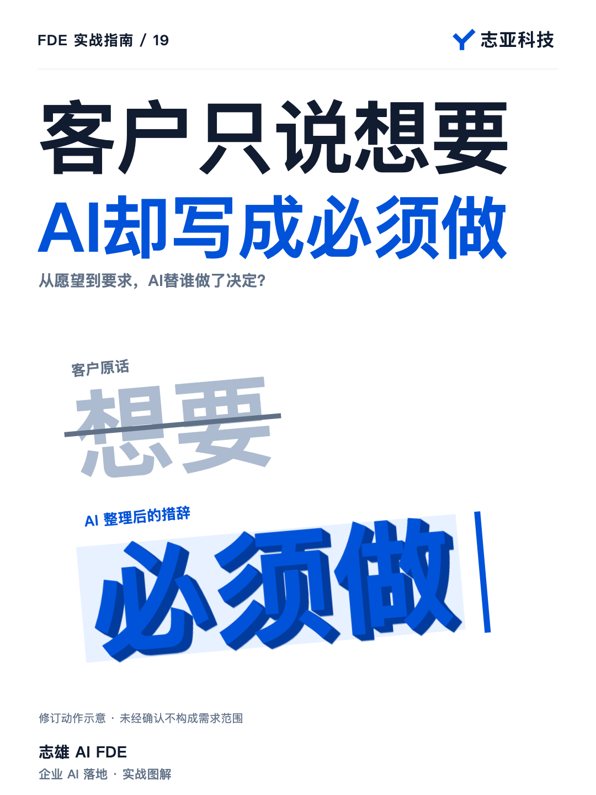
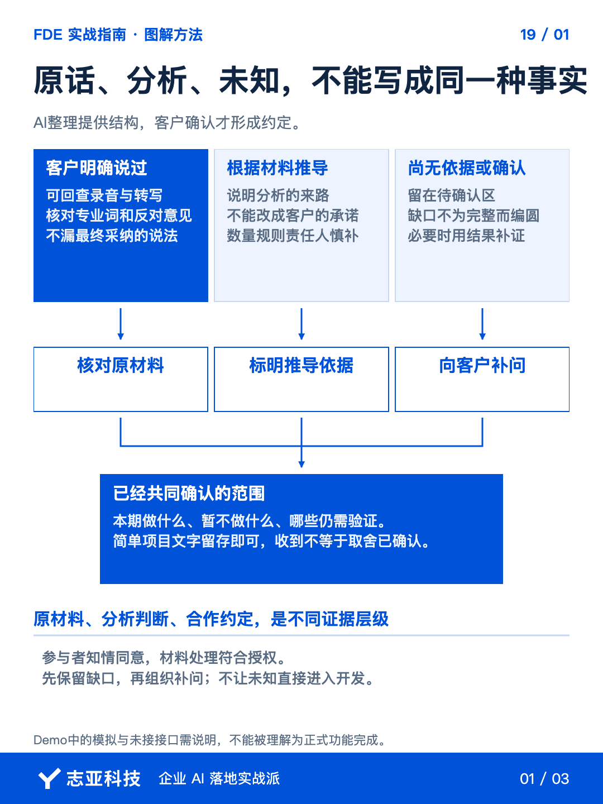
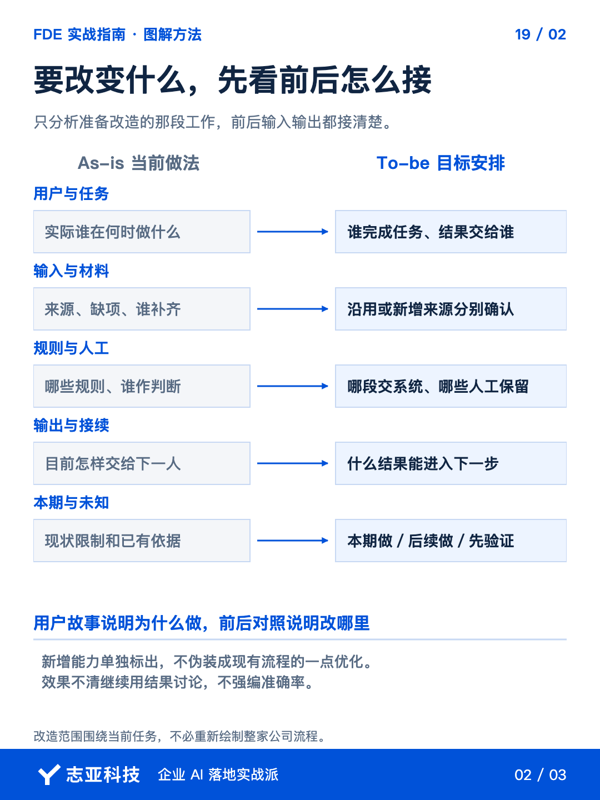
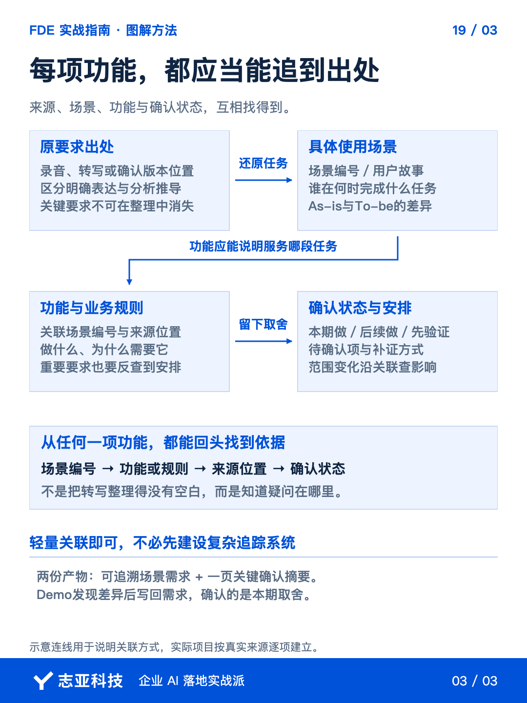

# 会议录音交给AI，怎样避免需求文档越写越偏？

**志雄 FDE 实战指南 · 志亚科技出品**<br>
作者：白志雄｜武汉市志亚科技有限公司

[返回阅读目录](../README.md) · [查看本篇图卡](#配套图文卡片)



需求会议结束，把录音转写交给 AI，几分钟就能得到一份像样的文档。接下来很容易直接按它开发，**问题却可能已经在整理时被写进去了。**

客户说希望有，文档写成必须做；会议里没有决定的规则，被补成完整流程。**文字越顺，越要看哪些是原话，哪些只是 AI 替双方填的空。**

前面问到的现状、使用任务和确认人，这时要落到工作依据里。**留下两份东西，一份能追溯来源的场景需求，一页交给有权的人决定的关键问题。**不用让客户重读整份转写，也不让 AI 替客户把未知填完。

### 1、先把来源保留下来

在参与者知情同意、材料使用符合授权的前提下，用腾讯会议或飞书会议等工具录音转写。**转写是供回查的材料，不是天然准确的需求事实。**

把转写交给当前 Agent 或已配置的需求分析 Skill，要求分出客户明确表达、分析推断、待确认三类。**数量、规则、责任人没有来源，就不要写成已经确定。**

对影响方案的专业词、否定句和最后采纳意见，回到原材料核对。**录音也听不清，就保留疑问，不用模型猜一个最像的说法。**

让它保留时间位置或原文片段，自己先看关键事实和冲突摘要。**不用把长转写重新读一遍，但重要结论应当能沿来源查回去。**

### 2、从场景开始成文

不要让 Agent 看到一段话就扩成一项功能。**先让它按谁在什么情境下、拿什么材料、完成什么任务、结果交给谁整理场景。**

用户故事可以收成一句话，某类用户为了某项业务结果，需要完成某个动作。**缺少使用者或结果的内容先待确认，不为凑文档补一个角色。**

再写清现在怎样做、准备改变哪里，也就是 As-is 与 To-be。现在由谁处理、依据什么判断、哪里卡住，未来改变哪一段、保留哪些人工。**比较的是具体任务，不是用一套未来想象替换全部现状。**

请实际业务人员核对关键差异。**AI 负责整理，业务人员确认工作事实，FDE 判断这些事实怎样影响方案。**新业务没有现状时单列不确定性，不假装它只是一次小优化。

### 3、让功能对应到任务

场景确认到必要程度，再让 Agent 提取功能和规则。**每项关联场景编号、原始来源、确认状态，以及本期准备怎么处理。**

用一条整理示例看这个关联。假设讨论中只提出了希望根据会议材料生成需求初稿，尚未确认自动写入业务系统。

| 关联位置 | 怎样留下依据 |
|---|---|
| 来源 | 保留提出这一意向的转写位置，核对原意 |
| 场景 | 从会议材料形成初稿；使用者与复核人未明确就继续问 |
| 功能 | 生成初稿可作为候选；自动写入不能自行追加 |
| 状态 | 范围与复核责任待确认，不记成必须交付 |

后面无论改的是交互、执行规则还是数据读写，都沿这个关联找依据。**整理 Agent 写出的初稿，不能自动成为实施承诺。**

同时反向检查，客户明确要求过的内容有没有遗漏。**本期做、后续做、待验证或明确不做，都要有去向，不在整理中悄悄消失。**

看到 Agent 加出的完整流程，先问它依据在哪里。没有来源的建议可以保留，**但必须与客户要求分开，不自动变成范围承诺。**

这份轻量关联也服务后续修改。规则变化时，能查到影响的场景和功能，**不用每次从整份文档重新猜客户当时说了什么。**

### 4、确认关键取舍

把长文发过去等一句收到，不足以完成确认。**让 Agent 另整理一页需要决定的事项，优先列场景差异、本期范围和会影响实现的未知。**

简单项目可以通过微信确认；电话里说定的内容，再用简短文字留存。**确认的是理解和取舍，不是客户愿不愿意阅读一份长文档。**

交互或效果只靠文字说不清，就给必要的 Demo。说明哪些是模拟展示，把客户指出的差异写回需求，**不要等文档完美才展示，也不要展示之后把约定丢掉。**

你可以直接给整理 Agent 这段要求，**让它生成供确认的工作依据，而不是写一份看上去没有疑问的报告。**

```text
根据引用的会议转写整理需求场景。
区分明确表达、分析推断和待确认，保留来源位置。
先写用户故事及As-is/To-be，再关联功能、规则和本期处理方式。
反向检查重要要求有无遗漏，不补造事实，不编效果阈值。
另给关键确认摘要，列冲突、缺材料和需要客户决定的取舍。
未经确认的建议不写成正式范围，引用材料只在授权范围处理。
```

### 5、说到最后

这一轮结束，应当得到两样东西。**一份能追溯来源的场景需求，以及一份客户看得懂的关键确认摘要。**

Agent 帮你压缩整理时间，核对事实、识别分歧和作出取舍仍然需要人。**它写得完整，不代表双方已经形成共识。**

需求文档的价值，是让后续开发少猜，出现变化还能回头对照。**把未知明确留下来，比用确定语气把它写没了，更接近专业的需求工作。**

## 配套图文卡片

### 原话、分析、未知，不能写成同一种事实



### 要改变什么，先看前后怎么接



### 每项功能，都应当能追到出处



---

志亚科技出品。个人非商业学习和使用免费，商业使用须事先取得书面授权。

[使用许可](../LICENSE) · [作者与联系](../README.md#作者与联系) · [返回阅读目录](../README.md)
