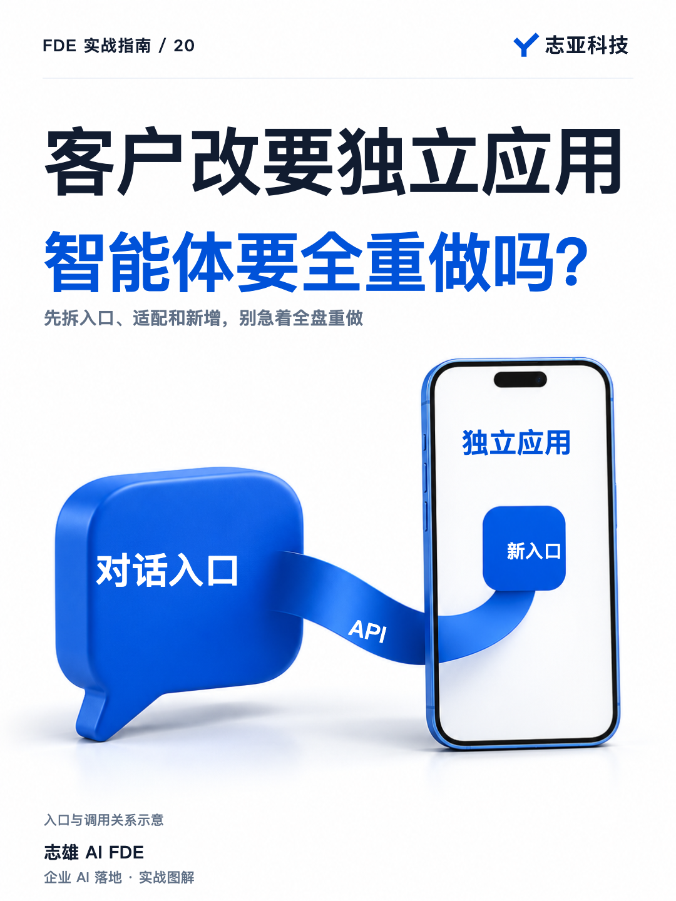
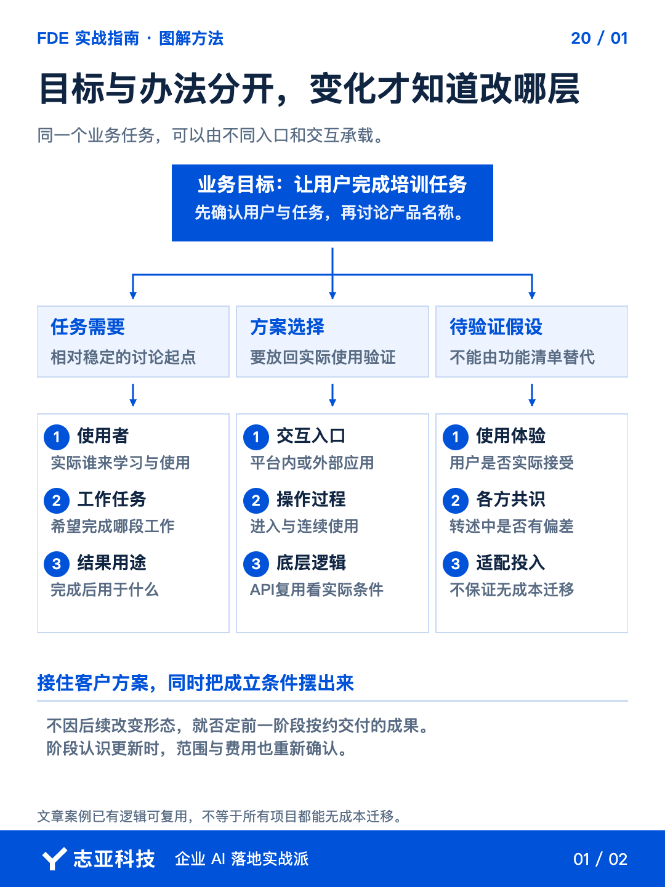
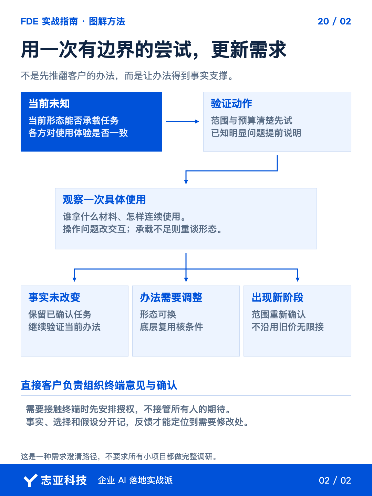

# 客户改要外部应用，原来的智能体要推倒重做吗？

**志雄 FDE 实战指南 · 志亚科技出品** 
作者：白志雄｜武汉市志亚科技有限公司

[返回阅读目录](../README.md) · [查看本篇图卡](#配套图文卡片)

我做过的一个医美销售培训项目，第一期成功交付了两个智能体。客户测试后进一步明确，想要的是外部应用。**入口要换，原来做好的东西是不是全白做了？**

这个项目的第二期，没有把所有处理能力推倒。**已有工作流和逻辑通过 API 提供给外部界面，继续承接原来的业务任务。**

关键不是证明哪种形态更高级，而是先把变化拆开。**业务目标有没有变，入口变在哪里，已有逻辑能留多少，再决定下一笔投入。**

### 1、先分清变的是什么

这个项目里，员工学习销售话术、练习学习成果，是业务任务；用智能体承载，是当时选择的办法。**客户说的产品名称，包含了方案，但没有说完需求。**

客户试用以后才明确外部应用的方向，这并不等于一开始的任务不存在。**如果学习与练习的目标仍在，就先检查新形态要怎样承接，不急着重做全部能力。**

对于类似变化，我会让 Agent 把反馈分成目标变化、使用方式变化和能力新增，再关联原需求。**同一句想换个应用，背后可能是不同的工作，不能按产品名直接估价。**

分不清的先问具体任务，使用者从哪里进入，怎样完成一次操作，结果交给谁。**这些答案需要客户确认，不因为听见外部应用，就替他补一套完整系统。**

### 2、把入口和能力拆开

一个智能体对话入口，与一个有独立界面的应用，使用方式可以不同，**但背后的某些处理逻辑仍然可能相同。**

回到交互、代码和数据这三层，先看本次变化动到了哪一层。**换入口，不自动要求重写逻辑；逻辑能留，也不证明连接已经适配。**

这个项目已经确认的事实，是原有工作流和逻辑通过 API 继续提供能力。调用方式、身份权限和数据适配，则是类似调整时必须另外核实的内容，**不能因为有接口，就假定新界面接上一定没有问题。**

架构拆分的实际价值就在这里。**不被一个产品名牵着全盘重做，也不拿可复用三个字省掉必要实施。**

### 3、做一张范围差异表

调整前，让 Agent 对照现有实现和客户新要求，列出三类工作。**先核实，再让客户看清哪些不是从零做，哪些确实增加了投入。**

| 工作类别 | 怎样判断和处理 |
|---|---|
| 可以沿用 | 已有逻辑仍服务同一任务，且能按新方案调用；本例通过API继续提供工作流能力 |
| 需要适配 | 调用参数、身份权限、资料和记录的衔接，按实际检查结果列工作，不能默认免费或已完成 |
| 需要新增 | 原范围没有的新界面、操作或能力，明确任务以后再估算、确认 |

这张表是判断结构，后两类不能让 AI 凭想象填满。**检查过什么就写什么，缺哪项条件就保留待确认。**

尤其别把能复用，写成没有成本。接口已有，仍可能需要联调、测试、部署与移交；**反过来，可以直接沿用的开发，也不重复算成全新工作。**

客户不必懂每一层技术，但应该能看见，**这笔报价里，保留了什么、适配了什么、新增了什么。**

### 4、两期各自确认范围

本例第一期的两个智能体按约完成，后续外部应用对应新的工作。**一期收口与二期扩展分开，才能既保留成果，也看清责任。**

把差异表、必要条件和工作量带给直接客户，确认后再安排。**不能用第一期费用无限承接新想法，也不能收到新要求就单方面宣布整套重做。**

有中间方时，由直接客户组织终端反馈；需要你参与，再对齐授权。**要拿到准确的使用事实，不是越过合作关系接管所有人的期待。**

完成调整以后，仍按新范围验证入口、实际逻辑和数据衔接。**旧成果曾经通过，不代表新的连接方式也已经通过。**

### 5、说到最后

客户改变交付形态，不必只剩两种反应，要么说他善变，要么自己从头再做。**先拆开目标、入口和处理能力，就有机会找到更合理的下一步。**

这个项目能带走的做法，是先盘点可保留的能力，再核实适配工作，最后确认新增范围。**真实反馈可以改变方案，但不该抹掉已有成果，也不该模糊下一次投入。**

接下来再谈一个更早的投入问题，客户说先做一点看看时，**哪些只是售前展示，哪些已经进入应该单独谈的验证工作。**

## 配套图文卡片

### 目标与办法分开，变化才知道改哪层

### 用一次有边界的尝试，更新需求

---

志亚科技出品。个人非商业学习和使用免费，商业使用须事先取得书面授权。

[使用许可](../LICENSE) · [作者与联系](../README.md#作者与联系) · [返回阅读目录](../README.md)
