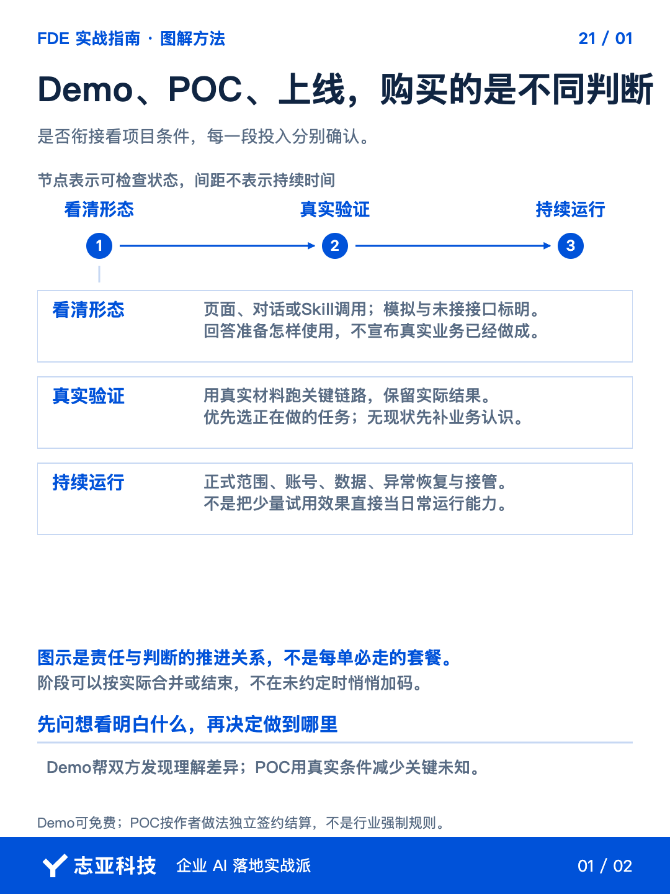
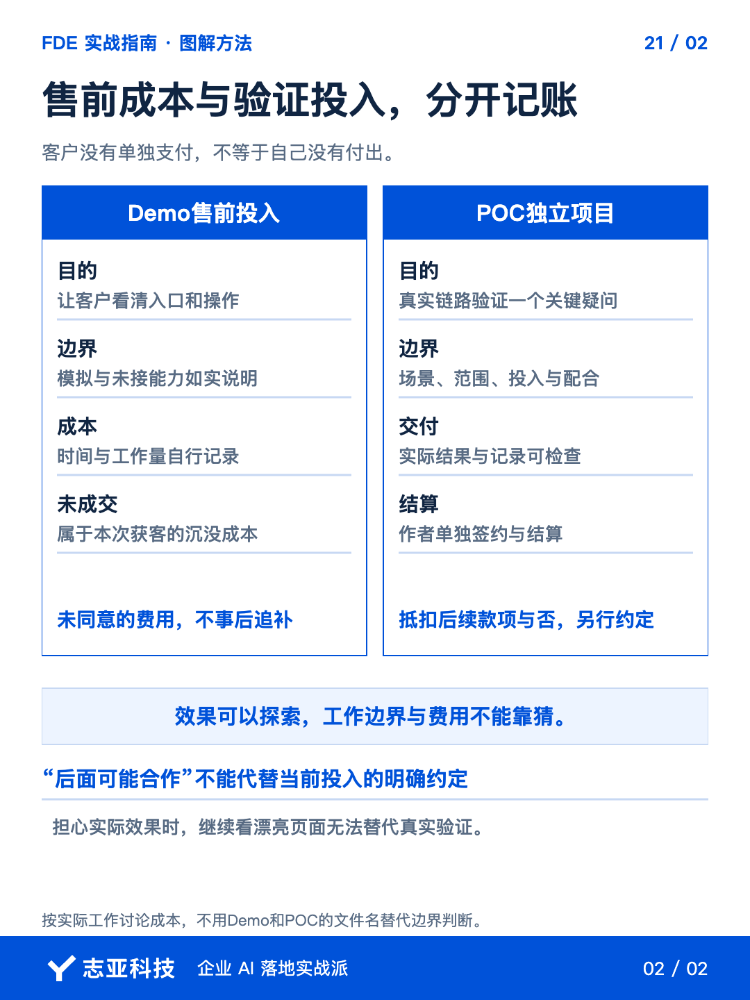

# 客户说先做出来看看，哪些算售前，哪些该收费？

**志雄 FDE 实战指南 · 志亚科技出品** 
作者：白志雄｜武汉市志亚科技有限公司

[返回阅读目录](../README.md) · [查看本篇图卡](#配套图文卡片)

客户说先做出来看看，你先做了页面，他又想接一点真实材料，再试一段完整流程。**每一步看起来都只多一点，售前却可能已经变成了开发。**

所以，先别急着答应免费，也不用立刻拒绝。**问清他想看的是未来怎样用，还是实际条件下能不能做成，再决定这一段投入怎样谈。**

这里把展示入口和操作形态的演示叫 Demo，把围绕真实业务开展的可行性验证叫 POC。我会把两段投入分别处理，**Demo 可以作为获客投入，POC 则按独立验证项目谈范围和费用。**

把两类工作分清以后，就能回答，演示做到哪里可以停，增加真实验证前要确认哪些事。

### 1、先确认想看什么

把客户的问题和当前方案交给 Agent，让它归纳，**这次最想弄清的是交互形态、实际效果，还是系统集成条件。**

客户还不知道员工将在哪里输入、看到什么结果，就先做能说明这些事情的 Demo。**不必为了让页面可看，把后面的数据库和业务逻辑全部接好。**

如果客户已经理解使用方式，真正担心的是实际材料能否支持效果，继续完善页面就偏了。**把问题转成一段需要验证的真实链路，再讨论 POC。**

名称不是判定依据。**文件叫演示版，但已经承接真实业务验证，工作量就不能仍按一张页面来算。**

### 2、Demo做到能对齐

智能体项目可以展示对话入口，已有 Agent 的场景可以展示 Skill 调用，外部应用则展示页面、模块和操作顺序。**选最接近未来使用形态的展示，不为显得完整多做系统。**

按前面讲过的三层架构检查，Demo 可以先展示 Agent 怎样接收任务和发起调用，代码逻辑层的规则、权限检查，以及数据层的读写仍可能只是模拟。让 Agent 构建演示时，把这些未接通部分一并列出。**客户需要知道自己在看什么，不能把模拟成功理解成真实能力已经完成。**

得到反馈后，先修正对形态的理解。**能说明入口和流程就收住，不因为客户继续提问，默认追加真实集成。**

Demo 的投入也记下来。报价时考虑全部售前成本，并提前说清最终价格与包含内容，**没有成交，就是自己的获客成本，不事后追补客户没同意的费用。**

### 3、POC选正在做的事

客户希望验证实际效果，又不愿一次投入完整项目，可以从大项目里拆一段小场景。**优先选他现在正在做、做过、有材料的工作。**

现状具体，客户才知道目前怎样判断，拿到新结果后才能指出差异。**没有当前做法、只有未来想一步到位的愿望，先补业务认识，不急着承诺一个确定性验证。**

让 Agent 从调研材料提取这段现状、准备验证的问题、必要输入和参与者，再由双方确认。**效果还拿不准，正是 POC 要解决的事情，不需要先把效果指标填满。**

但哪些逻辑要跑、哪些接口必须接，不能含糊。Agent 的调用要真正经过必要的规则与权限检查，并读到本次验证需要的资料和业务记录。**需要页面、后台和数据库，就接通这段链路；现有入口足够，就不为 POC 的名字再造一个前端。**

### 4、把投入单独说清

把这次合作整理成一份简短的验证确认单。以下六项可以直接拿去和客户逐项确认，**已谈妥的写明，未谈妥的留待确认，不让 AI 替双方填承诺。**

- 验证问题，要用哪段正在发生的工作，减少什么未知。
- 工作与交付，哪些逻辑和接口要接，交出什么结果与记录，哪些不在本次范围。
- 双方配合，谁提供材料、账号和业务反馈。
- 工作期限，验证何时开始和结束，依赖条件怎样安排。
- 本次费用，按什么工作和投入结算，何时支付。
- 后续抵扣，是否抵扣正式项目款项，有没有另外说定。

这些约定明确后，**把 POC 作为独立项目签约、支付和结算，不只等一句以后有大单。**

产物可以包括能试用的链路、实际结果、运行条件和后续建议。**约定交什么工作成果，不等于在未知条件下保证效果一定成功。**

抵扣后续款项是双方可以协商的安排。**没有说定，就不把潜在合作当成这次免单的理由。**

客户继续要求接数据、接系统时，可以直接说明下一段安排，**先确认验证问题和投入，再增加实现，不让收费讨论拖到工作已经做完以后。**

### 5、说到最后

确认单能说清验证什么、谁给条件、交什么和怎样结算，这次投入才算有了依据。**免费不是没有成本，付费验证也不是提前保证所有未知都能解决。**

客户买的是一次更有依据的判断，你承担的是约定的工作。范围和投入谈好以后，下一篇接着解决一个实际问题，**客户还说不清什么效果才算好，这次验证该怎样往下做。**

## 配套图文卡片

### Demo、POC、上线，购买的是不同判断

### 售前成本与验证投入，分开记账

---

志亚科技出品。个人非商业学习和使用免费，商业使用须事先取得书面授权。

[使用许可](../LICENSE) · [作者与联系](../README.md#作者与联系) · [返回阅读目录](../README.md)
