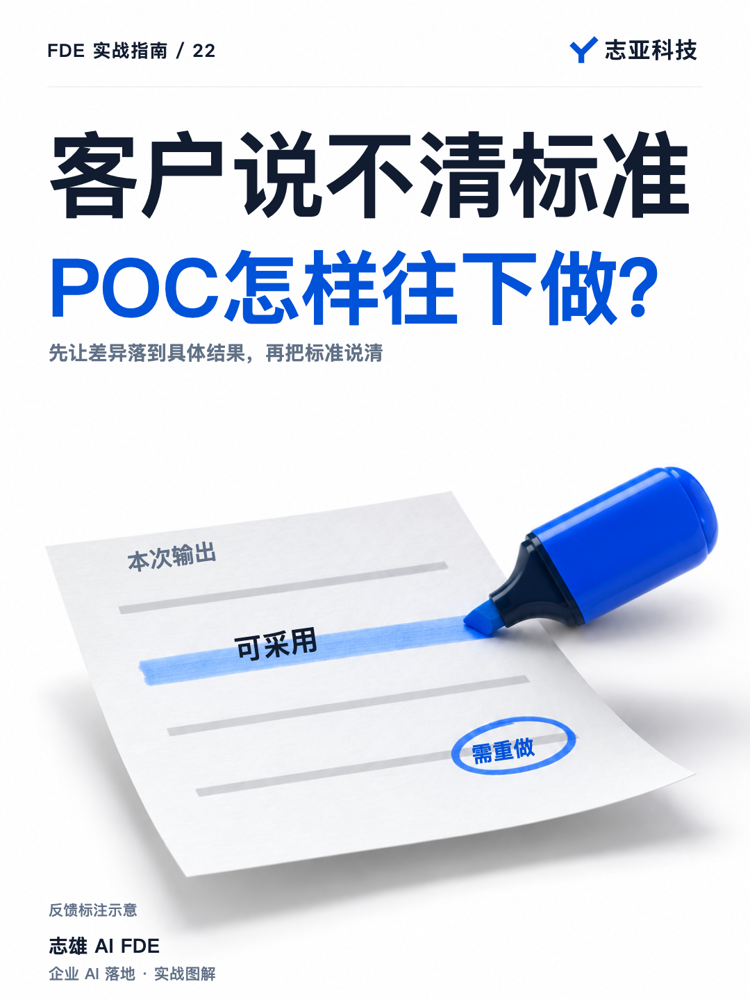
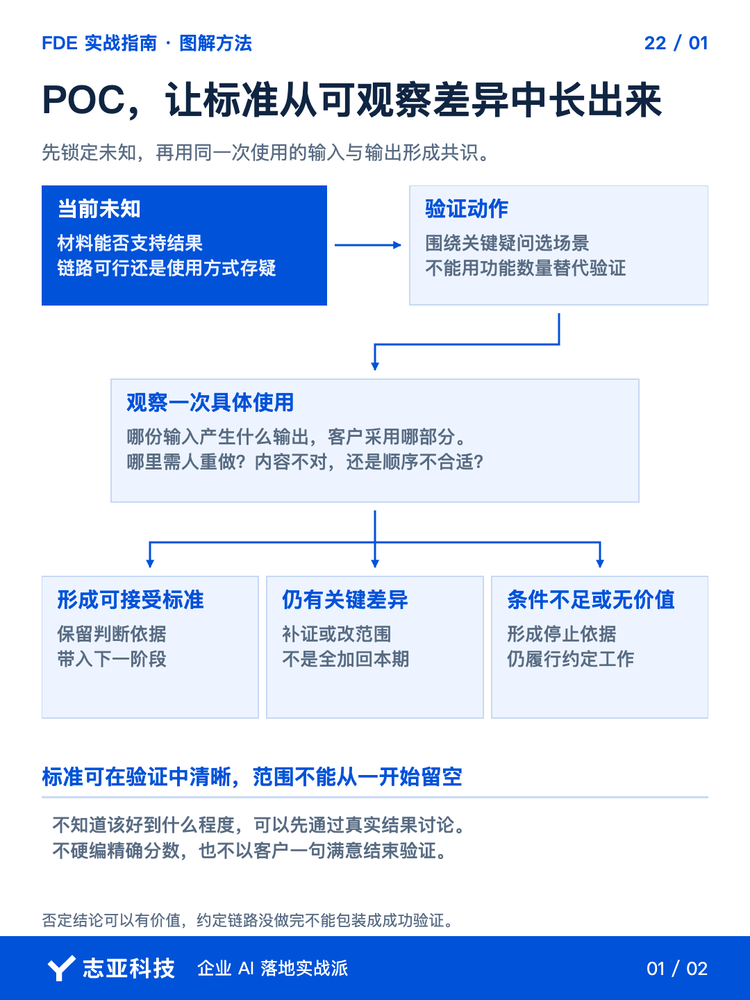
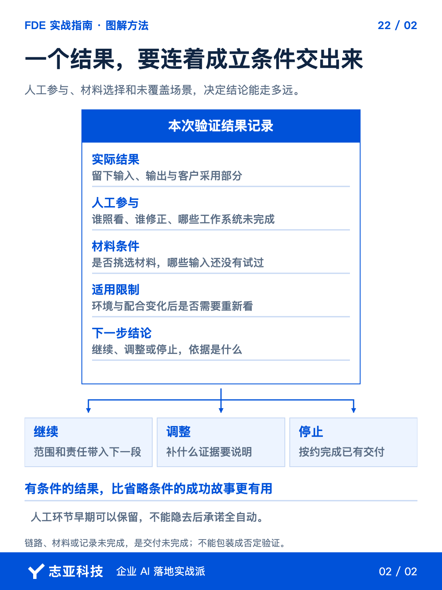

# POC还没开始，客户说不清标准，怎么办？

**志雄 FDE 实战指南 · 志亚科技出品** 
作者：白志雄｜武汉市志亚科技有限公司

[返回阅读目录](../README.md) · [查看本篇图卡](#配套图文卡片)

客户愿意做一次 POC，却说不清效果要多好才算合适。**你想先拿到验收指标，他却正因为没见过结果，才想做这次验证。**

这里不用逼双方编一个准确率。**先把本次试图弄清的问题和工作范围留下，再用真实结果把效果认识逐步讲清。**

这次要交出的，不只是一段能看的效果，还要有一份能支持下一步的验证记录。**把真实输入、实际输出和客户反馈对应起来，才知道继续、调整或停止各自有什么依据。**

### 1、先收住这次的问题

把调研记录交给 Agent，让它列出关键未知。材料是否足够、业务结果是否可用、操作方式是否合适，**不同疑问需要不同证据，不能都靠多做几个功能回答。**

请双方挑出本次最值得验证的一段。**原本担心实际材料质量，就让这些材料进入链路，不先把时间花在美化所有页面。**

沿用前一篇确认的现状任务、参与者和必要输入，费用、期限和交付范围也保持清楚。**效果可以探索，谁提供什么、这次交出什么工作，不能一起留空。**

### 2、让反馈对应到输出

链路跑起来后，把使用材料、实际输出和客户反馈交给 Agent。**让它按具体任务关联，不把全部意见压成一句客户不满意。**

每条记录可以按下面几项整理。这是记录结构，不是预先替客户定好分数。

| 记录项 | 对应的事实 |
|---|---|
| 本次任务与输入 | 哪份真实材料，准备完成什么工作 |
| 实际输出 | 系统给了什么，保留对应结果 |
| 客户采用的部分 | 哪些可以继续用于业务，为什么 |
| 需要重做的部分 | 改了哪里，原因落在哪个结果上 |
| 人工与运行条件 | 谁复核或修正，用了什么材料与环境 |
| 尚未确认的问题 | 还缺什么证据，不能先下什么结论 |

这份记录先回答差在哪里，再帮助查为什么有差异。**客户采用了什么、重做了什么，先对应到具体输出，不急着换模型。**

需要查原因时，再沿交互、代码和数据定位。任务理解偏了、规则执行错了、资料依据不对，是不同的问题。**先定位再改，不能把所有不合格都归为模型不够强。**

客户说哪一条不能接受，就请他指出对应结果和原因。**不要求他写专业评估报告，但关键判断要落在双方都能看到的东西上。**

Agent 负责整理差异，人确认业务含义。**暂时仍说不清的部分继续保留为未知，不因为文档需要结论就替客户补一个标准。**

### 3、条件一起留在记录里

结果很好，也要看它怎样得到。材料是否提前筛选、开发者是否修过输出、失败后重试过多少，**这些不会因为最终呈现不错就消失。**

让 Agent 根据运行记录归集系统动作、人工补位和未覆盖条件。**记录不到的先核实，不把缺日志当成没有人工投入。**

保留人工不一定不合格。客户可以接受一段需要复核的流程，**只要这段配合能长期承担，而不是把开发者临时照看说成全自动能力。**

反馈中冒出的新功能另列候选。**它可能值得做，但先判断是不是本次验证范围，不把探索过程变成无限追加。**

### 4、把结果整理成决定

让 Agent 输出一份简短结论，列已观察到的事实、仍需验证的部分、必要运行条件和下一步选择。**不要只留一个演示链接，也不要直接替双方宣布项目成功。**

事实支持继续，剩余投入可以接受，就讨论下一阶段；某段有效但条件不同，就调整再试；价值不足或资源拿不到，也可以停。**判断围绕证据，而不是围绕已经花了多少钱。**

同时检查约定工作有没有完成。**链路没做、材料没用、记录没留，不能把未完成交付包装成一次有价值的否定验证。**

客户逐渐确认的判断写回记录。继续做正式项目时，带上这些条件与限制，**不要签完下一份合同，又把前期学到的东西重置成各自想象。**

### 5、说到最后

POC 不需要先证明自己会成功才开始。**它需要通过约定的工作，让双方比开始时多知道一些会影响投入的事实。**

先限定问题，留下实际结果，公开人工和运行条件，再形成继续、调整或停止的选择。**效果标准可以在这个过程中长清楚，未知也应该在这个过程中变得可见。**

这才是验证结束时应当交出的价值。**不只是让客户看过一个效果，而是让下一步为什么值得做，或者为什么暂时不做，有共同依据。**

有了继续的依据，下一篇再看，把这段验证转成正式项目时，哪些成果可以沿用，哪些条件和费用必须重新确认。

## 配套图文卡片

### POC，让标准从可观察差异中长出来

### 一个结果，要连着成立条件交出来

---

志亚科技出品。个人非商业学习和使用免费，商业使用须事先取得书面授权。

[使用许可](../LICENSE) · [作者与联系](../README.md#作者与联系) · [返回阅读目录](../README.md)
