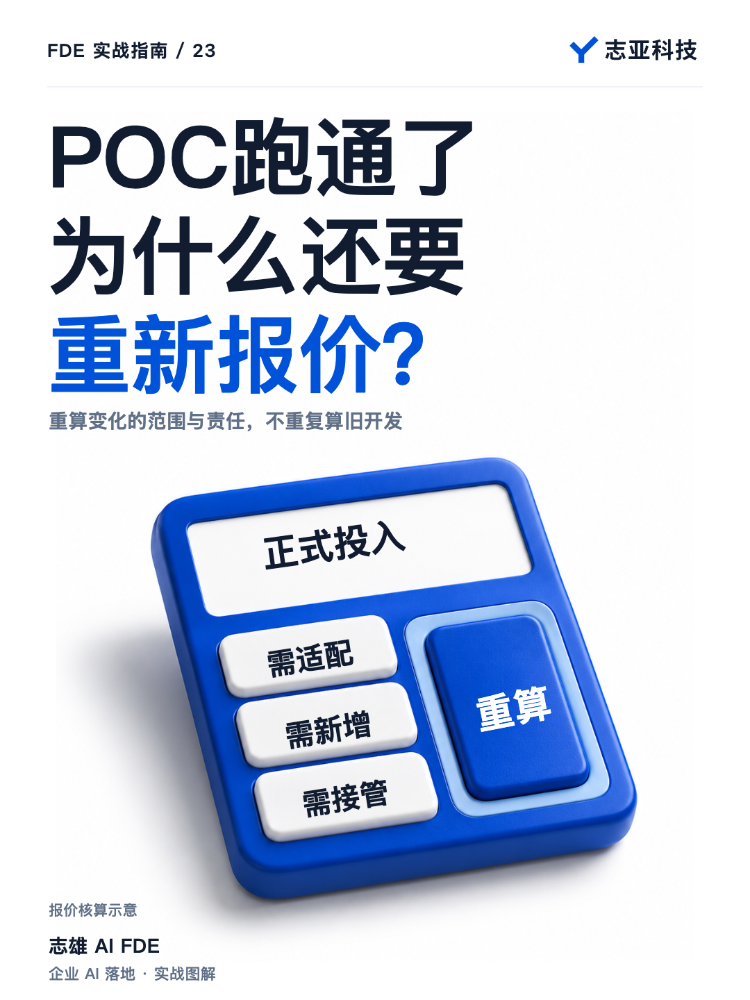
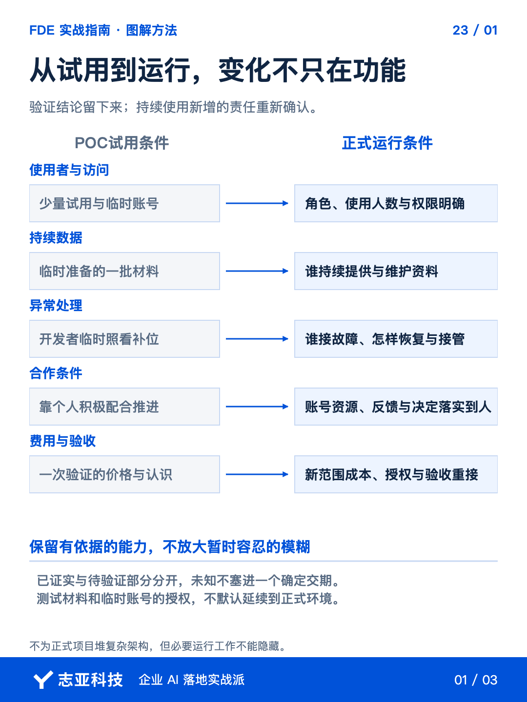
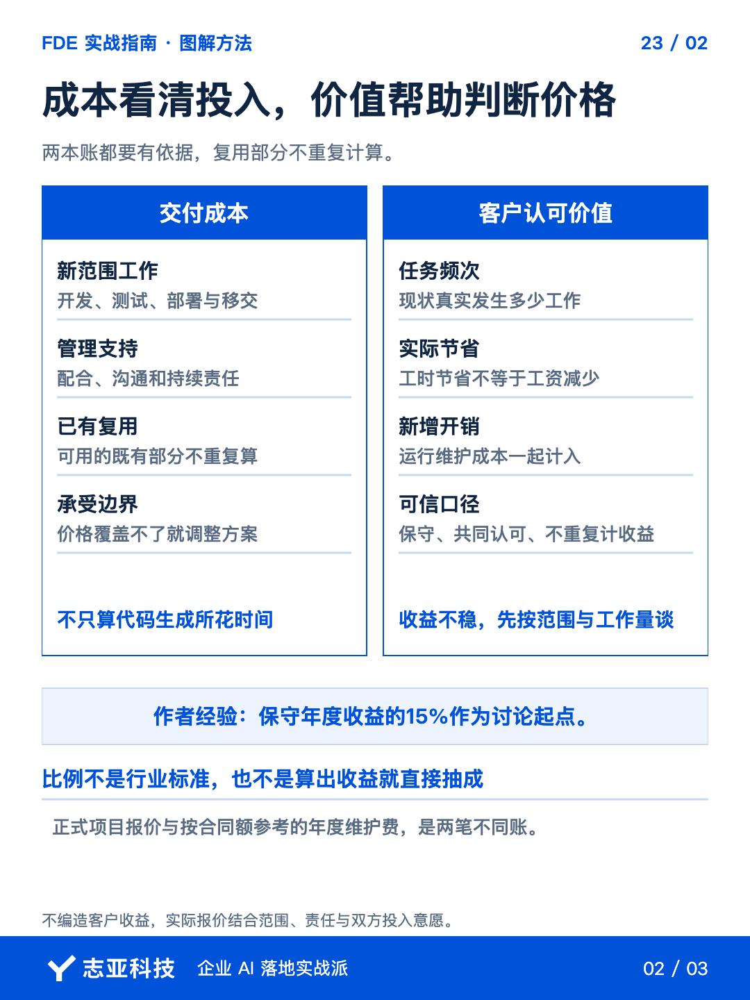
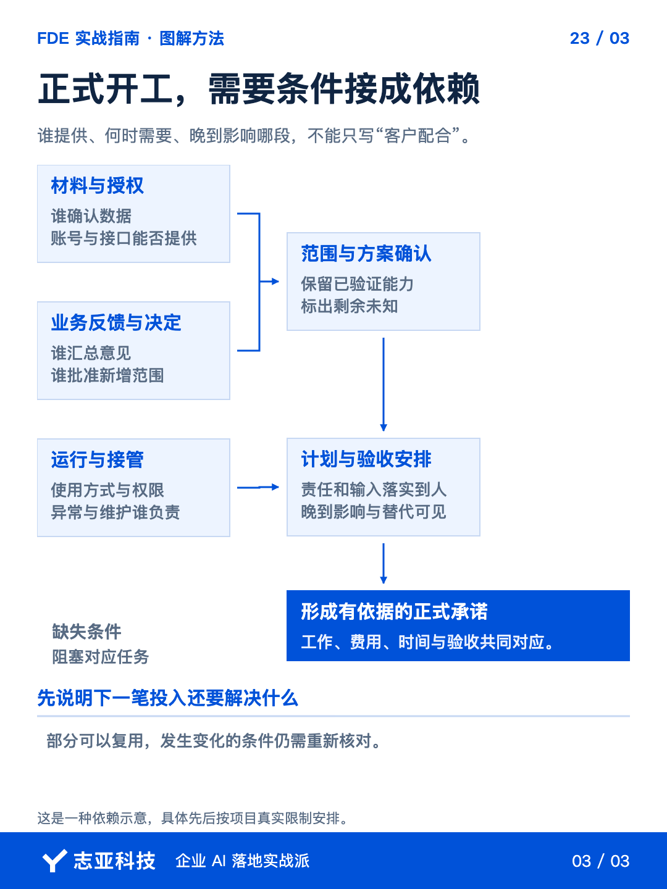

# POC转正式项目，范围和报价怎么重新确认？

**志雄 FDE 实战指南 · 志亚科技出品** 
作者：白志雄｜武汉市志亚科技有限公司

[返回阅读目录](../README.md) · [查看本篇图卡](#配套图文卡片)

POC 跑通，客户愿意继续，下一步很容易被理解成沿用原系统，再加一些功能。**但试用时由你准备材料、随时修正的过程，正式运行以后由谁接？**

如果前面的验证证据支持继续，就把它带进正式方案。**验证过的能力可以保留，试用时暂时容忍的条件不能自动放大。**

这一篇先做一张试用与正式使用的条件对照，再列出复用、适配和新增工作。**哪些已有证据可以沿用，哪些范围和责任发生变化，对照清楚以后再算费用。**

### 1、先留下验证边界

把 POC 约定、运行记录和客户确认交给 Agent，整理一页结论。**区分验证过的能力、仍需人工补位的部分，以及没有覆盖的条件。**

用过少量材料，就写清材料范围；只在一个环境试过，就留下环境限制。**不能让一句效果不错，替代对覆盖范围的说明。**

从已确认结果出发讨论正式任务。**可以复用的成果先保留，没有验证的假设继续单列，不把两者都装进确定的交期。**

这份结论也是内部汇报依据。**支持继续的证据是什么，下一笔投入准备减少什么未知，比单说建议全面上线更有用。**

### 2、对比正式使用条件

沿前面拆开的三层架构，让 Agent 把试用与正式运行列成对照。下面列的是待核对的条件，不是替项目预填结论。

| 检查位置 | POC保留的依据 | 正式运行要确认的变化 |
|---|---|---|
| Agent交互与调用 | 谁试过，完成了什么任务 | 使用者、入口和调用范围是否扩大 |
| 代码逻辑与API | 跑过哪些规则与接口 | 权限、状态检查和异常处理还缺什么 |
| 知识库或数据库 | 用过哪些资料与记录 | 谁持续供数，版本、访问及维护怎样安排 |
| 运行与接管 | 在什么环境运行，谁人工补位 | 谁接故障，怎样恢复，交给谁继续使用 |

**变化要落在具体工作上，不能只写正式版需要更稳定。**

一个人能用的过程，交给多人以后可能需要身份与权限；手工准备的数据，正式运行要有人持续提供。**变化不只表现为多几个按钮，也会出现在后台责任里。**

逐项选择保留人工、增加系统能力或缩小范围。**让承担业务和投入的人作取舍，不默认所有试用限制都会被免费消除。**

对不可控的外部条件，明确等待或替代安排。**正式两个字不是堆复杂架构的理由，但必要配合也不能继续靠某个人临时帮忙。**

### 3、重新估工作和价格

先让 Agent 根据新旧范围列出已完成、需要适配和新增工作，由你核对工作量。**测试、部署、管理、交接和支持也算，不只估代码生成时间。**

可直接复用的工作不要重复报开发量；复用需要适配和验证，就如实列出。**POC 费用对应上一段验证，正式项目价格对应下一段承诺，不能默认两者相同。**

有了完整工作清单，可以先按范围与人天谈价。确实能讨论业务收益时，再增加价值报价的视角。**我会把客户认可的保守年度收益的百分之十五，作为个人报价讨论参考，不当行业标准。**

这笔收益也需要拆开。现状任务量与投入来自哪里，上线后仍需多少人工，新增运行费用是多少，**先把口径对齐，不把节省工时直接说成减少工资，也不重复计算同一份收益。**

缺数据就标待确认，算不稳就先按范围和工作量谈。**价格覆盖不了必要成本，就调范围或实施方式，不用一个好看的比例掩盖交付亏损。**

这里讨论的是正式项目报价。**上线后的年度维护费，还要按服务范围与责任另算，第30篇会专门展开。**

### 4、把条件写进新约定

正式项目的范围确认后，再把任务、验收、费用与配合接起来。**谁提供账号和材料，谁确认规则，谁参与测试，都落到具体责任。**

POC 形成的效果认识，可以转成当前阶段的检查依据。**已经确认的判断留下，暂时仍未知的部分安排验证，不要求客户把所有未来情况提前想完。**

测试账号、材料授权与第三方服务也重新核实。**试用时允许，不自动代表可以按同样方式持续运行。**

把这些内容交给 Agent 整理范围差异和待确认摘要，人确认后进入报价与合同审查。**AI 可以汇总依据，不能替客户批准投入，也不能自动形成新的合作承诺。**

### 5、说到最后

从 POC 到正式项目，不是把原来的验证全部重做。**保留有依据的能力，重新确认扩大的使用范围，以及持续运行带来的工作。**

结束这一轮讨论，应当能说清，**原成果沿用什么、新增什么、谁补条件、按什么验收、对应多少投入。**

能放心扩大的是经过验证又有运行安排的部分。**不能一起放大的，是 POC 阶段双方暂时容忍的模糊。**

范围和价格确定以后，下一步还要把资源与配合落实到人。**一个可以继续投入的方案，不只列新增功能，也要列清持续运行的条件。**

## 配套图文卡片

### 从试用到运行，变化不只在功能

### 成本看清投入，价值帮助判断价格

### 正式开工，需要条件接成依赖

---

志亚科技出品。个人非商业学习和使用免费，商业使用须事先取得书面授权。

[使用许可](../LICENSE) · [作者与联系](../README.md#作者与联系) · [返回阅读目录](../README.md)
