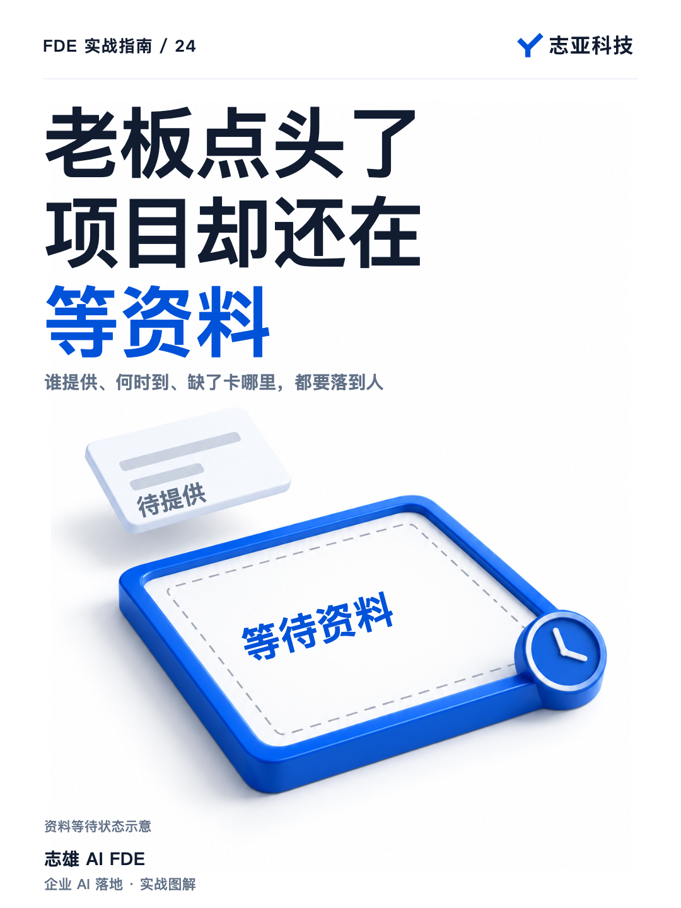
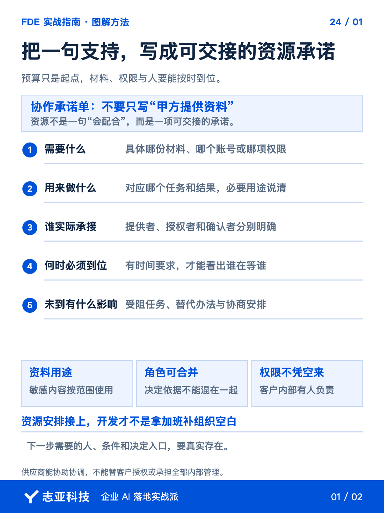
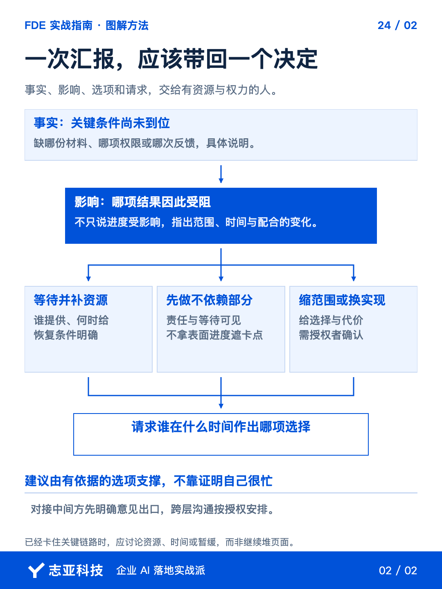

# 老板同意做AI了，怎样让其他人真正配合？

**志雄 FDE 实战指南 · 志亚科技出品** 
作者：白志雄｜武汉市志亚科技有限公司

[返回阅读目录](../README.md) · [查看本篇图卡](#配套图文卡片)

老板同意做 AI，范围也谈好了，开发却一直在等资料、等接口、等业务反馈。**大家都支持，下一步需要的东西却没有到位。**

继续催配合，很容易只换来一句正在协调。**你要让对方知道，具体缺什么、谁能提供、什么时候需要，以及晚了会影响哪段结果。**

前面确认谁有权决定，这里再用一张《协作准备清单》落实谁来行动。**不要求 FDE 接管客户的内部管理，只把双方工作怎样衔接说清。**

### 1、先拆出开工依赖

把本期方案和初步安排交给 Agent，让它按交付结果提取资料、环境、账号和业务决定，整理到清单里。

再沿三层架构查一遍。Agent 交互层需要谁确认真实任务与入口使用，代码逻辑层的 API、规则和权限由谁提供与批准，数据层的资料和记录由谁授权、维护。**技术组件有了名字，还要有人接住它依赖的条件。**

每行写清需要什么、用于哪段工作、谁能提供、何时需要、目前什么状态，以及缺失会影响什么。**不要只写甲方提供数据，要让负责的人能判断自己该交出哪一份材料。**

人再核对这些负责人是否真的有权限。涉及敏感材料时，确认使用范围与处理方式，**老板支持了项目，不等于全部数据都可以给任何工具。**

把影响下一步的条件优先确认。**并非所有材料都必须开工前齐全，但关键链路缺条件时，不能按已具备来承诺。**

### 2、把协作安排确认下来

清单发给直接负责人，请他确认人员和时间。**不是让 FDE 单方面给客户内部排任务，而是把双方工作怎样衔接摆出来。**

业务材料的提供人、规则的确认人、测试的参与者，可能是同一个人，也可能不同。**角色可以合并，动作不能只有一个模糊的大家配合。**

对接中间方时，由他组织终端配合与意见汇总；需要你参与再安排授权。**不让每个人直接发来的消息都变成开发指令，也不阻止实际使用者提供事实。**

已经答应却还没到位的条件，保留待办。**会议上说没问题，不等于材料已经可用，实际收到后还要检查是否符合当前任务需要。**

### 3、卡住时带选择汇报

等待发生后，把清单状态和实际影响交给 Agent，**让它整理事实、影响、选项和需要决定的事项，而不只写一份进度概述。**

材料晚到，是暂时阻碍一项任务，还是会改变后面所有测试？你先判断，再给选择。**可以补资源、先做不依赖它的部分，也可以缩范围或调整时间。**

内部推进者交给管理层，乙方交给客户负责人。**汇报对象不同，目的都是让有权的人知道现在需要他作什么决定。**

不要只写资料未给、进度受影响。**把具体缺什么、最晚何时需要、建议怎样处理说清，才能换回下一项行动。**

整理汇报时，可以按四句话准备。这里是待填写的工作结构，不是已经发生的客户对话。

- 当前事实，缺哪份材料、哪个接口或哪次确认，状态依据是什么。
- 具体影响，哪段结果不能继续，哪些独立工作仍可推进。
- 可选安排，补资源、先做不依赖的部分，或调整范围与时间，各自影响是什么。
- 请求决定，建议选哪项，请哪位有权负责人在什么时间确认。

Agent 可以整理选项，但对外发出前由你核对。**它不能替别人承诺时间，更不能把建议写成客户已经同意的安排。**

### 4、确认以后回到计划

资源和选择确认后，更新实际任务、时间与检查位置。**不能微信里说已调整，开发计划仍按旧条件执行。**

如果外部接口暂时没有，先做可替换部分时标明模拟条件，**不把有页面、有返回值当成真实集成已经完成。**

关键条件持续缺失，就与负责人确认暂停范围、恢复条件和后续安排。**继续堆不相关的页面，并不会使缺失的授权自动出现。**

把最新状态放在双方都能查看的位置。**轻量清单可以足够，不需要为了专业感新增一套没人维护的系统。**

### 5、说到最后

这一步完成后，应当能回答，**下一项结果需要谁给什么、什么时候给，以及没到位时怎样处理。**

有预算让项目值得投入，有授权让决定成立，真实配合才让工作发生。**FDE 要推动这些事情接起来，不是代替客户把所有内部责任都扛走。**

同样，甲方不能用一句你是专家，把必要材料、判断和组织配合全部交给供应商猜。**双方把自己的部分交出来，技术能力才有地方落下去。**

## 配套图文卡片

### 把一句支持，写成可交接的资源承诺

### 一次汇报，应该带回一个决定

---

志亚科技出品。个人非商业学习和使用免费，商业使用须事先取得书面授权。

[使用许可](../LICENSE) · [作者与联系](../README.md#作者与联系) · [返回阅读目录](../README.md)
