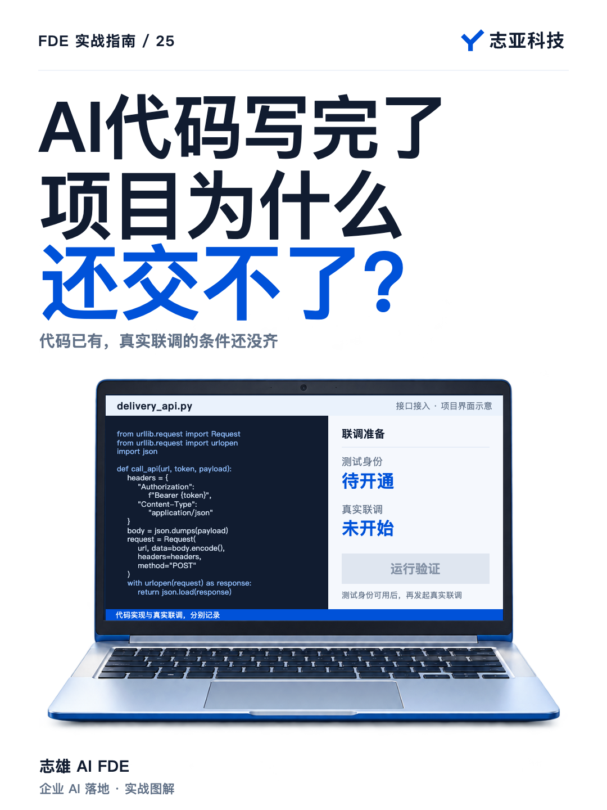
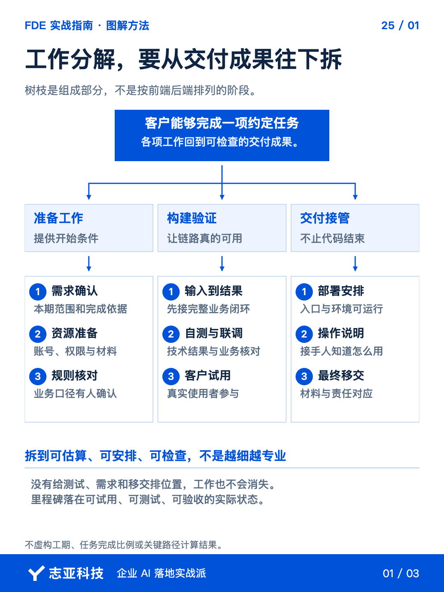
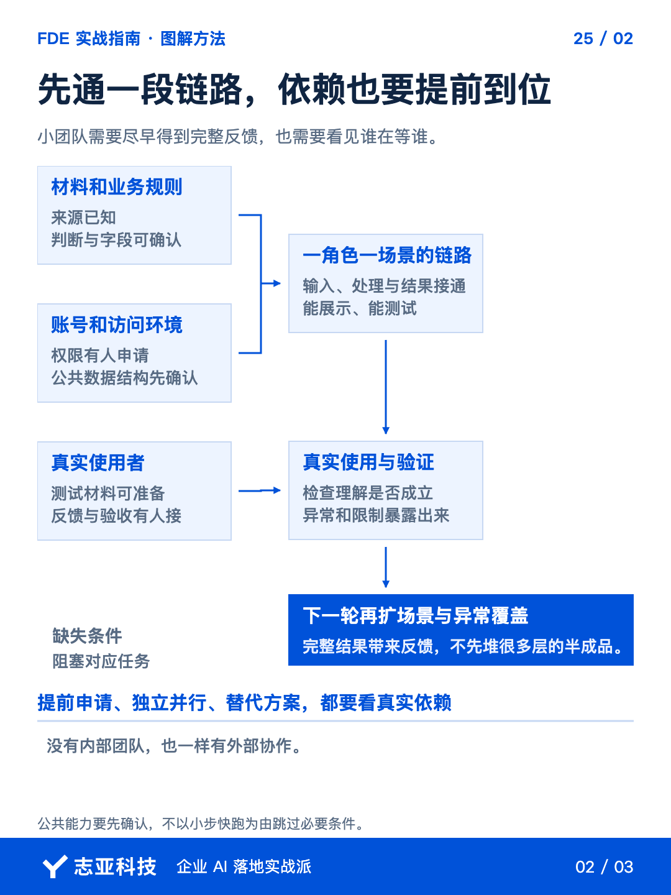
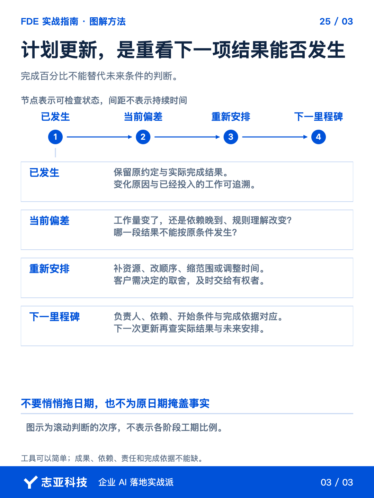

# AI代码写完了，项目为什么还交不了？

**志雄 FDE 实战指南 · 志亚科技出品**<br>
作者：白志雄｜武汉市志亚科技有限公司

[返回阅读目录](../README.md) · [查看本篇图卡](#配套图文卡片)



页面写好了，接口代码也有了，项目却还在等测试账号、业务规则和客户反馈。**代码完成了，用户要做的那件事还没有完整发生。**

如果计划按前端、后端分别报完成比例，这个缺口很容易被藏住。**更有用的排法，是从一项能验证的业务结果倒着拆，看它还被什么条件挡住。**

前面确认过的配合人和材料，这时要进入计划。把已确认范围交给 Agent 起草，**你重点检查结果、依赖和完成依据，而不是先调一张漂亮甘特图。**

### 1、从结果倒着拆

让 Agent 先提取本期交付结果，再分解实现和检查工作。**不要一上来只排前端、后端、数据库三个技术模块。**

一项可检查的结果，可以是一段真实业务能从输入走到输出。围绕它再拆材料、规则、构建、验证和移交，**这样每项工作才知道在支持哪个承诺。**

给任务加上负责人、前置条件和完成依据。以接入客户 API 为示意，本轮结果是从实际入口提交一份授权材料，拿到可核对的业务结果。**一张小计划就能把这件事拆清楚，不用先铺满整个项目。**

| 任务与负责人 | 开始需要什么 | 怎样算完成 |
|---|---|---|
| 1．实现调用，开发方 | 已确认规则、接口说明 | 实现与自测有记录，不代表实接成功 |
| 2．准备检查，开发方 | 约定场景、规则、接口说明 | 请求样本和异常分支已备好，模拟结果单列 |
| 3．开放测试身份，客户指定接口负责人 | 明确必要操作及访问范围 | 实际访问可用，不只收到申请 |
| 4．真实联调，开发方 | 1、2、3均具备 | 从入口发起，核对实际处理及数据结果 |
| 5．业务核对，客户业务负责人 | 联调完成、材料与人员可用 | 使用者完成约定任务，反馈已记录 |

这是计划示意，不是实际项目排期。**让 Agent 先按项目事实填表，缺负责人、投入估算或时间承诺的，留作待确认。**

**完成依据不能只有代码已生成，应当能指出怎样确认当前任务真的做到了。**数字和时间没有依据，就留作待估或待确认。

再由你检查漏项。需求沟通、客户测试配合、部署和说明都属于承诺中的工作时，**就进入基础计划，不留到最后用加班补。**

### 2、尽早做出完整反馈

计划如果先做所有页面，再做所有后台，最后一起联调，**不少理解差异就会被压到很后面才出现。**

选择一个角色、一段场景，让请求从入口经过 API 后的处理，到实际数据结果，再回到使用者。**先接通一段完整业务，不是先堆满三层功能。**

以调用代码已有、测试身份尚未开通的情况作进度检查示意，**合格的摘要不是接口已完成，而是把实现与联调分别说清。**

```text
任务1，已实现，附自测记录。
任务2，可先准备和模拟检查，不能记成真实联调。
任务3，测试身份尚未可用，找接口负责人确认可用时间。
任务4，受任务3阻塞，暂不承诺实际联调完成时间。
任务5，随联调顺延的影响待核对，重新确认业务人员的可用时间。
```

身份晚到，任务2可以并行，任务4、5的安排却要重看。**如果只在任务1上填完成，客户会以为快交付了；沿依赖往后看，才知道下一项承诺还缺什么。**

后续按任务扩大场景、补异常与稳定性。**计划要尽早产生一项能核对的业务结果，而不只让多个技术模块同时变成已完成。**

### 3、等待也要有位置

让 Agent 把外部依赖单列，并关联到受影响的任务。**资料由谁提供、权限由谁开放、哪个决定没定，全部放进同一张计划。**

工作量与等待时间要分开。接口审批等三天，不代表你有三个人天的开发工作，**但它确实可能挡住后面的开始时间。**

核对这些条件是确切承诺还是估计。**客户尚未确认的时间，不让 AI 自动当成固定日期；准备已经开始，不等于受阻的联调也已开始。**

能并行的工作提前做，不能绕开的就明确等什么。**不能只因为几个任务都可以交给 AI，就忽略它们依赖同一份规则或同一套环境。**

### 4、进度变化重算后面

进度更新时，把实际完成证据、受阻项和新决定交给 Agent。**让它对照原计划说明偏差与后续影响，不只修改完成百分比。**

重点看下一项里程碑是否仍能发生。关键条件晚了，哪些任务能调整，哪些结果必须重新确认，**由你核对后把取舍带给客户，不能悄悄把交期往后挪。**

需要一张轻量计划时，可以直接这样要求，**让 Agent 排的是有依赖和完成条件的任务，而不是随手生成一串日期。**

```text
按已确认范围，从交付结果倒推任务。
每项列负责人、必要输入、依赖、工作量、等待条件和完成依据。
区分真实确认与估计，不补造客户承诺，不把代码生成当作完成。
优先安排一段能验证的端到端结果。
根据最新证据列偏差、影响和可选调整，待我确认再更新对外承诺。
```

### 5、说到最后

计划维护到什么程度，取决于项目需要。多维表格或现有项目工具都可以，**关键是下一项工作、必要条件、负责人和结果能互相对上。**

遇到卡点，就沿这张计划核对，下一项结果是否还具备发生条件，需要找谁、补什么，或者调整哪项承诺。**计划不能保证没有变化，但应该让变化更早进入决定，而不是交期到了才变成解释。**

范围、任务和配合能够对应后，还要核对合同里是不是同一次约定。下一篇把计划与报价、交付、付款接起来看。

## 配套图文卡片

### 工作分解，要从交付成果往下拆



### 先通一段链路，依赖也要提前到位



### 计划更新，是重看下一项结果能否发生



---

志亚科技出品。个人非商业学习和使用免费，商业使用须事先取得书面授权。

[使用许可](../LICENSE) · [作者与联系](../README.md#作者与联系) · [返回阅读目录](../README.md)
