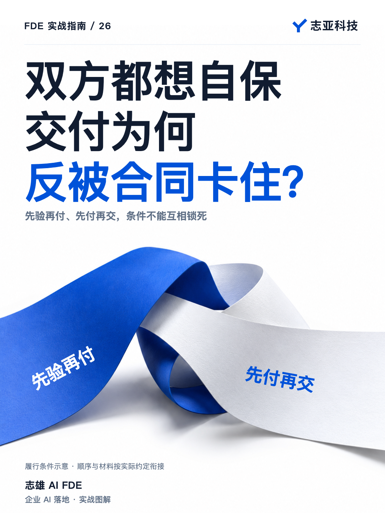
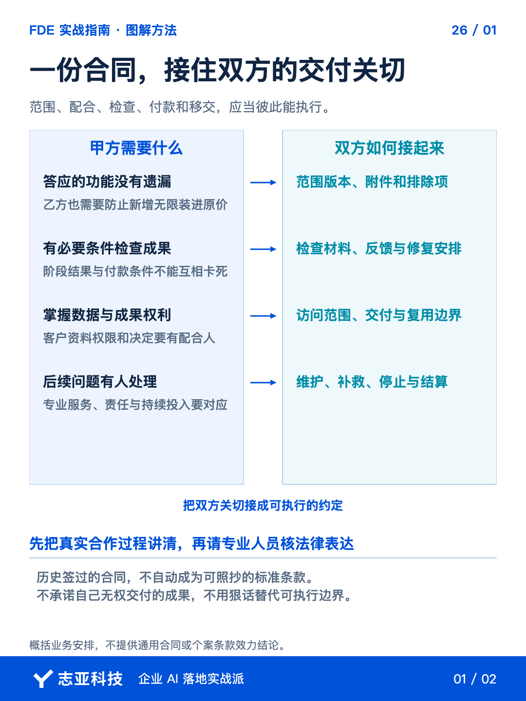
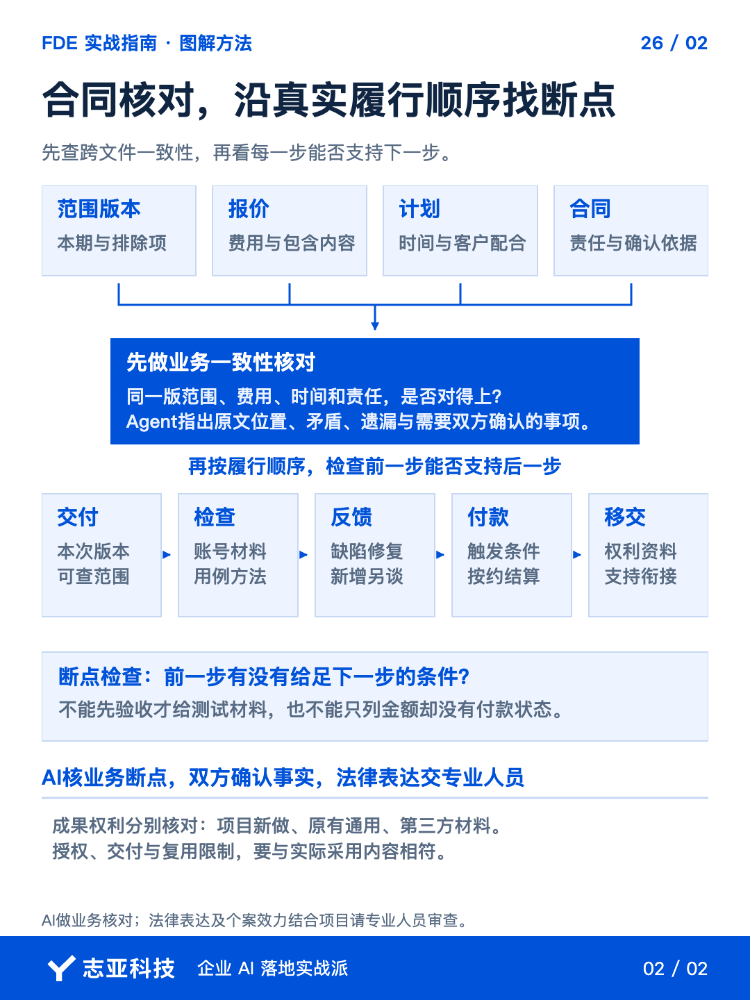

# AI项目合同，怎样把交付、付款和责任对齐？

**志雄 FDE 实战指南 · 志亚科技出品**<br>
作者：白志雄｜武汉市志亚科技有限公司

[返回阅读目录](../README.md) · [查看本篇图卡](#配套图文卡片)



甲方想验收后再付尾款，乙方想收到尾款再交完整源码，两边的担心都合理。**但验收前，客户靠什么检查？这件事没接上，条款就可能互相卡住。**

类似断点也会出现在工期里，日期写好了，需要的资料和权限却没人安排。**合同不能只看每一条有没有保护自己，还要看放在一起能不能执行。**

这一篇做两轮核对。先看范围、报价、计划与合同是否对应同一次约定，再沿交付、检查、付款和移交找缺失条件。**Agent 帮你查前后矛盾，最终法律表达和具体效力，再交专业人员审查。**

### 1、先固定范围依据

我之前的开发合同，会把双方确认的功能清单作为验收依据。沿用这个思路时，**先找到具体版本、确认记录和本期包含内容，不只留一句以需求为准。**

把范围、报价、计划和合同草案交给 Agent，让它逐项交叉核对。**答应的功能是否都能找到，排除项、客户配合与待确认条件有没有在合同里丢失。**

沿交互、代码和数据核对交付物，分别问三个问题，交哪些、授权到哪里、谁来接管。**技术上可以调用，不代表合同里已经说定交付和接管范围。**

缺依据的地方列出来，不让 AI 自动补一段看起来标准的条款。**生成合同的速度，不应该快过双方形成约定的速度。**

客户专有成果、原有组件、第三方内容也分别说明。**先核实能交付和授权什么，再处理权利表达，不把所有东西笼统写成全部归谁。**

### 2、沿时间线走一遍

让 Agent 把合同抽成阶段表，列触发条件、谁先行动、交什么、怎样反馈、何时付款与移交。**从签约一路推到维护，检查有没有互相等待的地方。**

阶段成果供客户检查，客户按约反馈，确认后支付，再按约移交完整成果。具体安排可以不同，**但不能要求对方完成一个没有条件完成的动作。**

拿自己的草案逐行问，**这一步开始前需要的材料、权限和上一项确认，前面是否已经安排到位。**

开票、账单与到账分开记。**发出开票资料，不代表钱已经收到；收了款，也不替代约定的交付动作。**

### 3、把客户条件接进去

资料、账号、接口和业务规则来自客户时，把它们关联到任务。**说明谁提供、何时需要、缺失会影响什么，不默认付了款就已经全部具备。**

数据访问还要写明必要范围和维护安排，交付结束怎样交接或撤销权限。**做过开发，不代表以后可以不受限制地访问客户后台。**

调整范围时怎么确认，验收问题怎样反馈，维护包括什么，也要前后对应。约定范围内的正常修复不改称新增功能，新增工作也不自动装进原价。**别让正文说不含新功能，附件又用无限优化把它重新装回来。**

双方确认的变动留存依据，再核对合同、附件和计划是否一致。**不要各处都是最新版，放到一起却是不同的一次约定。**

### 4、让审查找到具体问题

先让 Agent 列疑点，不让它直接重写成一份看似强硬的合同。**指出原文位置、业务矛盾、受影响步骤和需要双方确认的问题。**

以上面提到的检查材料为例，可以这样整理一条核对记录。这是业务检查示意，不是本人项目争议或可直接套用的条款。

| 核对项 | 要留下的内容 |
|---|---|
| 原文依据 | 标出验收要求和检查材料提供安排各自的位置 |
| 业务矛盾 | 要求先完成验收，但此前没有提供必要检查条件 |
| 影响步骤 | 客户能否检查成果，后续确认与付款能否继续 |
| 待确认事项 | 哪些材料和权限用于检查，由谁在何时提供 |

先由双方把事实和安排确认下来，再检查计划与合同是否一起更新。**查出矛盾是审查的开始，不是 AI 已替双方达成了新约定。**

历史合同里的绝对无漏洞、重额违约责任，也不能因为曾经签过就照抄。**把履行条件、补救方式、结算和成果处理交给法律专业人员结合项目核对。**

《民法典》对相关格式条款及违约金另有规定。预先拟定的重要责任条款，要关注提示说明与公平性；违约金也并非写多少就当然支持多少。**这里是风险核对提醒，不替任何一方作具体法律效力结论。**

你可以把审查任务压成这段要求，**让 AI 先帮助发现断点，而不是代替律师给合同盖章。**

```text
对照已确认范围、报价、计划与合同草案，做业务一致性检查。
逐项关联范围版本、配合条件、阶段成果、测试、付款、最终交接与维护。
列前后矛盾、互相等待、缺少约定及权利来源不明之处，保留原文位置。
不补造双方承诺，不断言法律效力，不替我发送或签署。
输出待双方确认事项及需法律专业人员审查的问题。
```

### 5、说到最后

合同准备好，不是终于有一份能拿来吓人的文件。**而是双方能沿着同一套条件，完成交付、检查、支付和接管。**

先把业务路径接上，再审法律表达。**合同保护底线，积极服务推进合作，不能靠其中一项替代另一项。**

签之前发现断点，比做完再争各自怎样理解更有用。**把不清楚的约定留在确认清单里处理，不把模板写得完整误认为风险已经消失。**

## 配套图文卡片

### 一份合同，接住双方的交付关切



### 合同核对，沿真实履行顺序找断点



---

志亚科技出品。个人非商业学习和使用免费，商业使用须事先取得书面授权。

[使用许可](../LICENSE) · [作者与联系](../README.md#作者与联系) · [返回阅读目录](../README.md)
