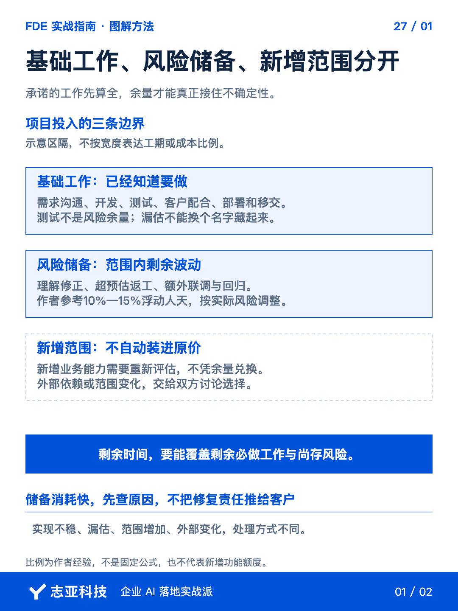
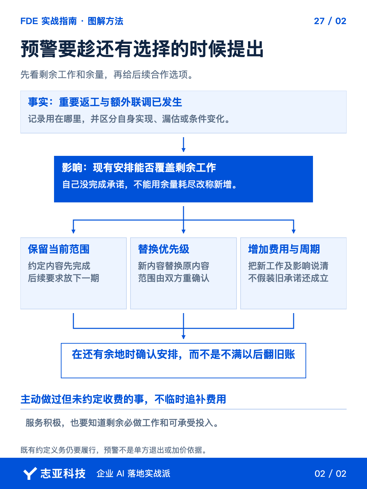

# AI项目报价，怎样判断预留时间够不够？

**志雄 FDE 实战指南 · 志亚科技出品** 
作者：白志雄｜武汉市志亚科技有限公司

[返回阅读目录](../README.md) · [查看本篇图卡](#配套图文卡片)

开发、自测、部署刚好排满交期，多一次联调，后面的安排就被挤掉。**留没留余量是一件事，剩下的时间还够不够兑现承诺，是另一件事。**

我会参考百分之十到十五的浮动人天，但不会算完比例就不管。**正常工作不能漏，外部等待要另排，执行中还要把剩余必做工作拿出来看。**

接着前面的报价和计划，这篇就处理一个判断，**什么时候可以继续吸收小调整，什么时候已经需要和客户重谈后续安排。**

### 1、先查基础工作漏没漏

把本期范围和任务计划交给 Agent，检查沟通、构建、自测、客户测试配合、部署与移交是否计入。**属于本次承诺的正常工作，先进入基础估算。**

测试不是等有空再做的风险项目。AI 生成结果需要检查，**不能报价只算开发，再把全部测试和说明挤进预留时间。**

接着让 Agent 列看得见的风险，标明来源、可能影响和需要的处理动作。接口不完整、资料未检查、规则待确认，**先判断哪些能提前消除，剩余的才需要储备或分期安排。**

沿第12篇的三层架构查一次，交互层的任务理解是否清楚，代码层的规则和 API 是否具备，数据层的资料、字段与权限是否核实。**先把风险落到具体位置，才知道要预留的是验证、联调还是资料处理的投入。**

最终工作量由你核对。**Agent 能帮忙查漏，不能仅凭一份需求就知道你当前工具、经验和客户条件下的真实效率。**

### 2、把余量放在正确位置

我会参考大约百分之十到十五的浮动人天，具体仍灵活处理。**这是个人经验起点，不是每个项目都照乘的行业标准。**

使用比例之前，先列清正常工作包含什么、对应多少人天。时间余量和外部等待也要分开，**几个人天的缓冲不能保证客户权限何时开放，外部条件要按依赖另行安排。**

再看预计会波动在哪里。约定范围内的理解修正、额外联调、超预计返工，可能消耗储备，**完整新增一段业务，不会因为留了余量就自动包含。**

给客户的价格和交期按整体投入协商。**留出容错空间，是为了积极响应合理调整，不是承诺任何要求都可以免费吸收。**

### 3、把剩余工作放到一起看

执行过程中，把重要调整和实际投入交给 Agent，按任务归集，**同时更新剩余必做工作与尚未解除的风险。**

不需要每分钟记账，但要能说清额外联调或返工大致花在哪里。**不要只看已经用了多少天，还要看剩下的时间能否容纳后续工作。**

让 Agent 按下面五项更新同一份记录，数值与事实从当前项目取得，缺失的单列待核对。

| 每次检查的内容 | 要看清什么 |
|---|---|
| 已投入 | 哪些任务已完成，额外联调或返工用了多少投入 |
| 剩余必做 | 按当前范围，还要完成哪些工作及大致投入 |
| 未解除风险 | 还有什么不确定，会影响哪一层或哪段协作 |
| 可用时间 | 交期前还可投入多少，外部等待是否另有安排 |
| 沟通判断 | 现有安排能否覆盖剩余工作，需要谁决定什么 |

再用一个算例看怎样判断，**以下只是解释方法，不是某个客户的真实工期或报价。**

| 当前记录 | 判断时怎样使用 |
|---|---|
| 距交期还有5个工作日，但你实际只能投入3人天 | 日历天数不能直接当可用投入 |
| 已知剩余工作估计3.5人天 | 即使暂不计额外风险，必做工作已超过可用投入 |
| 必要接口仍待授权，何时可用未确认 | 另列阻塞条件，不能靠那5天自动消化 |
| 客户希望再调一项内容 | 先确认范围和整体安排，不能因为AI可能很快就继续答应 |

这时先讨论腾出投入、调整范围或交期，接口条件也要由相应负责人确认。**不是等百分之十五用完才预警，已知必做工作本身兜不住，就已经需要决定。**

如果已知工作尚能覆盖，再看关键等待与未解除风险。**有剩余人天，不代表外部条件会如期具备；这些记录帮助判断，不承诺精确预测未知。**

发现余量消耗快，先查原因。自己实现不稳，该修复；范围新增，重新评估；外部条件变化，协商替代或时间，**不能把所有成本都用一句风险超标归给客户。**

如果原来估计失准，也如实更新判断。**储备不是掩盖漏估的口袋，消耗到哪里也不会改变原本应承担的交付责任。**

### 4、还有选择时就提醒

范围内的小调整能吸收，就积极做。接近边界时，用前面的记录说明已投入、剩余必做与当前缺口，**再讨论保留范围、替换优先级或增加投入和时间。**

不必等某个比例精确用尽才沟通。**当剩余时间不足以支持必做工作和当前承诺，就已经需要讨论。**提醒针对未来安排，不给以前主动做过、未约定收费的服务临时翻账。

如果缺口来自一项新要求，还要查清它会带动哪些变化。**下一篇继续讲，收到具体改动后，怎样把影响分析和共同确认做完整。**

### 5、说到最后

风险管理不是算一个百分比，然后把它藏在报价里。**基础工作估足，剩余不确定性留余量，执行中持续看剩下还能承担什么。**

把这些记录带回下一次估算，判断哪里确实发生风险、哪里只是自己漏算。**实际投入会让报价越来越贴近你的能力，不是让你每次都靠同一个比例猜。**

服务要积极，成本也要有数。**真正能长期保持快速响应，靠的是可持续的工作安排，不是把自己一直放在兜不住的边缘。**

## 配套图文卡片

### 基础工作、风险储备、新增范围分开

### 预警要趁还有选择的时候提出

---

志亚科技出品。个人非商业学习和使用免费，商业使用须事先取得书面授权。

[使用许可](../LICENSE) · [作者与联系](../README.md#作者与联系) · [返回阅读目录](../README.md)
