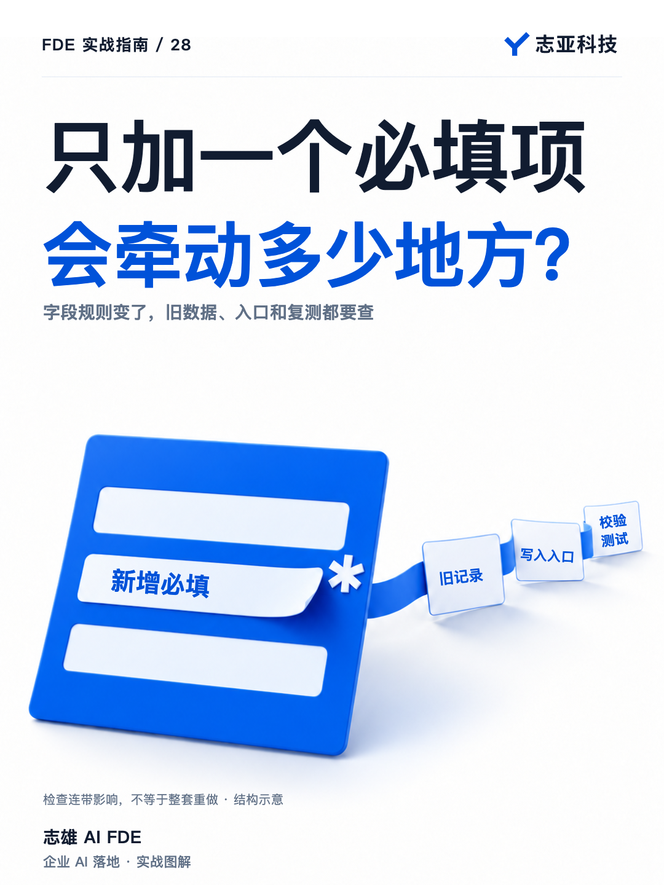
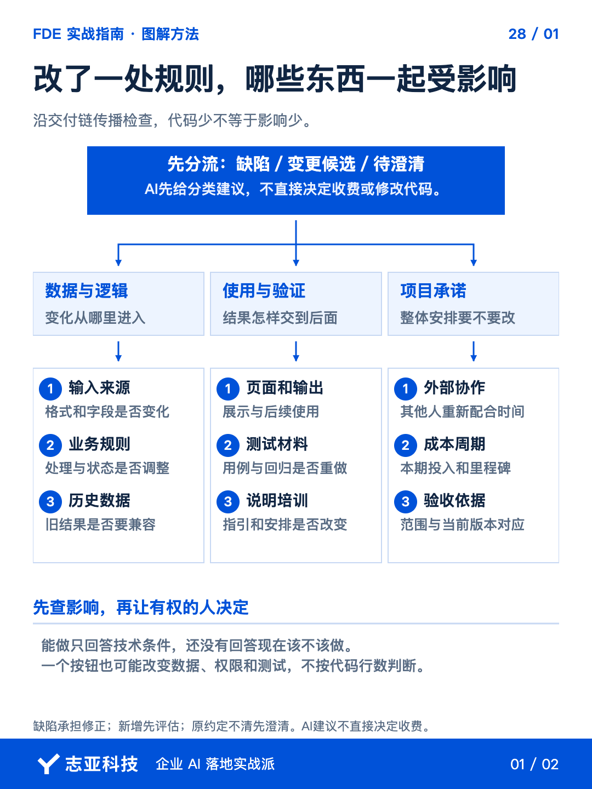
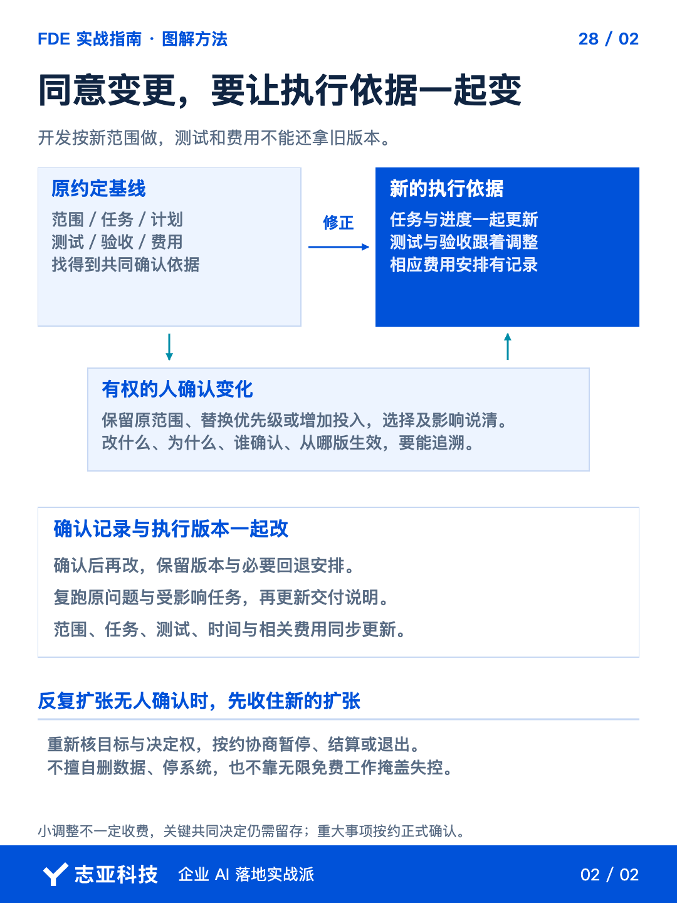

# 客户说只改一点，怎么判断会不会影响整个项目？

**志雄 FDE 实战指南 · 志亚科技出品**<br>
作者：白志雄｜武汉市志亚科技有限公司

[返回阅读目录](../README.md) · [查看本篇图卡](#配套图文卡片)



客户说只改一点，AI 看起来几分钟就能改好，最容易顺手先做。等改完才发现，测试、历史数据和原定交期都受影响，**省下的是写代码时间，漏算的是整段交付。**

余量是否能吸收这次调整，要看完整影响。**收到变化，先对原承诺、再查交付影响，确认以后才让 Agent 改业务逻辑。**

这样不是为了逢改收费，而是，**既积极响应，也不让一次小修改悄悄替双方重新定义整个项目。**

### 1、先拿出对照依据

把客户最新反馈、已确认需求及变更记录交给当前 Agent，**让它先指出相关原约定，不急着生成修复方案。**

原范围内该实现却没实现，先按缺陷处理；新增能力、流程或使用范围，列为变更候选。**AI 的分类只是建议，需要用事实核对，不由一句客户说的或开发者觉得来定。**

原文模糊时，保留争议点，说明双方分别怎样理解。**先澄清共同起点，不利用模糊直接宣布都要收费，也不默认全部包含。**

这一轮先产出对照，而不是代码。**弄清答应过什么，才有依据讨论愿意额外做到哪里。**

### 2、沿交付链查影响

让开发 Agent 根据实际实现检查相关入口、规则、接口、数据、权限和已有测试，**列出拟改范围与可能连带影响，不自动全盘重构。**

交互、代码和数据要连起来查。以增加一个必填字段作为检查示例，旧记录缺这个值怎么办，所有写入入口是否会提供它，校验和展示是否一起更新，**都不能只靠页面上多了一个输入框来回答。**

再核对相关测试和使用说明。某一层没有受影响，也要有检查依据，**不能因为改动从一个入口开始，就只检查那个入口。**

还有代码之外的影响。客户测试材料、培训、外部团队配合与里程碑需要怎样调整，**这些由你结合计划补齐，Agent 不会凭空知道尚未记录的协作安排。**

无法核实的依赖单列，先问必要问题。**技术上大概能做，不等于此刻已经具备按原条件完成的依据。**

### 3、先给选择再改

核对影响后，向有权确认的人提供安排，**本期吸收、替换优先级、留到下一期，或者增加预算和时间。**

能吸收的小调整，就主动处理；涉及明显扩张的，把后续成本讲出来。**风险余量让服务有弹性，不是所有新功能都能免费兑换。**

群里任何人都可以提意见，但范围与费用仍走约定出口。**接住反馈，不等于让每个提出意见的人都直接指挥开发。**

把分析整理成一张变更影响单，方便有权确认的人作选择。下面是记录结构，具体内容从本次约定和检查结果中取得。

| 记录项 | 应当留下什么 |
|---|---|
| 原约定 | 对应的需求位置、版本与确认依据 |
| 拟改内容 | 缺陷、变更候选或待澄清项，以及分类理由 |
| 交付影响 | 涉及哪层，哪些测试、材料、配合和交期需调整 |
| 可选安排 | 本期吸收、替换、下期或新增投入，各有什么影响 |
| 确认与生效 | 谁确认了什么，哪一版开始执行，哪些依据要同步 |

Agent 先填分析和待核实项，确认以后再补决定。**取舍与对外承诺由双方确认，不让工具的可执行性替代商业决定。**

### 4、确认后改完整一轮

记录改什么、为什么改、谁确认、影响哪些承诺，再更新实际任务。**范围变了，测试和验收依据也同步变，不能开发按新版，客户还拿旧标准检查。**

让 Agent 按确认范围修改，保留版本与必要回退安排。修好后重跑原问题及受影响任务，**实际结果出来，再更新交付说明，不用一句修改完成结束整轮变更。**

这段指令可以放在当前开发对话中，**先把分析和动手分开，避免 Agent 收到反馈就直接改系统。**

```text
先不要修改业务代码。对照已确认需求与最新反馈，定位原约定。
区分缺陷、变更候选和待澄清项，列依据与缺失信息。
沿交互、代码和数据检查影响，再核对测试、材料、外部配合与交付计划。
输出变更影响单，列原约定、拟改内容、交付影响、可选安排及待确认事项。
给出本期吸收、替换、下期或新增投入的选项，不补造双方承诺。
确认方案后再改，执行相关复测与回归，记录版本及未验证影响。
```

### 5、说到最后

一次变化处理完，应当让双方重新知道，**现在交什么、怎样验证、原来的时间与费用是否仍成立。**

范围内责任承担好，能吸收的积极做，超出边界的及时谈。**比立刻回复可以更有价值的，是说明怎样改才不会把其他承诺一起改坏。**

反复扩张却无人确认时，先收住新增并协商后续安排，不擅自删数据或停系统。**下一篇进入验收与回款，继续用这份更新后的约定判断，本期究竟交到了哪一步。**

## 配套图文卡片

### 改了一处规则，哪些东西一起受影响



### 同意变更，要让执行依据一起变



---

志亚科技出品。个人非商业学习和使用免费，商业使用须事先取得书面授权。

[使用许可](../LICENSE) · [作者与联系](../README.md#作者与联系) · [返回阅读目录](../README.md)
