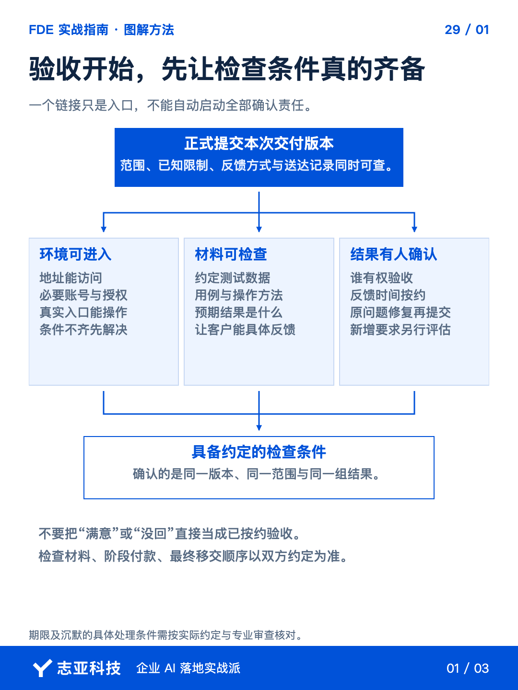
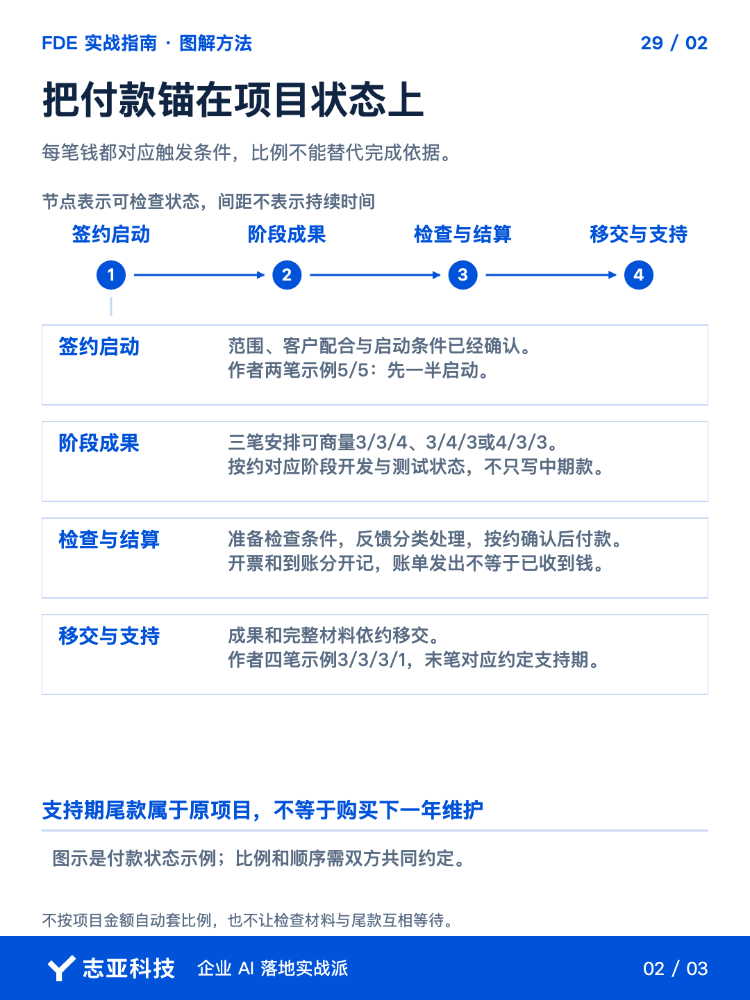
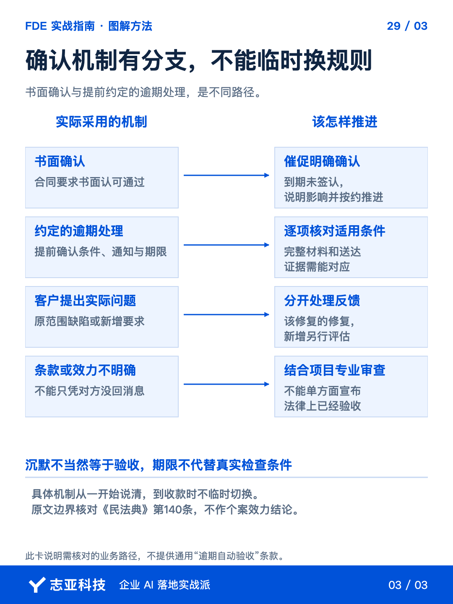

# AI项目尾款难收，开工前要说清哪些事？

**志雄 FDE 实战指南 · 志亚科技出品** 
作者：白志雄｜武汉市志亚科技有限公司

[返回阅读目录](../README.md) · [查看本篇图卡](#配套图文卡片)

系统已经能用，测试地址也发了，尾款却还在等客户看看。到这里才问谁验、几天反馈、怎样算通过，**事情就容易从项目收尾变成双方反复解释。**

现在把已签合同、最新范围和实际交付记录放在一起，**核对付款对应什么状态、验收怎样启动、反馈后怎样重新提交，以及完整成果什么时候交。**

开工前安排节点，执行中留下依据，收尾时按实际约定推进。**这比临时找一句催款话术更有用。**

### 1、先把每笔款对上

拿已签合同、当前范围与计划交给 Agent，提取付款节点、金额、触发条件和负责人。**重点核对每个节点到了什么状态，还缺哪项依据，不让它重新发明付款规则。**

我的项目会按情况分两笔、三笔或四笔。小额项目可以谈一半启动、一半交付测试后支付；三笔有三三四、三四三或四三三；需要支持观察期，也可以谈三三三一。**比例是协商结果，最后一成仍是原项目尾款，不是下一年度维护费。**

每笔款单独核对下面五项，内容必须来自实际约定和履行记录，不把示意结构当成统一付款方案。

| 要核对的项目 | 应当找到的依据 |
|---|---|
| 阶段成果 | 这笔款对应哪个范围、版本和已完成结果 |
| 检查条件 | 客户从哪里进入，用什么数据和方法检查 |
| 确认方式 | 谁负责反馈或确认，按什么期限和机制处理 |
| 付款触发 | 约定条件是什么，已有哪项履行或确认依据 |
| 实际状态 | 哪项尚缺、谁继续处理，账单与到账分别到哪一步 |

签约前可以协商节点，签约后按已有约定推进。**不能到收款时，才把原本没说过的新条件加进去。**

### 2、让验收具备条件

正式提交前，把交付版本与范围交给当前开发 Agent，**让它整理必要的测试地址、账号安排、数据、用例、方法及已知限制。**

账号和凭据按安全方式提供，不混入普通说明文档。再用授权测试身份检查入口和关键操作，**不能由你管理员账号能用，就认定客户已经能开始测。**

第12篇的三层架构，也帮助我们组织检查依据。沿一次约定业务任务，核对交互层接到了什么、代码层按哪些规则执行、数据层读取或留下了什么记录。**涉及哪一层就关联哪一层的依据，最终仍看约定任务能否完成，不让一段顺畅演示替代验收结果。**

核对材料是否达到合同要求，再正式通知并保留送达与确认依据。**验收起点要能说清，不是单方面发一句做完了就开始计时。**

缺环境或关键数据，先补条件。**计时条款不能替代一套真实可用的检查条件。**

### 3、按签下的机制确认

让 Agent 从合同提取反馈期限和确认方式，先核对自己准备采取的做法是否一致。**要求书面确认，与提前约定逾期未反馈如何处理，是两种不同机制。**

我以前的合同里有书面确认安排，后来也提出过完整提交测试材料后、按约定期限处理未反馈的做法。**这是不同阶段的约定思路，不把后来的偏好自动套到旧合同。**

客户没有回复，不能直接解释成已经验收。《民法典》对沉默何时可作为意思表示规定了适用条件，**具体条款与履行证据请专业人员结合项目核对。**

希望使用逾期处理机制，就提前把适用条件、通知方式与期限说清。**已经签的是书面确认机制，就按它催促反馈，不能临时改规则。**

### 4、把问题和新想法分开

反馈回来后，让 Agent 对照范围和用例关联问题。**该完成却没完成的修复，新增能力另行评估，争议项保留原始输入、结果与依据。**

确认修复后重新提交对应版本，更新受影响的测试。**不能只改代码，不说明这次验的是哪一版，也不能擅自认为修完一次就自动通过。**

按约具备付款条件后，发出明确的节点说明，附阶段成果与确认依据。**让对方知道这笔款为什么现在应处理，而不是只收到一句该付款了。**

最终源码、配置和文档的交接按约衔接。**供检查的必要材料、付款与最终移交不能互相锁死，让双方都无法完成下一步。**

账单、发票与到账分别记录。未付、部分付、已付保持清楚，**不把发了账单或开了票当成钱已落袋。**

### 5、说到最后

开工前把节点连起来，交付时按节点给足条件，反馈后按范围收口。**尾款不是最后突然出现的商务动作，它依赖整段交付留下的依据。**

让 Agent 帮忙整理材料和状态，人核对合同事实、交付结果与收款安排。**阶段成果、确认依据和到账状态能对上，才算把这一笔结算进程说清楚。**

项目收得清楚，后面的维护和新增才有新的起点。**下一篇就拆开讲，原项目的尾款、后续维护服务和系统运行费用，分别对应什么责任。**

## 配套图文卡片

### 验收开始，先让检查条件真的齐备

### 把付款锚在项目状态上

### 确认机制有分支，不能临时换规则

---

志亚科技出品。个人非商业学习和使用免费，商业使用须事先取得书面授权。

[使用许可](../LICENSE) · [作者与联系](../README.md#作者与联系) · [返回阅读目录](../README.md)
