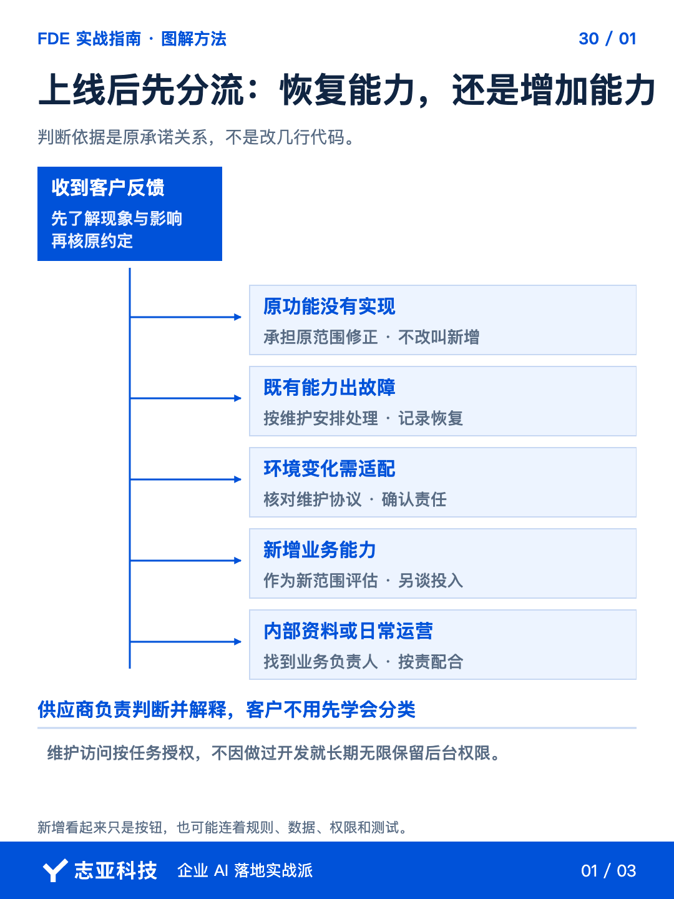
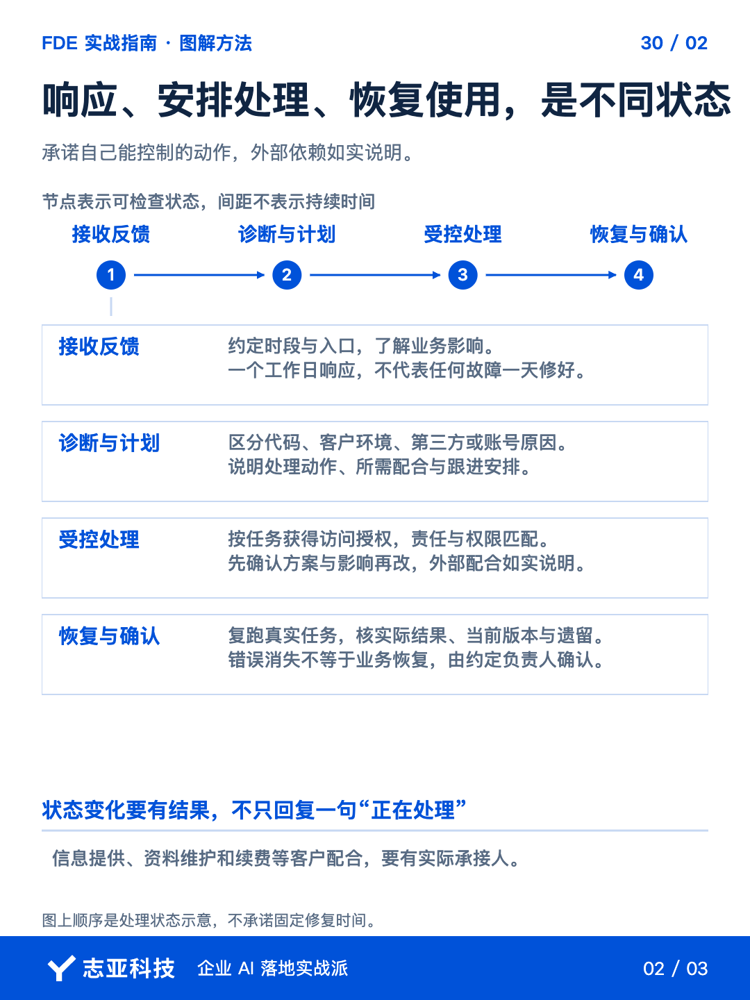
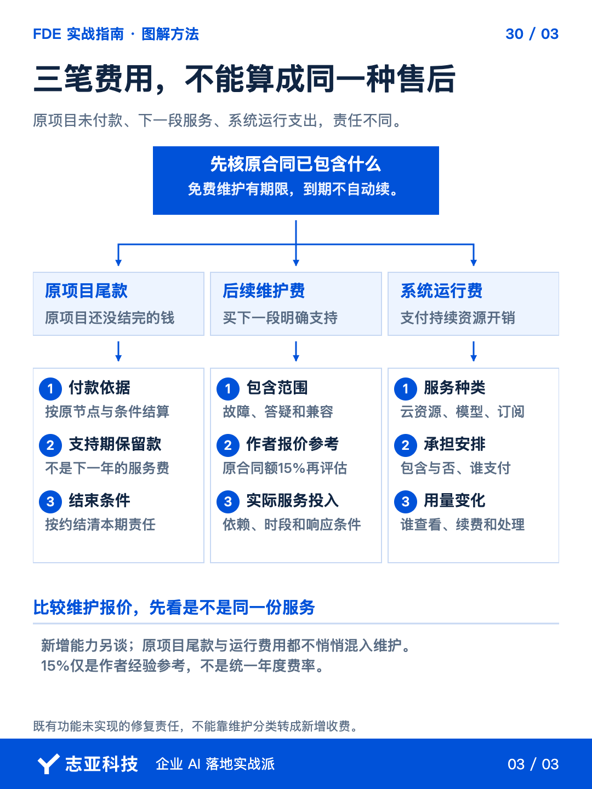

# AI系统上线后，维护费到底包什么？

**志雄 FDE 实战指南 · 志亚科技出品** 
作者：白志雄｜武汉市志亚科技有限公司

[返回阅读目录](../README.md) · [查看本篇图卡](#配套图文卡片)

系统上线以后，客户还会发来使用问题、故障和新想法。它们都发生在交付以后，**却不属于同一笔工作。**

我划定的维护包括故障修复、技术答疑和兼容性维护，新增功能另开项目。模型调用、云资源和平台订阅是否包含，也需要单独说清。**维护费买的是一段范围和期限明确的支持服务。**

接下来把范围、响应、恢复和费用逐项展开，**让客户知道联系以后会发生什么，也让你知道自己接下了多少责任。**

### 1、收到问题先定位

把脱敏反馈、相关运行信息及维护约定交给 Agent，先整理问题位置、影响范围和待补信息。**不要一收到消息就答应免费修改，也不要没看现象就先甩合同。**

原功能没实现，该修；新增业务能力，再估范围；环境变化导致适配，按维护约定核对。**判定看工作与原承诺的关系，不看改起来是一句话还是几天。**

需要查原因时，再沿交互、代码和数据定位。**定位帮助判断责任，不让 AI 根据一句反馈直接定责，也不把所有线上问题都装进维护费。**

同一反馈里包含几件事，拆开处理。**恢复现有服务可以先推进，后面附带的新需求不因此自动包含。**

### 2、把响应写成动作

把服务说明写到双方能照着执行。交付方可以让 Agent 对照已有约定查漏，采购方也可以用同一张表核对自己买到什么。

| 服务说明的项目 | 双方要确认的内容 |
|---|---|
| 范围与期限 | 包含哪些支持，什么时候开始和结束，新增怎样处理 |
| 反馈入口 | 从哪里联系，需提供哪些现象和必要材料 |
| 响应安排 | 什么时段接收，何时响应，怎样告知处理计划与进展 |
| 配合条件 | 谁提供授权、数据和环境，第三方依赖怎样跟进 |
| 恢复与费用 | 怎样确认恢复，服务费与运行费各包含什么、谁承担 |

表格只列核对项，具体标准由双方约定。**客户应该知道有人接到问题以后，接下来做什么。**

比如约定一个工作日内响应，接收、判断影响和安排处理，并不等于所有故障一天修好。**响应时间与恢复时间分开，不把外部接口或客户环境也当成自己能完全控制的事情。**

让 Agent 先汇总影响与处理建议，你确认后对客户说明。**技术记录不用整包发出去，必要事实、当前状态和下一次反馈安排要说得清。**

需要访问客户系统，按本次任务取得相应授权。**维护不是保留无限后台权限，更不能把凭据贴进普通反馈记录。**

### 3、处理完还要确认恢复

定位到问题后，沿用第28篇的做法，先说明方案与影响，确认后再改。**特别是数据、权限和外部依赖变化，不让 Agent 自动作出未经授权的调整。**

修复后复跑相关任务，核对实际结果，保留版本和必要记录。**一句错误已经消失，不等于原来承诺的业务能力已经恢复。**

把恢复结果与已知遗留告知客户，确认后收口。第三方仍未恢复的，就标明依赖状态，**不把已转交其他人当成已经解决。**

如果发现缺的是日常资料维护，明确由客户哪位负责人接手。**供应商提供技术支持，不代表客户内部内容更新和运营管理也全部外包给你。**

### 4、费用按责任拆开

先从原合同看免费维护从何时起、持续多久、包含什么。期满前确认下一段服务，**免费期结束，不自动续成无限支持。**

我会参考原合同金额的百分之十五讨论年度运维费用，但仍看系统依赖、支持时段和响应要求。**个人比例是报价起点，承担的工作不同，就重新核算。**

模型调用、云资源、平台订阅属于运行费用，另明确谁付、是否包含。**运维服务费不默认替客户无限垫付外部资源。**

原项目留下的支持期尾款也单独记。**尾款、后续维护费、系统运行费，分别对应不同责任，不用一个金额模糊打包。**

新增需求深度关联旧系统，也先评估再形成下一期。**不能为了显得服务好，把新项目藏在维护里，最后双方都不知道买过什么。**

### 5、说到最后

长期支持需要一条完整路径，**接收问题、核对责任、确认处理、验证恢复、更新记录。**

Agent 可以协助整理和定位，人负责授权、业务判断与服务承诺。**该修的积极修，新增的重新谈，复杂问题如实说明配合条件。**

维护结束时，同样按约处理遗留事项、资料和权限。**清楚的边界让响应与专业支持能够长期提供下去。**

到这里，20万元级项目这一组可控交付的安排就串起来了，金额只是能力与风险的参照。**下一篇转入复盘，回头看这些范围、架构和责任判断，怎样留下来供下一次使用。**

## 配套图文卡片

### 上线后先分流：恢复能力，还是增加能力

### 响应、安排处理、恢复使用，是不同状态

### 三笔费用，不能算成同一种售后

---

志亚科技出品。个人非商业学习和使用免费，商业使用须事先取得书面授权。

[使用许可](../LICENSE) · [作者与联系](../README.md#作者与联系) · [返回阅读目录](../README.md)
