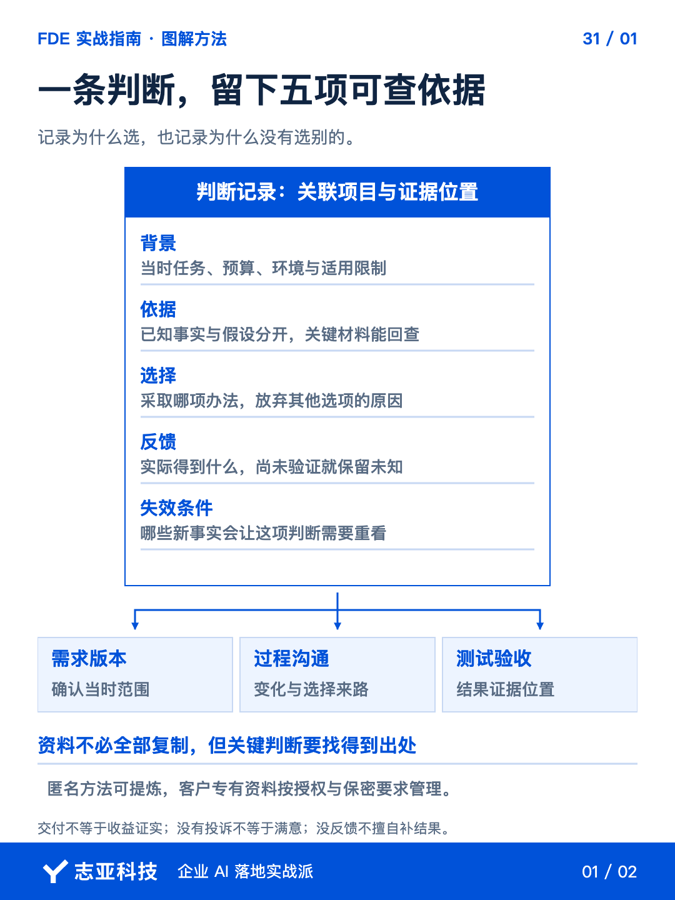
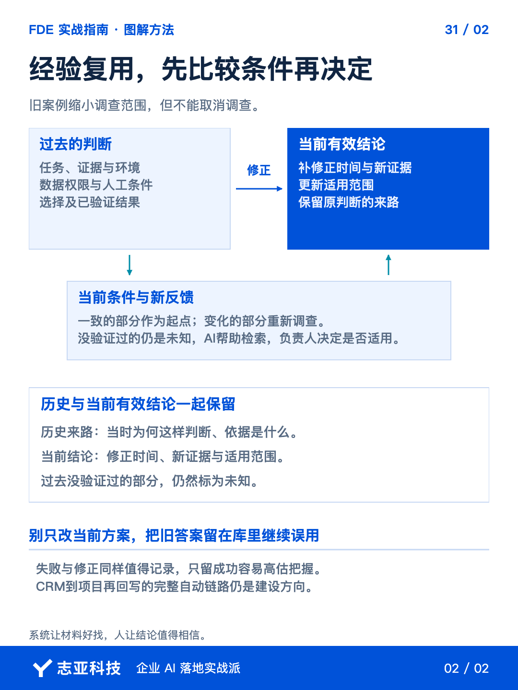

# AI项目复用旧方案，先检查哪些条件变了？

**志雄 FDE 实战指南 · 志亚科技出品**<br>
作者：白志雄｜武汉市志亚科技有限公司

[返回阅读目录](../README.md) · [查看本篇图卡](#配套图文卡片)


旧方案做成过，新客户又有相似需求，最容易直接拿来用。**但相似的任务，不代表相同的使用条件。**

拿人工配合做一个条件比较，旧方案允许先由人复核，新项目却要求无人值守。**原来有人照看时能用，不能证明现在无人值守也能用。**

要回答这次能不能沿用，只有旧代码和工具名还不够。**还要找回当时为什么这样选、结果靠什么条件成立，以及后来得到了什么反馈。**

我的个人档案也在沉淀这些依据。前面讲复用处理过程，这篇把判断记录下来，**让 Agent 帮你比较条件，而不是搜到一个同名案例就直接套方案。**

### 1、先从决定找材料

不用给每次操作写复盘。**优先选会改变范围、费用、架构、交付方式或责任的决定。**

把已授权的需求版本、关键沟通和实际交付记录交给 Agent，让它列决定、来源和待核实信息。**不是让它读完文件替你编一段当时的心路历程。**

为什么没采用另一个方案，也要求保留依据。**因数据拿不到被迫调整，与验证以后发现另一种方式更好，不能归成同一条经验。**

第12篇的三层架构也值得这样复盘。为什么让交互层的 Agent 负责理解与分发，把权限与状态检查放进代码和 API，哪些材料进入知识库，哪些事实由数据库维护，**记录的重点是这次为何这样分工、依据是什么，以及后来有没有发现不适用的条件。**

你先检查候选中哪些值得留，哪些只是普通执行动作。**提炼判断，是为了支持下一次取舍，不是把所有聊天再复制进一个文件夹。**

### 2、写清当时知道什么

每条记录先让 Agent 整理背景、依据、选择、反馈和失效条件。把开头的人工配合示例展开，**能看见应该存什么，而不只是多写一句项目成功。**下面只示意记录方法，不是新增客户案例。

| 记录项 | 人工复核这一条件怎样留 |
|---|---|
| 背景 | 当时允许人工复核后再使用，不是直接无人值守 |
| 依据 | 关联当时需求、检查记录和操作要求；来源缺失就待核实 |
| 选择 | 保留人工环节，记清选择原因，不补造当时想法 |
| 反馈 | 区分复核后可用与未经复核可用，不将前者写成后者 |
| 需要重查的条件 | 新项目取消人工环节时，旧结论不足以直接支持沿用 |

**原始来源能证明什么就写什么，推测和未知单列。**同样的方法也可以记录预算、数据或部署环境对选择的影响。

材料里没有的理由，先向当时作决定的人核对，当时知道的约束与后来信息分开。**不能拿最后结果倒推自己一开始什么都懂，也不能把偶然顺利写成方法必然正确。**

只有交付记录，没有业务收益依据，就写完成了哪段交付。客户没有投诉，不写成已满意，**反馈没回来，就保留尚未验证。**

关键材料按版本和位置关联，不复制无关原件。**匿名提炼和来源追溯同样受授权约束，个人知识库也不是客户材料可以无限扩散的地方。**

### 3、相似项目先比条件

新项目出现时，把当前已知条件交给 Agent 检索相关记录。**让它比较使用任务、预算、数据、环境、权限和人工配合，不只找相同的产品名。**

回到开头的人工配合示例，让 Agent 把人工补位标为历史适用条件，再列出哪些问题过去由人处理、现在需要补什么检查。**相似案例可以缩小调查范围，不能取消调查。**

要求检索结果列出可沿用、需重查、过去也未验证三类。你看差异与来源，再决定下一步，**不让 AI 因为搜到一个旧答案，就直接把它写成当前方案。**

可以这样提问，**让知识库帮助你检验适用性，而不是替旧经验增强语气。**

```text
对照当前项目条件，检索相关历史判断。
列当时背景、证据来源、选择、反馈与适用限制。
比较本次相同和不同的条件，区分可参考、需重查及历史未验证项。
不把计划写成成果，不补造收益，不凭相似名称直接推荐旧方案。
给出需要补充的关键事实，由我决定是否沿用。
```

### 4、新反馈回写旧判断

项目继续推进，出现反证或新的限制，让 Agent 提出修订位置。**保留原判断来路，同时写清新证据、修正时间和当前有效范围。**

不能只在新项目里改了方案，旧知识条目还继续宣称普遍适用。**过时结论要能被识别，检索时也能看到它后来发生过什么。**

我希望逐步把线索、项目过程和知识沉淀串起来，目前仍在建设。**开始复用不必等完整 CRM 建好，先关联项目编号、文件位置与判断记录，确认可靠，再考虑自动回写。**

### 5、说到最后

过程复用让下一次少做重复劳动，判断沉淀帮助下一次决定要不要这样做。**两者都需要证据，但保存的对象不同。**

把当时条件、可选方案、选择依据与实际反馈留下，再允许新证据修正。**知识库才不会变成一批越来越坚定、却越来越脱离现场的旧结论。**

下次遇到类似项目，先比条件再借经验。**能调用过去，也能看见过去何时不再适用，才是项目做完以后真正留下的能力。**

判断有了来路，现场仍需要决定下一步。**最后一篇就回到真实项目，把前面的方法用来定位当前卡点，而不是要求所有项目按同一个顺序发生。**

## 配套图文卡片

### 一条判断，留下五项可查依据



### 经验复用，先比较条件再决定



---

志亚科技出品。个人非商业学习和使用免费，商业使用须事先取得书面授权。

[使用许可](../LICENSE) · [作者与联系](../README.md#作者与联系) · [返回阅读目录](../README.md)
