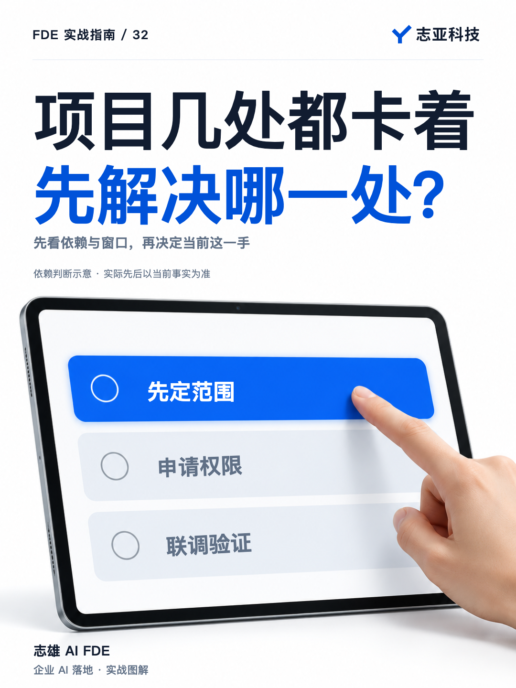
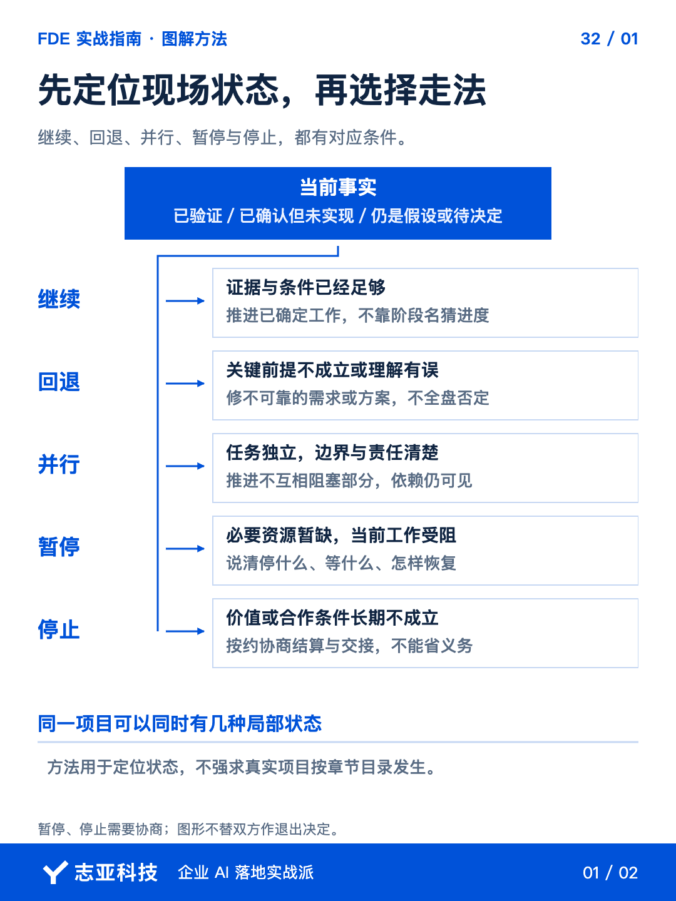
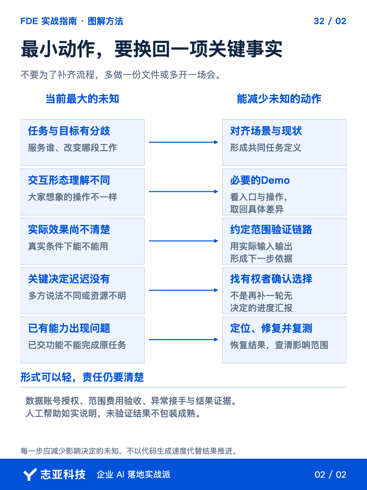

# AI项目卡住了，怎样判断下一步该做什么？

**志雄 FDE 实战指南 · 志亚科技出品**<br>
作者：白志雄｜武汉市志亚科技有限公司

[返回阅读目录](../README.md) · [查看本篇图卡](#配套图文卡片)



项目已经开发，需求还没完全说清；页面还有调整，接口授权也没下来。**几件事同时卡着，先做哪件，才不是白忙？**

容易上手的未必最该先做。页面能马上改，不代表改完以后，真正挡住交付的条件就会出现。**先看本轮要拿到什么结果，再找哪个问题不解决，后面就无法继续判断。**

前面的方法到这里要换一种用法，**不按文章目录逐项补齐，而是用它们定位当前卡点，选出下一项有效动作。**

### 1、先限定本轮结果

先问自己，这一轮准备让谁完成什么任务，拿到什么可以核对的结果。**不先限定范围，整个项目所有没做完的事，看起来都会同样紧急。**

把当前范围、最新记录和运行证据交给 Agent，区分已验证、已确认未实现、仍待决定。**每项保留依据，不拿开发百分比代替真实状态。**

一段在测试，另一段还在澄清，并不奇怪。**分别看它们是否影响本轮结果，不强迫整个项目处于同一个阶段。**

### 2、先排关键依赖

如果已经出现误写数据或未经授权的操作，先暂停自己能够控制的相关风险动作，并联系负责人。**不能为了赶进度继续放大问题，也不擅自中断不在自己权限内的服务。**

没有这类紧迫问题，再看前置依赖。**哪个条件没确认，会让后续方案、投入或验证都无法成立，就优先处理哪个。**

范围不清，会影响接口读写什么，就先澄清范围；范围已定，只缺必要访问，就先确认授权。**不是需求永远排第一，也不是技术能做就先做。**

可以独立完成、不制造额外风险的准备工作，允许并行。**优先级用来决定关键资源先放哪里，不要求所有人一起空等。**

### 3、拿一个卡点比一比

以接入现有业务系统为工作示例，本轮想让员工根据会议材料得到可用的客户跟进信息。现在有两个都影响继续的卡点，**本期是只给建议，还是还要修改已有记录，没确认；测试访问也没申请好。**

| 都要处理的事 | 为什么不能各自盲推 |
|---|---|
| 本期是否包含写入与更新 | 答案会改变要实现、授权和验证的操作 |
| 测试访问申请 | 申请什么范围，依赖上面那项决定，不能先按最大权限申请 |

这时先拿回一个最小业务决定，**本期到底要不要执行写入，而不是重开一轮覆盖全部未来需求的调研。**

如果只提供建议，就重新核对所需读取和展示条件；如果确认要更新记录，再据此申请必要操作范围，并安排写入验证。**这个决定会改变后面要做什么，所以比先把一份含糊的权限申请发出去更关键。**

等确认期间，接口说明和申请联系人可以先找，不受这项选择影响的准备可以并行。**先后顺序不是所有人停着等，而是不让依赖尚未成立的工作先作承诺。**

反过来，如果本期操作早已明确，只缺测试访问，优先项就变成授权。拿到实际可用条件再联调，**已提交申请仍不等于接口已经可用。**

但有时，两项都挡住验证，彼此却没有先后依赖。继续用工作示例，范围已定，**现在既缺测试访问，也缺业务方提供的授权样本，两样都得拿到。**

假设接口负责人今天能受理申请，错过要另排；业务负责人已约好稍后提供样本。这时怎么排？**先把权限申请送进队列，再利用等待时间核对样本，而不是先做更顺手的那件事。**

| 同时阻塞的条件 | 此刻采取的动作 |
|---|---|
| 测试访问 | 找接口负责人确认必要范围、受理情况和预计可用时间，保留实际答复 |
| 授权业务样本 | 按已约时间取得材料，核对能否覆盖本轮任务，缺什么直接反馈业务负责人 |

如果反馈变成权限今天无望，而样本提供人即将离开，就先拿样本，同时约好下一次授权跟进。**变的是可用窗口和等待事实，不是临时换一套喜好。两项都重要，也不代表必须同时由你盯着。**

这就是方法起作用的位置，**有依赖，先处理前提；没有依赖，就看谁的窗口容易错过、谁需要提前排队，再安排可以并行的准备。**

### 4、把选择落回工作

需要重看前提，就回到对应需求或方案；条件具备就继续；独立工作可并行，关键条件缺失就明确暂停什么。**回退和暂停也可以是负责的推进，不只是继续写代码才算进展。**

价值或合作条件长期不成立，还可以按约协商停止、结算和交接。**灵活处理不等于免去义务，更不等于自己决定删数据或断服务。**

每次选择都写回当前任务，留下原因、下一项动作和恢复条件。可以让 Agent 这样帮你梳理，**先做诊断，不让它直接替双方改变承诺。**

```text
围绕本轮已确认结果，整理当前卡点及证据。
区分紧迫风险、关键前置依赖和可独立准备的事项。
指出不解决哪项会改变或阻止后续方案、投入与验证。
建议下一项最小动作，说明要找谁、拿回什么事实、之后怎样选择。
缺依据的保留待确认，不自动改业务代码或对外作承诺。
```

### 5、说到最后

方法熟了，不是遇到项目就更快拿出整套流程，而是，**能说清眼下先解决什么，为什么，以及做完以后依据什么继续。**

小项目可以少写文件、合并记录，但范围、授权、付款、验收与故障责任仍要清楚。**省掉形式，不省掉必要判断。**

我说无招胜有招，指的就是这个。黑猫白猫，抓到老鼠才是好猫，**交付要取得可验证、有人接得住的结果，不是在卡住的时候，把能做的事情又忙一遍。**

## 配套图文卡片

### 先定位现场状态，再选择走法



### 最小动作，要换回一项关键事实



---

志亚科技出品。个人非商业学习和使用免费，商业使用须事先取得书面授权。

[使用许可](../LICENSE) · [作者与联系](../README.md#作者与联系) · [返回阅读目录](../README.md)
